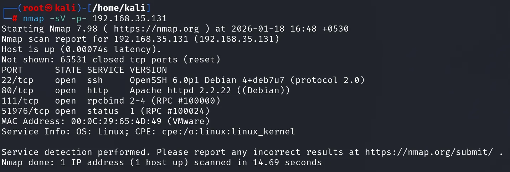
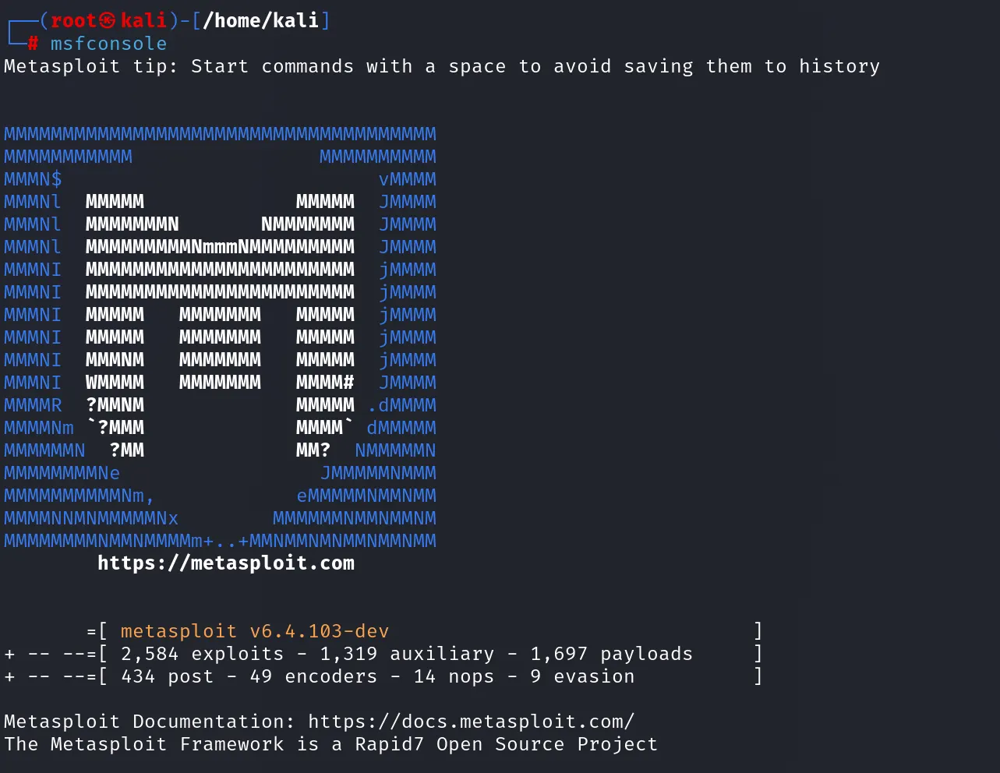
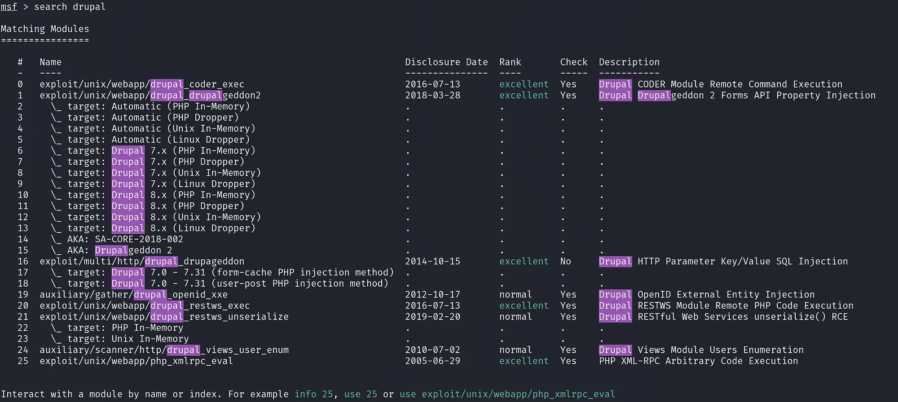
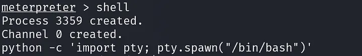
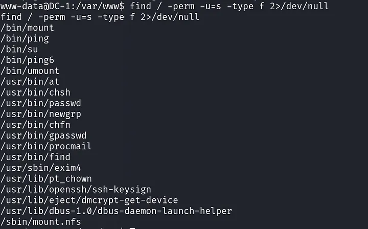

# Εργαστηριακό Εγχειρίδιο: Μηχανή DC-1

Το παρόν εγχειρίδιο είναι ένας οδηγός διεξαγωγής δοκιμών παρείσδυσης (Penetration Testing Walkthrough) στην ευάλωτη εικονική μηχανή **DC-1**. Ο κύριος στόχος της εργαστηριακής αυτής άσκησης είναι η καθοδήγηση του ερευνητή ή του ελεγκτή ασφάλειας μέσα από έναν ρεαλιστικό κύκλο ζωής αξιολόγησης τρωτότητας, ακολουθώντας πιστά τις διεθνείς βέλτιστες πρακτικές.

Μέσα από τη μελέτη της μηχανής DC-1 εξετάζονται σε βάθος κρίσιμες έννοιες της ασφάλειας πληροφοριακών συστημάτων, όπως η αναγνώριση επιφανειών επίθεσης στο τοπικό δίκτυο, η ανάλυση και εκμετάλλευση γνωστών αρχιτεκτονικών σφαλμάτων σε Συστήματα Διαχείρισης Περιεχομένου (Content Management Systems - CMS), η σταθεροποίηση κελύφους και η μετα-εκμετάλλευση υποδομών Linux, καθώς και η εκμετάλλευση εσφαλμένων διαμορφώσεων δικαιωμάτων πρόσβασης (misconfigurations) στο σύστημα αρχείων Unix για την επίτευξη τοπικής κλιμάκωσης προνομίων (Local Privilege Escalation).

Η συνολική διαδικασία δομείται στις ακόλουθες τέσσερις μεθοδολογικές φάσεις:
1. **Αναγνώριση & Χαρτογράφηση Δικτύου (Reconnaissance & Service Fingerprinting)**
2. **Ανάλυση Ευπαθειών & Αρχική Προσβολή (Vulnerability Assessment & Weaponized Exploitation)**
3. **Μετα-Εκμετάλλευση, Σταθεροποίηση & Περισυλλογή Ενδείξεων (Post-Exploitation & Data Harvesting)**
4. **Ανάλυση Εσωτερικών Δικαιωμάτων & Κλιμάκωση Προνομίων (Privilege Escalation to Root)**

---

## 2. Φάση 1: Αναγνώριση & Ανακάλυψη Υπηρεσιών (Reconnaissance & Discovery)

### 2.1 Διαμόρφωση Περιβάλλοντος Δοκιμών & Αρχιτεκτονική Δικτύου

Προκειμένου να διασφαλιστεί η ασφαλής και αξιόπιστη εκτέλεση της δοκιμής, τόσο ο σταθμός εργασίας του επιτιθέμενου (Kali Linux) όσο και το ευάλωτο μηχάνημα-στόχος (DC-1) τοποθετούνται εντός ενός ελεγχόμενου, απομονωμένου εικονικού δικτύου (λειτουργία Host-Only ή κοινό NAT Network μέσω λογισμικού υπερεπόπτη VirtualBox / VMware Workstation). Η αρχιτεκτονική αυτή εγγυάται ότι η εκπαιδευτική επίθεση δεν θα διαρρεύσει σε παραγωγικά εταιρικά ή οικιακά δίκτυα, ενώ ταυτόχρονα εξασφαλίζει αμφίδρομη, απρόσκοπτη διασύνδεση στα επίπεδα OSI Layer 2 (Data Link) και Layer 3 (Network).

Σε ένα τυπικό σενάριο ελέγχου διείσδυσης τύπου "Black-Box", ο ελεγκτής δεν γνωρίζει εκ των προτέρων τη στατική ή δυναμική διεύθυνση IPv4 του στόχου, καθώς αυτή αποδίδεται αυτόματα από την ενσωματωμένη υπηρεσία DHCP του εικονικού περιβάλλοντος. Συνεπώς, η πρώτη απαραίτητη ενέργεια είναι ο εντοπισμός του μηχανήματος-στόχου μέσω τεχνικών παθητικής ή ενεργητικής σάρωσης σε επίπεδο τοπικού δικτύου.

### 2.2 Ανακάλυψη Ενεργών Κόμβων μέσω του Πρωτοκόλλου ARP

Η ανίχνευση ενεργών υπολογιστικών συστημάτων στο τοπικό υποδίκτυο βασίζεται κυρίως στην αποστολή αιτημάτων ARP (*Address Resolution Protocol*). Σε αντίθεση με τις παραδοσιακές σαρώσεις ICMP Echo Requests (γνωστές ως "ping"), οι οποίες συχνά φιλτράρονται ή απορρίπτονται σιωπηρά από τα τοπικά τείχη προστασίας (iptables, nftables κ.λπ.), τα πακέτα ARP είναι υποχρεωτικά για την επικοινωνία σε επίπεδο Ethernet. Κάθε ενεργός κόμβος του ίδιου broadcast domain υποχρεούται εκ κατασκευής από το πρωτόκολλο να αποκριθεί με τη διεύθυνση MAC του, καθιστώντας τον εντοπισμό του αλάνθαστο.

```bash
sudo netdiscover -r 192.168.35.0/24
```
* `sudo`: Εκτελεί το εργαλείο με αυξημένα προνόμια υπερχρήστη (`root`), τα οποία είναι αυστηρά υποχρεωτικά καθώς απαιτείται άμεση πρόσβαση στη δικτυακή διεπαφή (raw socket access) για τη δημιουργία και αποστολή μη επεξεργασμένων πακέτων ARP.
* `netdiscover`: Εξειδικευμένο εργαλείο ανίχνευσης διευθύνσεων σε τοπικά δίκτυα Ethernet, ικανό να λειτουργεί τόσο σε παθητική ακρόαση όσο και σε ενεργητική λειτουργία μαζικής αποστολής ARP queries.
* `-r 192.168.35.0/24`: Ορίζει το εύρος του υπό εξέταση υποδικτύου IPv4 σε συμβολισμό CIDR (*Classless Inter-Domain Routing*). Το πρόγραμμα αποστέλλει σειριακά ή παράλληλα ARP requests για όλες τις 254 πιθανές διευθύνσεις του εύρους (`192.168.35.1` έως `192.168.35.254`), συλλέγοντας και ταξινομώντας τις απαντήσεις σε πραγματικό χρόνο.


*Εικόνα 1 — Εντοπισμός Ενεργών Κόμβων στο Τοπικό Υποδίκτυο με Netdiscover*

### 2.3 Πλήρης Σάρωση Θυρών και Αναγνώριση Υπηρεσιών (Deep Service Fingerprinting)

Μετά την επιβεβαίωση της διεύθυνσης IP του στόχου (`192.168.35.131`), απαιτείται λεπτομερής χαρτογράφηση των ανοικτών θυρών TCP και εξαγωγή των χαρακτηριστικών banners των εκτελούμενων υπηρεσιών. Η επιφανειακή σάρωση μόνο των 1.000 πιο συνηθισμένων θυρών (default Nmap scan) ενέχει τον κίνδυνο παράβλεψης κρίσιμων υπηρεσιών που εκτελούνται σε ασυνήθιστες ή υψηλές θύρες. Για τον λόγο αυτό, επιλέγεται η εξαντλητική σάρωση ολόκληρου του φάσματος των 65.535 θυρών.

```bash
nmap -sV -p- 192.168.35.131
```


*Εικόνα 2 — Αναλυτική Έξοδος Σάρωσης Υπηρεσιών μέσω Nmap*

* `nmap`: Network Mapper, το διεθνώς αναγνωρισμένο εργαλείο ελέγχου δικτυακών δεικτών, χαρτογράφησης τοπολογίας και ανάλυσης ευπαθειών.
* `-sV` (*Service Version Detection*): Ενεργοποιεί τον μηχανισμό διερεύνησης εκδόσεων. Το Nmap εκτελεί TCP handshake στις ανοικτές θύρες, αποστέλλει εξειδικευμένες σειρές δεδομένων (probes) από τη βάση δεδομένων `nmap-service-probes` και αναλύει τις αποκρίσεις για να ταυτοποιήσει με ακρίβεια το όνομα και την έκδοση της κάθε εφαρμογής.
* `-p-`: Συντομογραφία της παραμέτρου `-p 1-65535`. Εξαναγκάζει τον έλεγχο κάθε μίας από τις 65.535 διαθέσιμες θύρες TCP, εκμηδενίζοντας την πιθανότητα απόκρυψης υπηρεσιών σε μη τυπικές θύρες.
* `192.168.35.131`: Η διεύθυνση IPv4 του συστήματος-στόχου που προέκυψε από το προηγούμενο βήμα.

### 2.4 Επιθεώρηση Εφαρμογής Ιστού & Πρώιμη Αξιολόγηση Ευπαθειών

Η ανάλυση της θύρας 80 υποδεικνύει την ύπαρξη διακομιστή Apache σε περιβάλλον λειτουργικού συστήματος Debian Wheezy (7.x), γεγονός που καταδεικνύει ένα σημαντικά παρωχημένο σύστημα. Πλοηγούμενοι μέσω φυλλομετρητή (browser) στη διεύθυνση `http://192.168.35.131/`, παρουσιάζεται η αρχική σελίδα του δημοφιλούς Συστήματος Διαχείρισης Περιεχομένου (**Drupal**). 

Η επιθεώρηση του πηγαίου κώδικα της ιστοσελίδας, των μετα-ετικετών (meta tags) και των αρχείων όπως το `/CHANGELOG.txt` αποκαλύπτει ότι πρόκειται για την έκδοση **Drupal 7.x**. Ιστορικά, ο κλάδος Drupal 7.x παρουσίασε θεμελιώδη αρχιτεκτονικά κενά ασφαλείας στα επίπεδα διαχείρισης παραμέτρων εισόδου και εκτέλεσης ερωτημάτων βάσης δεδομένων, με διαβόητο παράδειγμα την ευπάθεια Drupalgeddon (CVE-2014-3704), η οποία επιτρέπει σε μη εξουσιοδοτημένους απομακρυσμένους χρήστες να εκτελέσουν αυθαίρετο κώδικα (Remote Code Execution - RCE).

---

## 3. Φάση 2: Ανάλυση Ευπαθειών & Αρχική Προσβολή (Exploitation)

### 3.1 Εκκίνηση και Προετοιμασία του Metasploit Framework

Για τη συστηματοποίηση και εκτέλεση της επίθεσης αξιοποιείται το **Metasploit Framework**, η πιο διαδεδομένη πλατφόρμα δοκιμών διείσδυσης. Το Metasploit παρέχει μια ολοκληρωμένη υποδομή διαχείρισης exploits, payloads, encoders και βοηθητικών εργαλείων, επιτρέποντας την αυτοματοποιημένη επαλήθευση των κενών ασφαλείας με σταθερό και προβλέψιμο τρόπο.

```bash
msfconsole
```

* `msfconsole`: Εκκινεί τη διαδραστική διεπαφή γραμμής εντολών (Command-Line Interface) του Metasploit. Κατά την εκκίνηση, το περιβάλλον αρχικοποιεί τις συνδέσεις με την υποκείμενη βάση δεδομένων PostgreSQL, φορτώνει χιλιάδες καταγεγραμμένα modules ευπαθειών στη μνήμη RAM και παρέχει ένα ευέλικτο κέλυφος διαχείρισης επιθέσεων.


*Εικόνα 3 — Εκκίνηση της Διεπαφής msfconsole*

### 3.2 Αναζήτηση Εξειδικευμένων Modules για το CMS Drupal

Με το περιβάλλον του Metasploit έτοιμο προς χρήση, πραγματοποιείται ερώτημα στην ενσωματωμένη ευρετηριασμένη βάση δεδομένων προκειμένου να εντοπιστούν όλα τα διαθέσιμα modules εκμετάλλευσης που στοχεύουν την πλατφόρμα Drupal.

```bash
msf6 > search drupal
```

* `search drupal`: Αναζητά αναδρομικά στις βιβλιοθήκες `exploits/`, `auxiliary/` και `post/` οποιοδήποτε module περιέχει τον όρο "drupal" στον τίτλο, στην περιγραφή ή στα μεταδεδομένα του. Το αποτέλεσμα παρουσιάζει έναν πίνακα με το όνομα του module, την ημερομηνία αποκάλυψης της ευπάθειας, τον δείκτη αξιοπιστίας (Ranking) και μια σύντομη περιγραφή του μηχανισμού επίθεσης.



*Εικόνα 4 — Πίνακας Αποτελεσμάτων Αναζήτησης Drupal Modules*

### 3.3 Επιλογή Module, Παραμετροποίηση & Εκτέλεση της Επίθεσης

Από τα αποτελέσματα επιλέγεται το module `exploit/multi/http/drupal_drupageddon`. Η ευπάθεια αυτή (**CVE-2014-3704**) εδράζεται στο API αφαίρεσης βάσεων δεδομένων (Database Abstraction API) του Drupal 7.x, το οποίο δεν εξυγίανε επαρκώς τις παραμέτρους πινάκων που περνούσαν σε προπαρασκευασμένα ερωτήματα SQL (prepared statements). 


*Εικόνα 5 — `use exploit/multi/http/drupal_drupageddon`: αυτόματη επιλογή payload `php/meterpreter/reverse_tcp`.*

Αυτό επιτρέπει σε έναν μη πιστοποιημένο απομακρυσμένο επιτιθέμενο να εκτελέσει SQL Injection, μέσω της οποίας μπορεί να τροποποιήσει διαχειριστικούς πίνακες, να εισαγάγει κακόβουλες εντολές PHP στη βάση ή να επιτύχει απευθείας εκτέλεση αυθαίρετου κώδικα στο λειτουργικό σύστημα (Remote Code Execution - RCE).

```bash
msf6 > use exploit/multi/http/drupal_drupageddon
msf6 exploit(multi/http/drupal_drupageddon) > set RHOSTS 192.168.35.131
msf6 exploit(multi/http/drupal_drupageddon) > exploit
```

* `use exploit/multi/http/drupal_drupageddon`: Φορτώνει στο ενεργό περιβάλλον εργασίας το συγκεκριμένο exploit module, διαμορφώνοντας αυτόματα το προεπιλεγμένο συμβατό ωφέλιμο φορτίο (payload), συνήθως το `php/meterpreter/reverse_tcp`.
 * `set RHOSTS 192.168.35.131`: Καθορίζει τη μεταβλητή συστήματος `RHOSTS` (*Remote Hosts*), δηλώνοντας τη διεύθυνση IPv4 του ευάλωτου διακομιστή-στόχου.
 * `exploit` (ή εναλλακτικά `run`): Εκκινεί τη διαδικασία της επίθεσης. Το Metasploit στήνει έναν τοπικό ακροατή (handler) στη μηχανή Kali, διαμορφώνει τα κακόβουλα HTTP POST αιτήματα με το SQL Injection payload και το αντίστροφο PHP κέλυφος, και τα αποστέλλει στον στόχο. Μόλις ο κώδικας εκτελεστεί από τον διακομιστή Apache, ο στόχος συνδέεται πίσω στο Kali Linux ανοίγοντας μια ενεργή συνεδρία Meterpreter.


*Εικόνα 6 — Ορισμός του στόχου με `set RHOSTS 192.168.35.131`.*


*Εικόνα 7 — Επιτυχής Εκμετάλλευση και Άνοιγμα Συνεδρίας Meterpreter*

---

## 4. Φάση 3: Μετα-Εκμετάλλευση & Περισυλλογή Ενδείξεων (Post-Exploitation)

### 4.1 Μετάβαση σε Κέλυφος Συστήματος και Αναβάθμιση σε PTY

Η συνεδρία Meterpreter παρέχει ισχυρές λειτουργίες διαχείρισης μνήμης, μεταφοράς αρχείων και εκτέλεσης διεργασιών, όμως η ενδελεχής εξερεύνηση ενός λειτουργικού συστήματος Linux απαιτεί άμεση πρόσβαση στο φυσικό κέλυφος εντολών Unix.

```bash
meterpreter > shell
```


* `shell`: Δημιουργεί ένα νέο υπο-κανάλι επικοινωνίας (channel) εντός της συνεδρίας Meterpreter και εκκινεί μια διεργασία του βασικού κελύφους εντολών (`/bin/sh`) στον στόχο.



*Εικόνα 8 — Εκκίνηση Βασικού Κελύφους μέσω Meterpreter*

Το αρχικό κέλυφος που αποκτάται είναι "τυφλό" (dumb shell). Δεν διαθέτει υποστήριξη περιβάλλοντος TTY, αυτόματης συμπλήρωσης εντολών (tab completion), ιστορικού εντολών μέσω των βελών πληκτρολογίου, ούτε σωστής διαχείρισης σημάτων τερματισμού (π.χ. το πάτημα `Ctrl+C` θα διακόψει ολόκληρη τη συνεδρία αντί για την τρέχουσα διεργασία). Για να ξεπεραστεί αυτός ο περιορισμός, πραγματοποιείται αναβάθμιση σε πλήρες ψευδο-τερματικό (Pseudo-Terminal - PTY) αξιοποιώντας τον διερμηνέα Python.

```bash
python -c 'import pty; pty.spawn("/bin/bash")'
```

* `python`: Καλεί τον εγκατεστημένο διερμηνέα Python του συστήματος-στόχου.
* `-c`: Επιτρέπει την απευθείας εκτέλεση κώδικα Python που περνά ως παράμετρος συμβολοσειράς στη γραμμή εντολών, παρακάμπτοντας την ανάγκη εγγραφής προσωρινού αρχείου script στον δίσκο.
* `'import pty; pty.spawn("/bin/bash")'`: Εισάγει την ενσωματωμένη βιβλιοθήκη `pty` της Python (η οποία διαχειρίζεται λειτουργίες ψευδο-ακροδεκτών στο λειτουργικό σύστημα Unix) και καλεί τη μέθοδο `spawn()`. Η μέθοδος αυτή εκκινεί μια νέα διεργασία `/bin/bash` συνδεδεμένη με έναν νεοδημιουργημένο εικονικό ακροδέκτη PTY, παρέχοντας ένα πλήρως λειτουργικό, διαδραστικό κέλυφος με αναγνωρίσιμο prompt χρήστη.
                    |

### 4.2 Εντοπισμός και Ερμηνεία του Flag 1

Βρισκόμενοι πλέον στον κατάλογο εργασίας του εξυπηρετητή ιστού (`/var/www`), πραγματοποιείται λεπτομερής καταγραφή των αρχείων προκειμένου να εντοπιστούν οι αρχικές κατευθυντήριες οδηγίες που άφησε ο δημιουργός του εργαστηρίου.

```bash
ls -la
cat flag1.txt
```

 * `ls -la`: 
* `ls`: Εμφανίζει τα περιεχόμενα του τρέχοντος καταλόγου.
* `-l` (*long listing*): Προβάλλει αναλυτικές πληροφορίες για κάθε αρχείο (δικαιώματα πρόσβασης rwx, αριθμό συνδέσμων, ιδιοκτήτη, ομάδα, μέγεθος σε bytes και χρονοσφραγίδα τελευταίας τροποποίησης).
* `-a` (*all*): Εμφανίζει όλα τα αρχεία συμπεριλαμβανομένων των κρυφών (εκείνων που το όνομά τους ξεκινά με τελεία `.`, όπως τα `.htaccess`, `.bashrc`).
 * `cat flag1.txt`: Συνενώνει και εκτυπώνει το περιεχόμενο του αρχείου κειμένου `flag1.txt` στην τυπική έξοδο (stdout).


*Εικόνα 9 — Ανάγνωση του Αρχείου flag1.txt*

Το περιεχόμενο του Flag 1 υποδεικνύει ότι τα αρχεία ρυθμίσεων (configuration files) του CMS περιέχουν κρίσιμα δεδομένα. Στο Drupal 7, το θεμελιώδες αρχείο διαμόρφωσης είναι το `sites/default/settings.php`, το οποίο περιλαμβάνει, μεταξύ άλλων, τα διαπιστευτήρια σύνδεσης με τη βάση δεδομένων MySQL.

---

## 5. Φάση 4: Τοπική Κλιμάκωση Προνομίων (Local Privilege Escalation)

### 5.1 Ανάλυση Επιφανειών Επίθεσης & Ανίχνευση Εκτελέσιμων SUID

Η τρέχουσα συνεδρία εκτελείται υπό τα δικαιώματα του λογαριασμού `www-data` (ο τυπικός μη προνομιούχος χρήστης που χρησιμοποιεί η υπηρεσία Apache). Για την πλήρη υποταγή του στόχου απαιτείται η απόκτηση προνομίων του υπερχρήστη `root` (UID 0). 

Ένας από τους πιο κρίσιμους μηχανισμούς τοπικής κλιμάκωσης προνομίων σε περιβάλλοντα Unix/Linux είναι η εκμετάλλευση εκτελέσιμων αρχείων με ενεργοποιημένο το ειδικό δικαίωμα **SUID** (*Set User ID*). Όταν ένα δυαδικό αρχείο διαθέτει το SUID bit, εκτελείται πάντοτε με τα προνόμια του ιδιοκτήτη του αρχείου και όχι του χρήστη που το κάλεσε. Εάν ένα εκτελέσιμο που ανήκει στον `root` φέρει SUID bit και ταυτόχρονα επιτρέπει την εκτέλεση εξωτερικών εντολών ή διαφυγή σε κέλυφος (shell escape), μπορεί να αξιοποιηθεί για άμεση κλιμάκωση προνομίων.

```bash
find / -perm -u=s -type f 2>/dev/null
```

* `find /`: Εκκινεί εξαντλητική, αναδρομική αναζήτηση ξεκινώντας από τη ρίζα του συστήματος αρχείων (`/`).
* `-perm -u=s`: Φιλτράρει τα αποτελέσματα ελέγχοντας αποκλειστικά αρχεία των οποίων τα δικαιώματα περιλαμβάνουν το SUID bit για τον χρήστη-ιδιοκτήτη τους (ισοδύναμο με οκταδικό μοτίβο `-4000`).
* `-type f`: Περιορίζει την αναζήτηση αποκλειστικά σε κανονικά δυαδικά αρχεία (files), απορρίπτοντας καταλόγους, συμβολικούς συνδέσμους και ειδικές συσκευές συστήματος.
* `2>/dev/null`: Ανακατευθύνει τη ροή της τυπικής εξόδου σφαλμάτων (Standard Error - file descriptor 2) στην ειδική συσκευή απορριμμάτων του πυρήνα `/dev/null`. Αυτό αποτρέπει την παραγωγή εκατοντάδων μηνυμάτων "Permission denied" καθώς ο μη προνομιούχος χρήστης `www-data` επιχειρεί να διαβάσει προστατευμένους καταλόγους συστήματος, διατηρώντας την έξοδο καθαρή και ευανάγνωστη.



*Εικόνα 10 — Αποτελέσματα Σάρωσης binary Αρχείων SUID*


### 5.2 Μηχανισμός Εκμετάλλευσης του SUID Δικαιώματος στο `find`

Η παρουσία του SUID bit στο εκτελέσιμο `/usr/bin/find` συνιστά σοβαρότατο σφάλμα διαμόρφωσης ασφαλείας (Security Misconfiguration). Το εργαλείο `find` ενσωματώνει τη λειτουργία `-exec`, η οποία επιτρέπει στον χρήστη να ορίσει μια αυθαίρετη εντολή συστήματος που θα εκτελεστεί αυτόματα για κάθε αντικείμενο που ικανοποιεί τα κριτήρια της αναζήτησης.

Επειδή το δυαδικό αρχείο `find` ανήκει στον χρήστη `root` και φέρει το SUID bit, κάθε υπο-διεργασία που γεννάται μέσω της παραμέτρου `-exec` κληρονομεί αυτόματα το αποτελεσματικό αναγνωριστικό χρήστη (Effective User ID - EUID) του `root`. Καλώντας απευθείας ένα κέλυφος συστήματος (όπως το `/bin/sh`), δημιουργείται ένα κέλυφος με πλήρη προνόμια υπερχρήστη.

```bash
/usr/bin/find . -exec /bin/sh \; -quit
```


*Εικόνα 11 — Κέλυφος με προνόμια `root` μέσω κατάχρησης του SUID `find`.*

* `/usr/bin/find`: Καλεί το συγκεκριμένο εκτελέσιμο με την απόλυτη διαδρομή του, αποτρέποντας πιθανές παρεμβολές από μεταβλητές περιβάλλοντος όπως η `$PATH`.
* `.`: Ορίζει ως πεδίο αναζήτησης τον τρέχοντα κατάλογο.
* `-exec /bin/sh \;`: Ορίζει την εντολή που θα εκτελεστεί. 
  * Το `/bin/sh` εκκινεί μια νέα συνεδρία κελύφους.
  * Το σύμβολο `;` υποδηλώνει το τέλος της παραμέτρου `-exec`, ενώ η ανάστροφη κάθετος `\` (escape character) είναι απαραίτητη ώστε ο χαρακτήρας `;` να ερμηνευτεί από το ίδιο το `find` και όχι πρόωρα από το γονικό κέλυφος bash.
 * `-quit`: Εντολή προς το `find` να τερματίσει αμέσως τη λειτουργία του μετά την πρώτη επιτυχή εκτέλεση. Χωρίς την παράμετρο `-quit`, το `find` θα επιχειρούσε να εκτελέσει το `/bin/sh` διαδοχικά για κάθε αρχείο του καταλόγου, δημιουργώντας πολλαπλά περιττά υπο-κελύφη.


*Εικόνα 12 — Επιτυχής Κλιμάκωση Προνομίων σε Επίπεδο Root*

### 5.3 Επαλήθευση Ταυτότητας & Ανάκτηση του Τελικού Flag

Έχοντας πλέον αποκτήσει προνόμια υπερχρήστη (`root`), επικυρώνεται η διαχειριστική εξουσία στο σύστημα και ανακτάται το τελικό αρχείο επιβράβευσης (flag), επισφραγίζοντας την πλήρη ολοκλήρωση της δοκιμής παρείσδυσης.

```bash
whoami
cd /root
ls -la
cat thefinalflag.txt
```

* `whoami`: Επιστρέφει το ενεργό αναγνωριστικό όνομα χρήστη της τρέχουσας συνεδρίας. Η απάντηση `root` επιβεβαιώνει τη λειτουργία στο ανώτατο επίπεδο δικαιωμάτων του λειτουργικού συστήματος.
* `cd /root`: Αλλάζει τον τρέχοντα κατάλογο εργασίας στον προστατευμένο αρχικό κατάλογο (home directory) του διαχειριστή συστήματος, στον οποίο απαγορεύεται αυστηρά η πρόσβαση σε απλούς χρήστες.
* `ls -la`: Απαριθμεί αναλυτικά όλα τα περιεχόμενα του καταλόγου `/root`, αποκαλύπτοντας την ύπαρξη του αρχείου `thefinalflag.txt`.
* `cat thefinalflag.txt`: Αναγιγνώσκει και τυπώνει στην οθόνη το τελικό μήνυμα ολοκλήρωσης του εργαστηρίου.


*Εικόνα 13 — Ανάγνωση του Τελικού Αρχείου thefinalflag.txt*

## 6. Τεχνική Σύνοψη, Αξιολόγηση Επικινδυνότητας & Μέτρα Αποκατάστασης

Η επιτυχής κατάληψη της μηχανής DC-1 κατέδειξε μια αλυσίδα δύο βασικών κενών ασφαλείας, τα οποία συνδυαστικά οδήγησαν από την πλήρη έλλειψη διαπιστευτηρίων (Zero Access) στον απόλυτο έλεγχο της υποδομής (Root Compromise).

| Στάδιο Επίθεσης | Εντοπισθείσα Αδυναμία | Επίπεδο Επικινδυνότητας (CVSS v3) | Τεχνική Επίπτωση |
| :--- | :--- | :--- | :--- |
| **Αρχική Προσβολή** | Drupalgeddon (CVE-2014-3704) | **CRITICAL (9.8)** | Απομακρυσμένη εκτέλεση αυθαίρετου κώδικα (RCE) μέσω SQLi |
| **Κλιμάκωση Προνομίων** | SUID Misconfiguration στο `/usr/bin/find` | **HIGH (7.8)** | Παράκαμψη μηχανισμών περιορισμού και απόκτηση προνομίων Root |

### 6.1 Προτεινόμενα Μέτρα Αποκατάστασης (Remediation & Hardening)

1. **Διαχείριση Ενημερώσεων Εφαρμογών Ιστού (Patch Management):**
   * Η έκδοση του Drupal πρέπει να αναβαθμιστεί άμεσα στην πιο πρόσφατη υποστηριζόμενη έκδοση ασφαλείας.
   * Εγκατάσταση και ορθή παραμετροποίηση ενός Τείχους Προστασίας Εφαρμογών Ιστού (**Web Application Firewall - WAF**), όπως το ModSecurity, με ενημερωμένους κανόνες (OWASP Core Rule Set) για την έγκαιρη ανίχνευση και απόρριψη κακόβουλων αιτημάτων SQL Injection.

2. **Αυστηροποίηση Δικαιωμάτων Συστήματος Αρχείων (Least Privilege Principle):**
   * Πρέπει να αφαιρεθεί άμεσα το SUID bit από το εκτελέσιμο `find` καθώς και από κάθε άλλο εργαλείο γενικής χρήσης που δεν απαιτεί ειδικά δικαιώματα για την ομαλή λειτουργία του:
     ```bash
     sudo chmod u-s /usr/bin/find
     ```
   * Εφαρμογή τακτικών αυτοματοποιημένων ελέγχων ακεραιότητας και δικαιωμάτων (π.χ. μέσω AIDE, Tripwire ή περιοδικών cron scripts) που σαρώνουν το σύστημα για μη εξουσιοδοτημένες αλλαγές σε αρχεία SUID/SGID.
   * Ενεργοποίηση και επιβολή αυστηρών πολιτικών υποχρεωτικού ελέγχου πρόσβασης (Mandatory Access Control - MAC) μέσω **AppArmor** ή **SELinux**, περιορίζοντας τις δυνατότητες διεργασιών όπως ο Apache (`www-data`) από το να εκτελούν δυαδικά αρχεία διαχείρισης συστήματος ή να εκκινούν κελύφη PTY.