# Αναλυτικές Σημειώσεις — Εργαστήριο 03: Raven 1 (VulnHub)

Το αρχείο αυτό είναι η **εμπλουτισμένη έκδοση** του `README.md` του εργαστηρίου. Το αρχικό κείμενο διατηρείται **αυτούσιο** και μετά από κάθε βήμα προστίθεται πλαίσιο *«Επεξήγηση»* με τη θεωρία πίσω από κάθε ενέργεια, την ανάλυση των εντολών και τα σημεία όπου οι φοιτητές δυσκολεύονται συχνότερα.

**Η μεθοδολογία σε μία ματιά**

Ένα μηχάνημα τύπου *boot-to-root* δεν επιλύεται με μεμονωμένες, ασύνδετες τεχνικές. Η επίλυσή του ακολουθεί έναν δομημένο μεθοδολογικό κύκλο, ο οποίος είναι κοινός σε κάθε επαγγελματικό έλεγχο διείσδυσης (penetration test) και αποτυπώνεται σε διεθνή πρότυπα όπως το **PTES** (Penetration Testing Execution Standard):

```
 1. Reconnaissance   →  ποιος είναι ο στόχος; (IP, ports, services)
 2. Enumeration      →  τι τρέχει και τι εκθέτει; (web, users, versions)
 3. Exploitation     →  ποια ευπάθεια αξιοποιείται; (RCE, weak creds)
 4. Post-exploit     →  τι βλέπω από μέσα; (files, configs, DB)
 5. Privilege esc.   →  πώς από user γίνομαι root; (SUID, sudo, creds)
 6. Reporting        →  τι έμαθα και πώς διορθώνεται; (flags, remediation)
```

Κάθε βήμα του παρόντος οδηγού αντιστοιχεί σε μία από τις φάσεις αυτές. Όταν η πορεία της επίλυσης φαίνεται να σταματά, ο αναλυτής οφείλει να επανέρχεται στο ερώτημα: *σε ποια φάση βρίσκομαι και ποια συγκεκριμένη πληροφορία μού λείπει για να μεταβώ στην επόμενη;* Η συστηματική αυτή προσέγγιση αντικαθιστά τις τυχαίες δοκιμές με τεκμηριωμένη μεθοδολογία.

**Μαθησιακά αποτελέσματα:** Με την ολοκλήρωση του εργαστηρίου, ο/η φοιτητής/φοιτήτρια θα είναι σε θέση να εντοπίζει ενεργούς κόμβους (hosts) σε ένα τοπικό δίκτυο, να ερμηνεύει την έξοδο του σαρωτή θυρών nmap, να ανακαλύπτει μη δημοσιευμένους καταλόγους και λογαριασμούς χρηστών, να κατανοεί για ποιον λόγο ένας αδύναμος κωδικός πρόσβασης υπονομεύει τη συνολική ασφάλεια ενός συστήματος, και να εξάγει διαπιστευτήρια (credentials) από αρχεία ρυθμίσεων όπως το `wp-config.php` καθώς και από πίνακες της βάσης δεδομένων MySQL.

---

# Raven 1 CTF - Write-up (Επεξήγηση και Λύση)

Το **Capture the flag (CTF)** είναι μια δοκιμασία στον κυβερνοχώρο όπου ο παίκτης προσπαθεί να βρει κρυμμένα "σημάνσεις" (flags) μέσα σε ένα σύστημα (το λεγόμενο "box"). Αυτές οι προκλήσεις προσφέρουν μια εξαιρετική ευκαιρία για διασκέδαση, αυτοδίδακτη μάθηση και πρακτική εξάσκηση σε νέες δεξιότητες. Σήμερα, θα λύσουμε ένα CTF από την πλατφόρμα Vulnhub που ονομάζεται **Raven**.

Το **Raven 1** είναι ένα εξαιρετικό παράδειγμα ενός δομημένου CTF, με πολύ πρακτική προσέγγιση. Αυτό το απαιτητικό μηχάνημα έχει ιδιαίτερο ενδιαφέρον καθώς εμπλέκει τη χρήση πολλών διαφορετικών εργαλείων και τεχνικών.
Μπορείτε να κατεβάσετε το μηχάνημα από την επίσημη σελίδα: [VulnHub - Raven: 1](https://www.vulnhub.com/entry/raven-1,256/)

> **Writeup αναφοράς:** [Raven 1 CTF Write-up — Hariharan](https://corruptedprotocol.medium.com/raven-1-ctf-write-up-1ddaf2cff9e2)

Ο κεντρικός στόχος σε αυτό το CTF είναι να βρούμε **4 flags** τα οποία είναι πολύ καλά κρυμμένα μέσα στο σύστημα.

## Βήμα 1: Αναγνώριση Δικτύου (Reconnaissance)


### Επεξήγηση Βήματος 1 — γιατί το ARP και όχι το ping

**Βασικές έννοιες.** Ένα **τοπικό δίκτυο (LAN — Local Area Network)** είναι ένα δίκτυο περιορισμένης γεωγραφικής έκτασης στο οποίο οι συσκευές επικοινωνούν απευθείας μεταξύ τους. Κάθε συσκευή διαθέτει δύο διευθύνσεις: μια λογική **διεύθυνση IP** (επίπεδο δικτύου — OSI L3), που μπορεί να αλλάζει, και μια μοναδική φυσική **διεύθυνση MAC** (επίπεδο ζεύξης δεδομένων — OSI L2), ενσωματωμένη στην κάρτα δικτύου. Το πρωτόκολλο **ARP (Address Resolution Protocol)** είναι εκείνο που αντιστοιχίζει μια διεύθυνση IP στην αντίστοιχη MAC.

Για τον λόγο αυτό, στο πλαίσιο ενός LAN ο πιο αξιόπιστος έλεγχος ύπαρξης ενός κόμβου δεν είναι το πρωτόκολλο **ICMP** (που χρησιμοποιεί η εντολή `ping`), αλλά το ARP. Κάθε ενεργή κάρτα δικτύου υποχρεούται να απαντήσει στο ερώτημα «ποια διεύθυνση MAC αντιστοιχεί σε αυτή τη διεύθυνση IP;», διότι διαφορετικά η επικοινωνία μέσω Ethernet είναι αδύνατη. Αντίθετα, οι απαντήσεις ICMP μπορούν να φιλτραριστούν ή να απενεργοποιηθούν από ένα τείχος προστασίας (firewall), καθιστώντας το `ping` αναξιόπιστο ως μοναδικό κριτήριο.

| Μέθοδος | Πρωτόκολλο | Μπλοκάρεται εύκολα; | Πότε χρησιμοποιείται |
| :--- | :--- | :--- | :--- |
| `ping` sweep | ICMP | **Ναι** (τείχη, ρυθμίσεις) | Γρήγορος έλεγχος |
| `netdiscover` / `arp-scan` | ARP (L2) | Όχι εντός LAN | Τοπικό δίκτυο εργαστηρίου |
| `nmap -sn` | ICMP + ARP + TCP | Μερικώς | Γενική σάρωση |
| `nmap -Pn` | TCP (χωρίς ping) | Όχι | Όταν το ICMP φιλτράρεται |

**Το εργαλείο `netdiscover`.** Πρόκειται για εργαλείο ενεργητικής αναγνώρισης που αποστέλλει αιτήματα ARP σε ένα εύρος διευθύνσεων και καταγράφει τις απαντήσεις. Η τυπική σύνταξη είναι `netdiscover -r <εύρος>`:

* Η παράμετρος `-r` ορίζει το **εύρος σάρωσης** σε συμβολισμό **CIDR (Classless Inter-Domain Routing)**. Ο συμβολισμός αυτός εκφράζει πόσα από τα 32 δυαδικά ψηφία μιας διεύθυνσης IPv4 είναι σταθερά (το «πρόθεμα δικτύου»). Έτσι, το `/24` δεσμεύει τα πρώτα 24 ψηφία και αφήνει ελεύθερα τα υπόλοιπα 8, δηλαδή 2⁸ = 256 διευθύνσεις, εκ των οποίων 254 είναι αξιοποιήσιμες για κόμβους (η πρώτη αντιστοιχεί στο δίκτυο και η τελευταία στη διεύθυνση εκπομπής — broadcast).
* Για κάθε κόμβο που απαντά, το εργαλείο εμφανίζει τη διεύθυνση IP, τη διεύθυνση MAC και τον **κατασκευαστή** της κάρτας δικτύου. Η ένδειξη «VMware, Inc.» αποτελεί ισχυρή ένδειξη ότι ο κόμβος είναι **εικονική μηχανή (Virtual Machine)**.

**Η σημασία της διεύθυνσης MAC.** Τα πρώτα τρία οκτάδες (bytes) μιας διεύθυνσης MAC συνιστούν το **OUI (Organizationally Unique Identifier)** και προσδιορίζουν τον κατασκευαστή. Σε έναν πραγματικό έλεγχο διείσδυσης, η εμφάνιση μιας MAC τύπου «VMware» ή «QEMU» μέσα σε ένα εταιρικό δίκτυο υποδηλώνει εικονική μηχανή — συχνά δοκιμαστικό ή ήδη παραβιασμένο σύστημα.

**Συχνό σφάλμα.** Ενδεχόμενη σάρωση του εύρους `/24` σε λανθασμένο υποδίκτυο (π.χ. σάρωση άλλου δικτύου ενώ το εργαστήριο βρίσκεται στο `10.0.2.0/24` του NAT του VirtualBox) δεν αποδίδει αποτελέσματα. Συνιστάται ο προηγούμενος έλεγχος της τοπικής διεύθυνσης με την εντολή `ip a`, ώστε να προσδιοριστεί το ορθό υποδίκτυο προς σάρωση.
Το πρώτο βήμα είναι να εντοπίσουμε τη διεύθυνση IP του μηχανήματος το οποίο τρέχει ως εικονική μηχανή (virtual machine) στο τοπικό μας δίκτυο. Για να το πετύχετε αυτό, μπορείτε να χρησιμοποιήσετε το εργαλείο `netdiscover` (π.χ. εκτελώντας `netdiscover -r <εύρος δικτύου>`) ή κάποιο άλλο εργαλείο σάρωσης δικτύου της επιλογής σας (όπως το `nmap -sn`).

## Βήμα 2: Απαρίθμηση και Σάρωση Θυρών (Enumeration & Port Scanning)


### Επεξήγηση Βήματος 2 — ερμηνεία της εξόδου του nmap

**Τι είναι μια θύρα και μια υπηρεσία.** Κάθε δικτυακή υπηρεσία «ακούει» σε μια αριθμημένη **θύρα (port)** — έναν λογικό δίαυλο επικοινωνίας στο επίπεδο μεταφοράς (OSI L4, πρωτόκολλα TCP/UDP). Η ίδια διεύθυνση IP μπορεί να εξυπηρετεί ταυτόχρονα πολλές υπηρεσίες, καθεμία σε διαφορετική θύρα (π.χ. SSH στη θύρα 22, HTTP στη θύρα 80). Ο εντοπισμός των ανοικτών θυρών αποκαλύπτει επομένως ποιες υπηρεσίες είναι διαθέσιμες και, κατ' επέκταση, ποια είναι η **επιφάνεια επίθεσης (attack surface)** του συστήματος.

Το **nmap (Network Mapper)** είναι το καθιερωμένο εργαλείο σάρωσης θυρών και αναγνώρισης υπηρεσιών. Η εντολή `nmap -sC -sV <IP>` συνδυάζει τρεις επιμέρους τεχνικές:

| Παράμετρος | Τι κάνει | Τι προσθέτει στην πληροφορία |
| :--- | :--- | :--- |
| (κανένα) | TCP connect / SYN scan | Ποιες θύρες είναι **ανοιχτές** |
| `-sV` | Version detection | Ποια **υπηρεσία και έκδοση** (π.χ. Apache 2.4.10) |
| `-sC` | Default scripts | Banner, τίτλοι HTTP, ενδείξεις ευπαθειών |

**Τα τρία βασικά states μιας θύρας:**

* **open** — κάποια υπηρεσία ακούει και δέχεται συνδέσεις.
* **closed** — δεν ακούει κανείς, αλλά το μηχάνημα απαντά (RST).
* **filtered** — δεν έχουμε απάντηση, την μπλοκάρει firewall ή την πετάει ο host.

**Πώς μεταφράζεται το αποτέλεσμα σε σχέδιο επίθεσης:**

| Θύρα | Υπηρεσία | Πρώτη σκέψη |
| :--- | :--- | :--- |
| 22 | SSH | Υπάρχουν γνωστοί χρήστες; Αδύναμοι κωδικοί; |
| 80/443 | HTTP/S | CMS, εκδόσεις, κρυφοί κατάλογοι, σχόλια σε κώδικα |
| 111 | rpcbind | NFS exports — συχνά «ανοιχτός» χωρίς έλεγχο |
| 3306 | MySQL | Credentials σε config αρχεία |

**Στο Raven 1** οι τρεις ανοιχτές θύρες (22, 80, 111) υπαγορεύουν μια σαφή στρατηγική: ο **ιστότοπος** αποτελεί την κύρια επιφάνεια επίθεσης, το **SSH** θα αποτελέσει το σημείο εισόδου μόλις εντοπιστεί έγκυρος κωδικός, ενώ η παρουσία του rpcbind υπενθυμίζει ότι καμία υπηρεσία δεν πρέπει να αγνοείται.

**Χρήσιμες παραλλαγές:**

```bash
nmap -sV -p- 10.0.2.6            # και οι 65535 θύρες (αργό αλλά πλήρες)
nmap -sV -p 22,80,443 10.0.2.6   # στοχευμένα
nmap -A 10.0.2.6                 # -sV + -sC + OS detection + traceroute
```

**Επισήμανση προσοχής:** η παράμετρος `-sC` εκτελεί αυτοματοποιημένα σενάρια (scripts) τα οποία, σε μια ευάλωτη ή ασταθή υπηρεσία, ενδέχεται να προκαλέσουν δυσλειτουργία ή και κατάρρευσή της. Σε παραγωγικά περιβάλλοντα χρησιμοποιείται με φειδώ και αποκλειστικά κατόπιν ρητής εξουσιοδότησης.
Είναι πάντα εξαιρετικά σημαντικό να προχωράμε σε "απαρίθμηση" (enumeration) του μηχανήματος, παρά να κάνουμε τυφλές δοκιμές. Η κατανόηση του κάθε βήματος είναι κρίσιμη. Μια βασική σάρωση δικτύου (συνήθως με το **Nmap**) είναι απαραίτητη για κάθε CTF, προκειμένου να αποκαλυφθούν οι "ανοιχτές πόρτες" (open ports) και να εντοπιστούν πιθανές ευπάθειες χρησιμοποιώντας διάφορα scripts του εργαλείου (π.χ. με `nmap -sC -sV <IP>`).

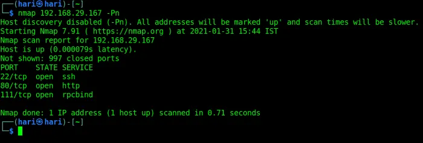

*Εικόνα 1 — Σάρωση Nmap: 22/tcp (ssh), 80/tcp (http) και 111/tcp (rpcbind) ανοιχτές.*

Από τα αποτελέσματα της σάρωσης διαπιστώνουμε ότι υπάρχουν **3 ανοιχτά ports (θύρες)**. Από αυτές τις τρεις, οι υπηρεσίες **SSH** (συνήθως στο port 22) και **HTTP** (port 80) είναι οι πιο συνηθισμένες.
Ξεκινάμε βάζοντας τη διεύθυνση IP του μηχανήματος στον Web Browser μας για να δούμε τι ακριβώς "σερβίρει" η σελίδα!

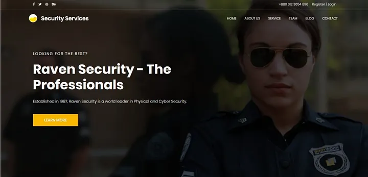

*Εικόνα 2 — Η αρχική σελίδα «Raven Security» στην πύλη 80.*

## Βήμα 3: Ανάλυση της Ιστοσελίδας και Εύρεση του 1ου Flag


### Επεξήγηση Βήματος 3 — τι ψάχνουμε μέσα σε μια σελίδα

Το πρώτο flag σε CTF κρύβεται συνήθως σε σημείο που **δεν φαίνεται** αλλά υπάρχει στο HTML. Τα κλασικά σημεία ελέγχου:

| Σημείο | Πώς το βλέπετε | Τι μπορεί να κρύβει |
| :--- | :--- | :--- |
| HTML comments | `Ctrl+U` ή DevTools (F12) | Flags, ονόματα χρηστών, paths |
| Meta tags | `<meta name="generator">` | CMS και έκδοση (π.χ. WordPress 5.x) |
| `robots.txt` | `http://host/robots.txt` | Καταλόγους που «δεν θέλουν» να δουν |
| `sitemap.xml` | `http://host/sitemap.xml` | Δομή του site |
| JavaScript αρχεία | DevTools → Sources | API endpoints, κλειδιά, σχόλια |
| HTTP headers | `curl -I http://host` | Server, τεχνολογίες |

**Τα εργαλεία προγραμματιστή (Developer Tools).** Κάθε σύγχρονος φυλλομετρητής (browser) διαθέτει ενσωματωμένα εργαλεία ανάπτυξης, προσβάσιμα με το πλήκτρο `F12` ή με τον συνδυασμό `Ctrl+U` (προβολή πηγαίου κώδικα). Μέσω αυτών ο αναλυτής εξετάζει τον πηγαίο κώδικα **HTML** που ο διακομιστής απέστειλε στον φυλλομετρητή — δηλαδή ό,τι αποστέλλεται προς τον πελάτη (client-side), ανεξαρτήτως του αν εμφανίζεται οπτικά στη σελίδα.

**Γιατί τα σχόλια HTML αποτελούν συχνό εύρημα.** Τα σχόλια της μορφής `<!-- ... -->` δεν αποδίδονται οπτικά, παραμένουν όμως πλήρως ορατά σε όποιον εξετάσει τον πηγαίο κώδικα. Οι προγραμματιστές εισάγουν τέτοια σχόλια κατά την ανάπτυξη και συχνά παραλείπουν να τα αφαιρέσουν πριν τη δημοσίευση. Το φαινόμενο αυτό συνιστά το απλούστερο παράδειγμα **διαρροής πληροφορίας (information disclosure)**: αποκάλυψη ευαίσθητων στοιχείων χωρίς να απαιτείται καν η εκμετάλλευση κάποιας ευπάθειας λογισμικού.

**Ταυτόχρονη πληροφορία που πρέπει να κρατήσετε:** από τη σελίδα της Raven Security μαθαίνετε ότι πρόκειται για εταιρικό site με WordPress — άρα το επόμενο βήμα (directory fuzzing) έχει συγκεκριμένο στόχο: το `/wordpress/`.

**Έλεγχος από τερματικό (χρήσιμο όταν δεν έχετε browser):**

```bash
curl -s http://10.0.2.6/ | grep -i "flag\|comment"
```
Η ιστοσελίδα έχει πολλούς υπερσυνδέσμους (hyperlinks). Το αμέσως επόμενο πράγμα που πρέπει να ελέγξει κάθε επαγγελματίας ασφαλείας είναι τα **Εργαλεία Προγραμματιστών (Developer Tools)** του Browser (πατώντας F12) και να κάνει "Επιθεώρηση" (Inspect) στον πηγαίο κώδικα (HTML) της σελίδας.
Πολλές φορές, τα CTF κρύβουν χρήσιμα στοιχεία σε μορφή σχολίων HTML (`<!-- σχόλιο -->`).

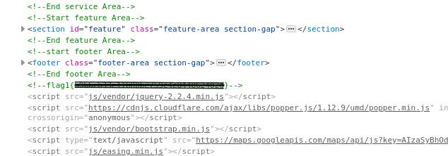

*Εικόνα 3 — Το `<!--flag{...}-->` κρυμμένο στα σχόλια του HTML.*

Και πράγματι, το **Πρώτο Flag (Flag 1)** είναι πολύ καλά κρυμμένο μέσα στον κώδικα στα Developer Tools!

## Βήμα 4: Brute-Force στους Καταλόγους (Directory Fuzzing)


### Επεξήγηση Βήματος 4 — η λογική του directory fuzzing

**Ορισμός.** Το **directory fuzzing** (ή directory brute-forcing) είναι η αυτοματοποιημένη δοκιμή πλήθους πιθανών ονομάτων καταλόγων και αρχείων σε έναν διακομιστή ιστού, με σκοπό τον εντοπισμό πόρων που δεν είναι συνδεδεμένοι (linked) από τις ορατές σελίδες. Η μέθοδος δεν βασίζεται σε τυχαίες δοκιμές, αλλά σε **λεξικά (wordlists)** που περιέχουν χιλιάδες συνήθη ονόματα (π.χ. `common.txt`, `directory-list-2.3-medium.txt`). Εάν ο διαχειριστής έχει αφήσει προσβάσιμους καταλόγους όπως `/backup/`, `/vendor/` ή `/wordpress/` χωρίς δημόσιο σύνδεσμο προς αυτούς, το εργαλείο τους εντοπίζει μέσω των αποκρίσεων του διακομιστή.

**Πώς ξεχωρίζετε «υπάρχει» από «δεν υπάρχει» — κωδικοί HTTP:**

| Κωδικός | Σημασία | Τι σημαίνει για εμάς |
| :--- | :--- | :--- |
| **200** | OK | Η σελίδα/κατάλογος υπάρχει και είναι προσβάσιμη |
| **301/302** | Redirect | Υπάρχει, αλλά σε άλλο path (π.χ. `/wordpress` → `/wordpress/`) |
| **403** | Forbidden | **Υπάρχει** αλλά απαγορεύεται η πρόσβαση — πληροφορία από μόνη της |
| **401** | Unauthorized | Απαιτεί login |
| **404** | Not found | Δεν υπάρχει |

**Γιατί το 403 είναι χρήσιμο:** επιβεβαιώνει ύπαρξη αρχείου/καταλόγου. Σε πραγματικό audit, ένα `403` σε `/admin/` λέει «υπάρχει πίνακας διαχείρισης» — και ίσως τον προσεγγίσετε με άλλο τρόπο (παράκαμψη, γνωστό CVE).

**Σύγκριση εργαλείων:**

| Εργαλείο | Πλεονέκτημα | Μειονέκτημα |
| :--- | :--- | :--- |
| **DirBuster** | Γραφικό, εύκολο για αρχάριους | Αργό, βαρύ |
| **gobuster** | Γρήγορο, CLI, scripts | Θέλει σωστό wordlist |
| **ffuf** | Πολύ γρήγορο, φίλτρα μεγέθους | Καμπύλη εκμάθησης |

**Παράδειγμα με gobuster:**

```bash
gobuster dir -u http://10.0.2.6/ -w /usr/share/wordlists/dirb/common.txt -x php,txt
```

**Στο Raven 1** το αποτέλεσμα `301 → /wordpress/` είναι το κρίσιμο εύρημα: μας λέει ότι υπάρχει CMS, άρα υπάρχει διαχείριση χρηστών και plugins — δηλαδή επιφάνεια επίθεσης.
Το επόμενο λογικό βήμα, μετά τον έλεγχο της αρχικής σελίδας, είναι ο εντοπισμός μη δημοσιευμένων καταλόγων (directories) στον διακομιστή. Για τον σκοπό αυτό χρησιμοποιείται το **DirBuster** (ή αντίστοιχα εργαλεία όπως τα Gobuster/Dirb). Πρόκειται για ιδιαίτερα διαδεδομένη τεχνική, η οποία επιτρέπει τον εντοπισμό μη προσβάσιμων μέσω συνδέσμων διαδρομών (paths) χωρίς τυφλές δοκιμές.

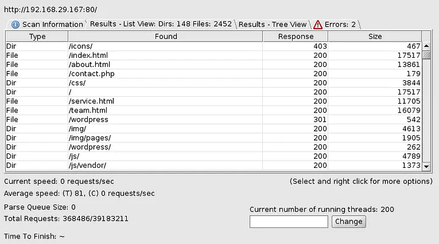

*Εικόνα 4 — DirBuster: εντοπίστηκε ο κατάλογος `/wordpress/` (HTTP 301).*

Τα αποτελέσματα του εργαλείου μάς αποκαλύπτουν την ύπαρξη ενός καταλόγου ονόματι **WordPress**.

## Βήμα 5: Αξιολόγηση Ευπαθειών με το WPScan


### Επεξήγηση Βήματος 5 — η λειτουργία του WPScan

**Τι είναι ένα CMS.** Το **WordPress** είναι ένα **Σύστημα Διαχείρισης Περιεχομένου (CMS — Content Management System)**: μια έτοιμη πλατφόρμα λογισμικού που επιτρέπει τη δημιουργία και διαχείριση ιστοσελίδων χωρίς εξειδικευμένη ανάπτυξη κώδικα, με επεκτάσιμη λειτουργικότητα μέσω **προσθέτων (plugins)** και **θεμάτων (themes)**. Ακριβώς λόγω της ευρείας διάδοσής του, το WordPress αποτελεί συχνό στόχο, καθώς μια γνωστή ευπάθεια σε ένα δημοφιλές plugin επηρεάζει ταυτόχρονα πλήθος ιστοτόπων.

**Τι είναι το WPScan.** Πρόκειται για σαρωτή ειδικά σχεδιασμένο για WordPress. Δεν παραβιάζει τον ιστότοπο, **συλλέγει** πληροφορίες (παθητική και ενεργητική απαρίθμηση):

* **Έκδοση** WordPress (από meta tags, readme, feeds).
* **Plugins/themes** και τις εκδόσεις τους → σύγκριση με γνωστές ευπάθειες (WPScan API).
* **Χρήστες** — μέσω του `?author=1` enumeration ή της REST API.

**Ανάλυση της εντολής της άσκησης:**

```bash
wpscan --url http://10.0.2.6/wordpress -e u
```

| Τμήμα | Σημασία |
| :--- | :--- |
| `--url` | Ο στόχος (το path του WordPress, όχι απαραίτητα η ρίζα) |
| `-e u` | *enumerate users* — λίστα χρηστών |
| `-e vp` | ευάλωτα plugins |
| `-e vt` | ευάλωτα themes |
| `--api-token` | για πλήρη βάση ευπαθειών (δωρεάν token) |

**Γιατί η απαρίθμηση χρηστών είναι κρίσιμη:** το WordPress επιτρέπει σύνδεση με **username + password**. Αν γνωρίζετε το username (`michael`, `steven`), το brute-force γίνεται εφικτό — δεν χρειάζεται να μαντέψετε και τα δύο.

**Πώς αμύνεται ένα site:** απενεργοποίηση author enumeration, 2FA, όριο προσπαθειών (rate limiting), ισχυροί κωδικοί, απόκρυψη έκδοσης. Κάθε ένα από αυτά θα είχε σταματήσει την πορεία αυτού του CTF.

**Σημείωση δεοντολογίας:** το WPScan στέλνει εκατοντάδες αιτήματα, σε ξένο site αυτό είναι επίθεση. Εδώ το κάνουμε σε τοπική VM.
Το σύστημα διαχείρισης περιεχομένου WordPress έχει ένα αρκετά κακό ιστορικό όσον αφορά τις ευπάθειες. Ξεκινώντας μια σάρωση με το εξειδικευμένο εργαλείο **WPScan**, μπορούμε να ανακαλύψουμε την ακριβή έκδοση του WordPress, τυχόν ευπαθή πρόσθετα (plugins), αλλά και να απαριθμήσουμε τους χρήστες.

Η σύνταξη της εντολής WPScan ενδέχεται να φανεί αρχικά περίπλοκη (π.χ. `wpscan --url http://<IP>/wordpress/ -e u`). Σε κάθε περίπτωση δυσκολίας, η ενσωματωμένη τεκμηρίωση του εργαλείου, μέσω των εντολών `man wpscan` ή `wpscan --help`, παρέχει πλήρη επεξήγηση των διαθέσιμων παραμέτρων.

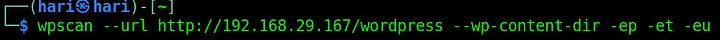

*Εικόνα 5 — Εκτέλεση του WPScan με απαρίθμηση χρηστών (`-eu`) και plugins/themes (`-ep -et`).*

Η σάρωση μπορεί να πάρει μερικά λεπτά για να ολοκληρωθεί.

Μετά την ολοκλήρωση της σάρωσης, η βάση δεδομένων του εργαλείου μάς αποκαλύπτει τα **ονόματα των χρηστών (usernames)**. Ίσως μπορούμε να χρησιμοποιήσουμε αυτά τα usernames για να συνδεθούμε στο μηχάνημα μέσω SSH; Ας δούμε!

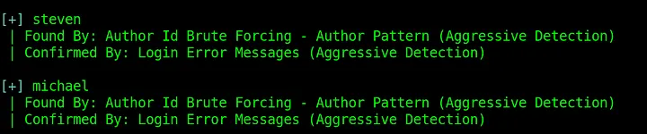

*Εικόνα 6 — WPScan: εντοπίστηκαν οι χρήστες `steven` και `michael`.*

## Βήμα 6: Πρόσβαση στο Σύστημα και Εύρεση 2ου Flag


### Επεξήγηση Βήματος 6 — γιατί ο «προφανής» κωδικός είναι ρεαλιστικό σενάριο

**Ορισμός — επίθεση ωμής βίας (brute-force).** Πρόκειται για τη συστηματική, αυτοματοποιημένη δοκιμή πολλών υποψήφιων κωδικών πρόσβασης έως ότου εντοπιστεί ο ορθός. Όταν οι δοκιμαζόμενοι κωδικοί προέρχονται από προκαθορισμένη λίστα συνήθων κωδικών, η τεχνική ονομάζεται **επίθεση λεξικού (dictionary attack)**.

Ο συνδυασμός `michael:michael` (όνομα χρήστη ταυτόσημο με τον κωδικό) ενδέχεται να φαίνεται εξωπραγματικός, αποτελεί όμως απολύτως ρεαλιστικό σενάριο. Οι επιθέσεις **credential stuffing** (δοκιμή διαπιστευτηρίων που έχουν διαρρεύσει από άλλες υπηρεσίες) και **password spraying** (δοκιμή λίγων πολύ συνήθων κωδικών σε πολλούς λογαριασμούς) βασίζονται ακριβώς σε τέτοιες επισφαλείς συνήθειες των χρηστών: όνομα χρήστη ως κωδικός, `Password1`, εποχή συνοδευόμενη από `!` κ.ο.κ. Στατιστικά, ένα μικρό λεξικό προσεκτικά επιλεγμένων κωδικών —και όχι ολόκληρο το `rockyou.txt`— επαρκεί για σημαντικό ποσοστό επιτυχίας.

**Το εργαλείο `hydra` και η ταχύτητα της επίθεσης.** Το `hydra` είναι εργαλείο αυτοματοποιημένης δοκιμής διαπιστευτηρίων σε πλήθος πρωτοκόλλων, μεταξύ των οποίων και το SSH. Η επίθεση ωμής βίας στο SSH είναι εγγενώς βραδεία, διότι κάθε μεμονωμένη δοκιμή απαιτεί πλήρη **χειραψία (handshake)** TCP και, εν συνεχεία, κρυπτογραφική χειραψία SSH. Για τον λόγο αυτό το `hydra` εκτελεί πολλές δοκιμές παράλληλα (παράμετρος `-t`). Η ίδια ακριβώς ιδιότητα, ωστόσο, καθιστά την επίθεση ευδιάκριτη: οι διακομιστές αντιμετωπίζουν τέτοιες προσπάθειες με μηχανισμούς όπως το **`fail2ban`** (προσωρινός αποκλεισμός διεύθυνσης IP έπειτα από επαναλαμβανόμενες αποτυχίες) ή με περιορισμό ρυθμού συνδέσεων.

```bash
hydra -l michael -P /usr/share/wordlists/rockyou.txt ssh://10.0.2.6
hydra -L users.txt -P pass.txt -t 4 ssh://10.0.2.6     # λίστες και για τα δύο
```

**Τι κάνουμε αφού συνδεθούμε — η λογική του enumeration ως `michael`:**

1. **Ποιος είμαι;** `id`, `whoami`, `sudo -l` (τι μπορώ να τρέξω ως root;)
2. **Πού είμαι;** `pwd`, `ls -la`, `cat /etc/passwd` (άλλοι χρήστες)
3. **Τι μπορώ να διαβάσω;** `find / -name "flag*" 2>/dev/null`, `ls /var/www`
4. **Τι υπηρεσίες τρέχουν;** `ps aux`, `ss -tuln`

**Γιατί το `sudo -l` είναι το πρώτο που τρέχουμε:** αν ο χρήστης έχει δικαίωμα `sudo` σε κάποια εντολή (π.χ. `less`, `find`, `vim`), η κλιμάκωση είναι σχεδόν σίγουρη. Στο Raven 1 η διαδρομή είναι διαφορετική (επαναχρησιμοποίηση κωδικού), αλλά η συνήθεια μένει.

**Το flag 2** βρίσκεται στο `/var/www/flag2.txt`: επιβεβαιώνει ότι ο web root είναι προσβάσιμος από τον χρήστη και ότι τα «μυστικά» του site δεν προστατεύονται.
Εδώ υπάρχει ένα πρόβλημα. Ο κωδικός πρόσβασης (password) για το username που βρήκαμε (χρήστης `michael`) μάς είναι άγνωστος. Σε αυτές τις περιπτώσεις, είναι πολύ καλή πρακτική να δοκιμάζουμε πάντα τους πιο "κοινούς" ή προφανείς κωδικούς πριν ξεκινήσουμε χρονοβόρες επιθέσεις brute-force.

Συγκεκριμένα, ο χρήστης εκτελεί την εντολή `hydra -l michael -P /usr/share/wordlists/rockyou.txt ssh://10.0.2.6`, η οποία στοχεύει τον λογαριασμό με όνομα `michael` στην IP διεύθυνση `10.0.2.6`, αξιοποιώντας το γνωστό λεξικό κωδικών `rockyou.txt` για τη μαζική και αυτοματοποιημένη δοκιμή χιλιάδων πιθανών κωδικών πρόσβασης. Όπως φαίνεται στα αποτελέσματα της εκτέλεσης στο κάτω μέρος του τερματικού, η επίθεση ολοκληρώνεται με επιτυχία, καθώς το εργαλείο εντοπίζει έναν έγκυρο κωδικό, αποκαλύπτοντας ότι το password για τον χρήστη `michael` είναι επίσης η λέξη «michael».

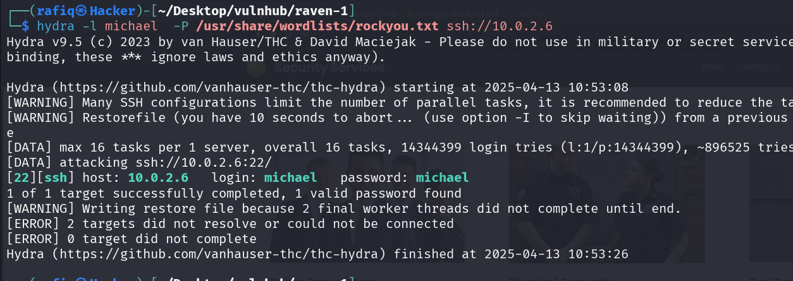

*Εικόνα 7 — `hydra -l michael -P rockyou.txt ssh://…`: επιτυχής brute-force, `login: michael  password: michael`.*

Εδώ, κάνοντας τη δοκιμή, διαπιστώνουμε ότι το username και το password ήταν τα ίδια: **“michael”**.
Συνδεόμαστε λοιπόν με επιτυχία μέσω SSH (`ssh michael@<IP>`).

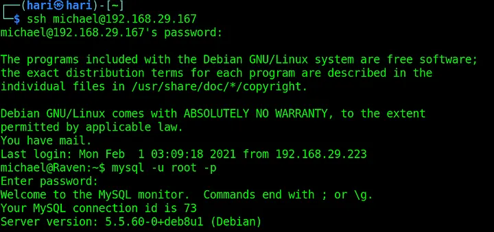

*Εικόνα 8 — Επιτυχής σύνδεση ως `michael` και είσοδος στη MySQL ως `root`.*

Το επόμενο μεγάλο βήμα σε κάθε CTF, αφού αποκτήσουμε πρόσβαση ως απλοί χρήστες, είναι η **Κλιμάκωση Προνομίων** (Privilege Escalation) για να γίνουμε διαχειριστές (root). Όμως, προτού προχωρήσουμε σε αυτό, ας ρίξουμε μια ματιά στα διαθέσιμα αρχεία του συστήματος στα οποία έχουμε ήδη πρόσβαση.

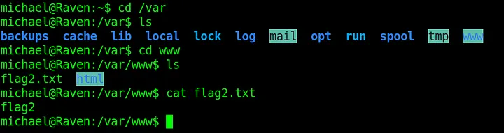

*Εικόνα 9 — Ανάγνωση του `flag2.txt` μέσα στο `/var/www/`.*

Όταν ερευνούμε τους φακέλους, πλοηγούμαστε στον κατάλογο `/var/www/html/`. Μέσα σε αυτόν τον κατάλογο, εντοπίζουμε το **Δεύτερο Flag (Flag 2)**!

## Βήμα 7: Εξερεύνηση Βάσης Δεδομένων (Εύρεση Flags 3 & 4)


### Επεξήγηση Βήματος 7 — από αρχείο ρυθμίσεων σε βάση δεδομένων

**Τι είναι η βάση δεδομένων.** Το WordPress αποθηκεύει το περιεχόμενο και τους χρήστες του σε μια **σχεσιακή βάση δεδομένων** που διαχειρίζεται το σύστημα **MySQL**. Η εφαρμογή συνδέεται σε αυτήν χρησιμοποιώντας διαπιστευτήρια τα οποία είναι αποθηκευμένα στο αρχείο ρυθμίσεων `wp-config.php`.

**Ο κρίσιμος ρόλος του `wp-config.php`.** Το αρχείο αυτό αποτελεί κεντρικό σημείο ασφάλειας κάθε εγκατάστασης WordPress: περιέχει τις παραμέτρους `DB_NAME`, `DB_USER`, `DB_PASSWORD` και `DB_HOST`, καθώς και τα **κλειδιά αυθεντικοποίησης (authentication keys)**. Εάν ένας χρήστης αποκτήσει δικαίωμα ανάγνωσής του, διαθέτει πλέον τα διαπιστευτήρια για απευθείας πρόσβαση στη βάση δεδομένων.

**Η αλυσίδα:**

```
/wp-content/../wp-config.php  →  credentials  →  mysql -u user -p  →  USE wordpress;
                                                                    →  SELECT * FROM wp_posts;
```

**Ανάλυση των SQL εντολών:**

| Εντολή | Τι κάνει |
| :--- | :--- |
| `SHOW DATABASES;` | Λίστα βάσεων — ψάχνουμε `wordpress` |
| `USE wordpress;` | Επιλογή βάσης (αλλιώς «No database selected») |
| `SHOW TABLES;` | Πίνακες: `wp_posts`, `wp_users`, `wp_options`… |
| `SELECT * FROM wp_posts;` | Περιεχόμενο δημοσιεύσεων (εδώ κρύβονται flags) |
| `SELECT user_login, user_pass FROM wp_users;` | Χρήστες και **hashes** |

**Γιατί τα flags βρίσκονται σε «drafts»:** τα `wp_posts` έχουν πεδίο `post_status` (`publish`, `draft`, `inherit`). Τα flags εμφανίζονται σε εγγραφές **draft/revision** — δηλαδή σε περιεχόμενο που δεν δημοσιεύτηκε ποτέ, αλλά έμεινε στη βάση. Είναι ρεαλιστικό: διαγραμμένο ή κρυφό περιεχόμενο συχνά παραμένει.

**Καλή πρακτική ελέγχου:**

```sql
SELECT ID, post_title, post_status FROM wp_posts WHERE post_status != 'publish';
SELECT user_login, user_pass FROM wp_users;
```

**Γιατί αυτό είναι σοβαρό σε παραγωγή:** ο web user (`www-data`) δεν θα έπρεπε να έχει δικαιώματα ανάγνωσης όλων των αρχείων του site, και η βάση δεν θα έπρεπε να εκθέτει hashes σε οποιονδήποτε έχει shell.
Κάνοντας μια ακόμη πιο βαθιά έρευνα στους καταλόγους, πηγαίνουμε στον φάκελο του WordPress (η διαδρομή είναι `/var/www/html/wordpress/`). Εκεί υπάρχει το αρχείο `wp-config.php`, το οποίο είναι εξαιρετικά σημαντικό καθώς περιέχει τα στοιχεία σύνδεσης της βάσης δεδομένων (Database credentials).

Χρησιμοποιούμε αυτά τα διαπιστευτήρια για να συνδεθούμε στη **MySQL** μέσω του τερματικού (π.χ. `mysql -u <χρήστης> -p`).

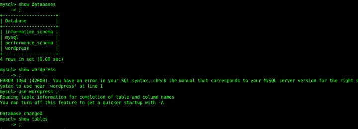

*Εικόνα 10 — MySQL: βάσεις `mysql`, `performance_schema` και `wordpress`.*

Αλλάζουμε την ενεργή βάση δεδομένων σε αυτή του WordPress (γράφοντας `USE wordpress;`). Τώρα, οι πίνακες (tables) της βάσης είναι ορατοί σε εμάς (`SHOW TABLES;`). Βλέπουμε κάποιους πολύ ενδιαφέροντες πίνακες, όπως ο πίνακας `wp_users` και ο `wp_posts`.

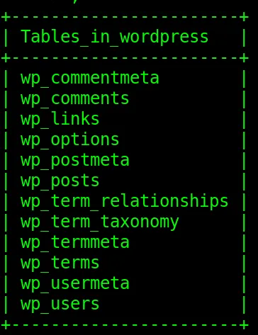

*Εικόνα 11 — `SHOW TABLES`: οι πίνακες `wp_users`, `wp_posts`, `wp_options` κ.λπ.*

Αν ψάξουμε μέσα στον πίνακα `wp_posts` (τις δημοσιεύσεις του site), θα βρούμε μέσα το **Τρίτο Flag (Flag 3)** και το **Τέταρτο Flag (Flag 4)**. Ουσιαστικά, αυτό αποτελεί και το επίσημο τέλος του CTF, αφού βρήκαμε και τις 4 σημαίες!

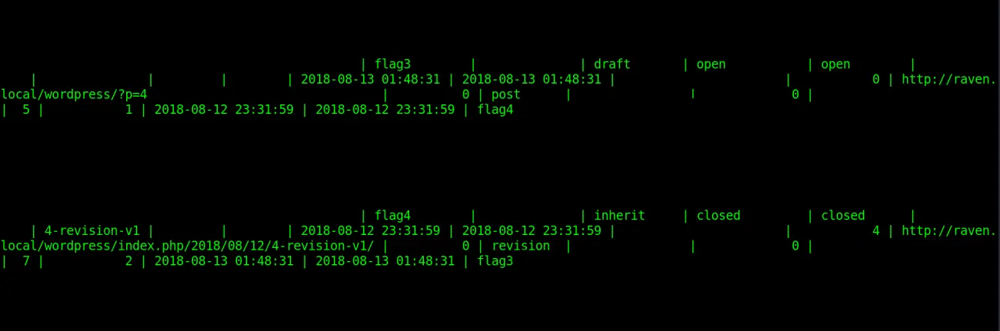

*Εικόνα 12 — Στα `wp_posts` εμφανίζονται τα `flag3` και `flag4`.*

Όμως μισό λεπτό... Τι γίνεται με το **Root Access** (την απόλυτη διαχειριστική πρόσβαση);

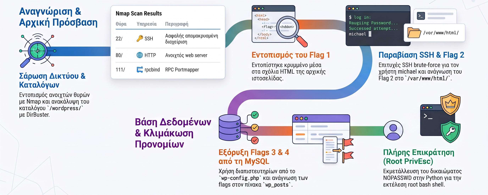

## Βήμα 8: Ανάκτηση Κωδικού με John the Ripper


### Επεξήγηση Βήματος 8 — η ανάκτηση ενός hash και οι κίνδυνοι της επαναχρησιμοποίησης κωδικών

**Τι είναι μια συνάρτηση κατακερματισμού (hash).** Πρόκειται για **μονόδρομη συνάρτηση** που μετατρέπει μια είσοδο οποιουδήποτε μήκους (τον κωδικό) σε μια συμβολοσειρά σταθερού μήκους (το hash). Η διαδικασία είναι μη αντιστρέψιμη: από το hash δεν είναι υπολογιστικά εφικτή η ανάκτηση του αρχικού κωδικού. Για τον λόγο αυτό τα συστήματα δεν αποθηκεύουν τους κωδικούς σε αναγνώσιμη μορφή, αλλά τα hashes τους. Ένα **salt** είναι μια τυχαία τιμή που προστίθεται στον κωδικό πριν τον κατακερματισμό, ώστε δύο ίδιοι κωδικοί να παράγουν διαφορετικά hashes και να αποτρέπεται η χρήση προϋπολογισμένων πινάκων (rainbow tables).

**Η μορφή `$P$B...`.** Το πρόθεμα `$P$` υποδηλώνει hash τύπου **phpass** — του αλγορίθμου που χρησιμοποιούσε το WordPress (βασίζεται σε MD5 με πολλαπλές επαναλήψεις και salt). Καθώς η συνάρτηση είναι μονόδρομη, το hash δεν «αποκρυπτογραφείται», ο κωδικός **ανακτάται** μέσω εξαντλητικής δοκιμής (διαδικασία γνωστή ως *cracking*).

**Πώς λειτουργεί η επίθεση λεξικού.** Το εργαλείο **John the Ripper** (`john`) εφαρμόζει την ακόλουθη λογική:

```
για κάθε λέξη στο rockyou.txt:
    υπολόγισε phpass(λέξη, salt)
    αν το αποτέλεσμα ταυτίζεται με το αποθηκευμένο hash  →  ο κωδικός βρέθηκε
```

Η διαδικασία είναι χρονοβόρα, διότι ο αλγόριθμος phpass έχει σχεδιαστεί ώστε να είναι **σκόπιμα βραδύς** (εκτελεί χιλιάδες επαναλήψεις ανά υπολογισμό, αυξάνοντας το κόστος κάθε δοκιμής). Το `john` αντισταθμίζει εν μέρει το κόστος αυτό εκτελώντας τους υπολογισμούς παράλληλα και με αλγοριθμικές βελτιστοποιήσεις.

**Ανάλυση της εντολής:**

```bash
john --wordlist=/usr/share/wordlists/rockyou.txt hashes.txt
john --show hashes.txt        # δείχνει ό,τι βρέθηκε
```

**Γιατί ο κωδικός του `steven` ανοίγει και το root:** επειδή ο διαχειριστής **επαναχρησιμοποίησε** τον κωδικό. Είναι το πιο συνηθισμένο λάθος σε πραγματικά περιστατικά: ένας κωδικός που διέρρευσε από εφαρμογή γίνεται κλειδί για το σύστημα.

**Πώς θα έπρεπε να είναι:** διαφορετικοί κωδικοί ανά υπηρεσία, `sudo` με NOPASSWD μόνο για συγκεκριμένες εντολές, MFA για SSH, και τακτικός έλεγχος με `john --test` / password policy.

**Στην πράξη, μετά το `steven:pink84`:** με τα διαπιστευτήρια αυτά συνδεόμαστε ως `steven` και αποκτούμε ένα κανονικό (μη προνομιούχο) κέλυφος, από το οποίο θα ξεκινήσει η κλιμάκωση προνομίων του επόμενου βήματος.

```bash
su steven          # ή: ssh steven@10.0.2.6   (κωδικός: pink84)
id                 # επιβεβαίωση: uid=1000(steven) — ακόμη όχι root
```

**Σημείωση:** το flag 4 δεν βρίσκεται πάντα στο `/root/flag4.txt` — σε αυτό το μηχάνημα η διαδρομή προς root είναι το ζητούμενο, και τα flags 1–3 έχουν ήδη βρεθεί μέσω web/DB.
Ο πίνακας `wp_users` που είδαμε προηγουμένως στη βάση δεδομένων, περιέχει τα "hashes" (κρυπτογραφημένες μορφές) των κωδικών πρόσβασης των χρηστών του WordPress.

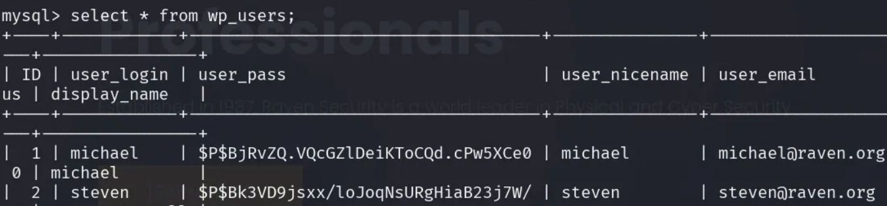

*Εικόνα 13 — `SELECT * FROM wp_users`: τα hashes (phpass, `$P$…`) των `michael` και `steven`.*

Αντιγράφουμε αυτά τα hashes και χρησιμοποιούμε ένα εργαλείο "σπασίματος" κωδικών που ονομάζεται **John The Ripper** (`john`) για να τα απορυπτογραφήσουμε (π.χ. παρέχοντας του ένα λεξικό όπως το `rockyou.txt`).
Η διαδικασία αυτή μας αποκαλύπτει με επιτυχία τον κωδικό πρόσβασης για τον χρήστη **`steven`**. Το πιο ενδιαφέρον κομμάτι είναι ότι ο κωδικός του `steven` τυγχάνει να είναι **ο ίδιος κωδικός που απαιτείται για την πρόσβαση στο root** (είτε μέσω `su root` είτε μέσω δικαιωμάτων `sudo`)!

```bash
# Αποθηκεύουμε τα hashes σε αρχείο και τρέχουμε λεξικό
john hashes.txt --wordlist=/usr/share/wordlists/rockyou.txt
```

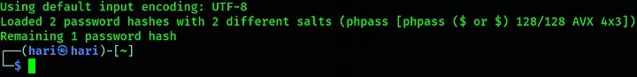

*Εικόνα 14 — John The Ripper: 2 hashes (phpass), απομένει 1 προς σπάσιμο.*

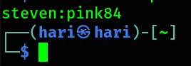

*Εικόνα 15 — Επιτυχής ανάκτηση διαπιστευτηρίων: `steven:pink84`.*

Πλέον έχουμε έγκυρα διαπιστευτήρια και πρόσβαση ως `steven`. Το τελευταίο βήμα είναι η **κλιμάκωση προνομίων** από τον χρήστη αυτόν προς `root`.

## Βήμα 9: Ανύψωση Δικαιωμάτων με `sudo` + Python (GTFOBins)

Έχοντας πλέον κέλυφος ως ο χρήστης `steven`, το πρώτο πράγμα που εξετάζουμε για κλιμάκωση προνομίων είναι **τι μας επιτρέπεται να εκτελέσουμε ως `root`**. Αυτό το δείχνει η εντολή `sudo -l`, η οποία παραθέτει τις εγγραφές του αρχείου `/etc/sudoers` που αφορούν τον συνδεδεμένο χρήστη.

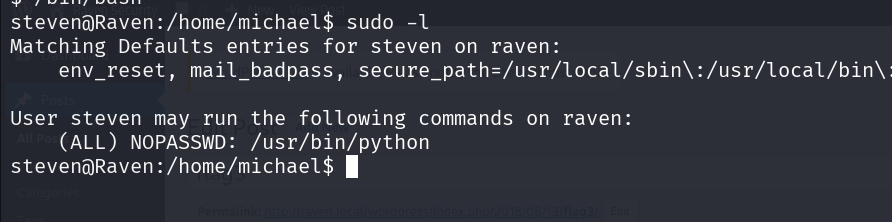

### Έξοδος του τερματικού

```text
Matching Defaults entries for steven on raven:
    env_reset, mail_badpass, secure_path=/usr/local/sbin\:/usr/local/bin\...

User steven may run the following commands on raven:
    (ALL) NOPASSWD: /usr/bin/python
```

Παρατηρούμε ότι ο `steven` μπορεί να εκτελέσει την **Python ως `root` χωρίς κωδικό** (`NOPASSWD`). Αυτό από μόνο του είναι η ευπάθεια: η Python δεν είναι ένα «ασφαλές» εργαλείο που κάνει μία συγκεκριμένη δουλειά — είναι ένας **πλήρης διερμηνέας** που μπορεί να εκτελέσει αυθαίρετο κώδικα, άρα και να ξεκινήσει ένα κέλυφος. Εκμεταλλευόμαστε τη ρύθμιση καλώντας ένα διαδραστικό `bash` με δικαιώματα `root`:

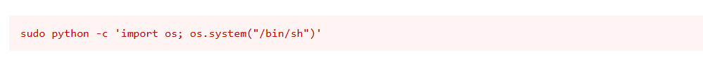

```bash
sudo python -c 'import os; os.system("/bin/bash")'
```

Η τεχνική αυτή (καταγεγραμμένη στο **GTFOBins**) αξιοποιεί το δικαίωμα εκτέλεσης της Python ως `root` ώστε να «δραπετεύσει» από το περιβάλλον του διερμηνέα (**binary escape**) και να ανοίξει ένα πλήρες root shell (`root@raven`).

### Επεξήγηση Βήματος 9 — γιατί ένα απλό `sudo python` δίνει root

**Τι είναι το GTFOBins.** Πρόκειται για μια δημόσια βάση γνώσης (*Get The F\* Out Binaries*) που καταγράφει πώς «νόμιμα» εκτελέσιμα του Unix μπορούν να καταχραστούν όταν τους δοθούν αυξημένα δικαιώματα — μέσω `sudo`, `SUID`, δυνατοτήτων (capabilities) κ.ο.κ. Η λογική πίσω από κάθε εγγραφή είναι η ίδια: αν ένα πρόγραμμα που τρέχει ως `root` μπορεί να εκτελέσει **εντολές ή κώδικα της επιλογής μας**, τότε τα προνόμιά του γίνονται δικά μας.

**Ανάλυση της εντολής:**

* **`sudo python`** — εκκινεί τον διερμηνέα της Python υπό τον λογαριασμό του υπερχρήστη. Λόγω του `NOPASSWD`, δεν ζητείται καν κωδικός.
* **`-c`** (*command*) — επιτρέπει τη μετάδοση κώδικα Python απευθείας ως όρισμα, χωρίς να χρειάζεται ξεχωριστό αρχείο `.py`.
* **`import os`** — εισάγει το ενσωματωμένο module `os`, που παρέχει διεπαφές προς το λειτουργικό σύστημα.
* **`os.system("/bin/bash")`** — καλεί τη συνάρτηση συστήματος, εκτελώντας το κέλυφος `/bin/bash`.

**Ο μηχανισμός της κλιμάκωσης.** Όταν τρέχουμε κάτι με `sudo`, η διεργασία αποκτά **effective UID 0** (root). Η Python είναι πλέον μια διεργασία-γονέας με δικαιώματα root. Η `os.system()` κάνει `fork()` και εκκινεί το `/bin/bash` ως **διεργασία-παιδί**, κάθε παιδί **κληρονομεί** το περιβάλλον ασφαλείας του γονέα, άρα το νέο κέλυφος ξεκινά κι αυτό ως `root`. Δεν υπάρχει εδώ «σπάσιμο» κάποιου μηχανισμού ασφαλείας: απλώς μια υπερβολικά πλατιά άδεια (`sudo` σε έναν ολόκληρο διερμηνέα) χρησιμοποιείται ακριβώς για ό,τι επιτρέπει τεχνικά.

**Επαλήθευση.** Μέσα στο νέο κέλυφος εκτελούμε:

```bash
id        # uid=0(root) gid=0(root) groups=0(root)
whoami    # root
```

Αν το `id` επιστρέψει `uid=0(root)`, η κλιμάκωση ολοκληρώθηκε και έχουμε πλήρη έλεγχο του μηχανήματος (και πρόσβαση στο `/root/flag4.txt`, όπου υπάρχει).

**Σημείωση — εναλλακτική διατύπωση.** Η ίδια ιδέα γράφεται και ως `sudo python -c 'import pty; pty.spawn("/bin/bash")'`. Το module `pty` δίνει ένα πλήρως **διαδραστικό** ψευδο-τερματικό (χρήσιμο για job control, `sudo`, interactive προγράμματα), ενώ η `os.system` αρκεί για ένα απλό root shell. Και οι δύο βασίζονται στο ίδιο κενό ρύθμισης.

**Πώς θα έπρεπε να είναι (αντιμετώπιση).** Η ρίζα του προβλήματος είναι η παραβίαση της **αρχής των ελάχιστων προνομίων**: ποτέ δεν δίνουμε `sudo` σε έναν γενικό διερμηνέα (Python, Perl, Ruby) ή σε εργαλεία που μπορούν να εκκινήσουν κέλυφος (`vi`, `less`, `find`, `awk`, `tar`). Αν χρειάζεται αυτοματισμός, δίνουμε δικαίωμα μόνο στο **συγκεκριμένο script** με πλήρη διαδρομή και ελεγμένες παραμέτρους, κατά προτίμηση χωρίς `NOPASSWD`.

### Σύνοψη


### Επεξήγηση — τι να κρατήσετε από αυτό το εργαστήριο

| Φάση | Εργαλείο | Κρίσιμη ιδέα |
| :--- | :--- | :--- |
| Recon | `netdiscover` | Το ARP δεν «φιλτράρεται» σε LAN |
| Scan | `nmap -sC -sV` | Οι εκδόσεις υπηρεσιών οδηγούν σε γνωστές ευπάθειες |
| Web | DevTools / `curl` | Τα σχόλια HTML διαρρέουν πληροφορία |
| Fuzzing | DirBuster / `gobuster` | Τα 403 είναι ευρήματα, όχι αποτυχίες |
| CMS | `wpscan -e u` | Οι χρήστες είναι το ήμισυ του προβλήματος |
| Access | `hydra` + λεξικό | Οι «προφανείς» κωδικοί δουλεύουν |
| Post | `wp-config.php` | Τα credentials γράφονται σε αρχεία |
| Privesc | `sudo -l` + Python (GTFOBins) | `sudo` σε διερμηνέα = root, η `john` + επαναχρήση κωδικού είναι εναλλακτική |
Η μεθοδολογία που ακολουθήθηκε είναι, ως προς τη σύλληψή της, σχετικά απλή, η κύρια δυσκολία για τον αρχάριο αναλυτή έγκειται στον προσδιορισμό του ορθού πρώτου βήματος και στη μετάβαση από τη μία φάση στην επόμενη. Οι δυσκολίες αυτές είναι αναμενόμενες κατά την επίλυση ενός CTF, με συστηματική εξάσκηση, η εξοικείωση με τις τεχνικές και τα εργαλεία βελτιώνεται σταθερά.

Το μηχάνημα διαθέτει και συνέχεια (**Raven 2**), η οποία καλύπτεται σε αντίστοιχο εργαστήριο του παρόντος υλικού (Εργαστήριο 04).

---


## Παράρτημα Α — Χάρτης εντολών του εργαστηρίου

| Σκοπός | Εντολή |
| :--- | :--- |
| Εύρεση IP στόχου | `netdiscover -r 10.0.2.0/24` |
| Σάρωση υπηρεσιών | `nmap -sC -sV 10.0.2.6` |
| Έλεγχος headers | `curl -I http://10.0.2.6/` |
| Εύρεση καταλόγων | `dirb http://10.0.2.6/` ή `gobuster dir -u … -w …` |
| Απαρίθμηση WP | `wpscan --url http://10.0.2.6/wordpress -e u` |
| SSH brute-force | `hydra -l michael -P rocklyn.txt ssh://10.0.2.6` |
| Σύνδεση | `ssh michael@10.0.2.6` |
| Δικαιώματα | `id`, `sudo -l`, `ls -la /var/www` |
| MySQL | `mysql -u root -p` → `USE wordpress; SHOW TABLES;` |
| Σπάσιμο hashes | `john --wordlist=rockyou.txt hashes.txt` |

## Παράρτημα Β — Γλωσσάρι

| Όρος | Σημασία |
| :--- | :--- |
| **Reconnaissance** | Συλλογή πληροφοριών χωρίς άμεση επαφή/επίθεση |
| **Enumeration** | Ενεργητική απαρίθμηση (χρήστες, κατάλογοι, εκδόσεις) |
| **Fuzzing (dir)** | Δοκιμή λίστας ονομάτων για ανακάλυψη πόρων |
| **CMS** | Σύστημα διαχείρισης περιεχομένου (WordPress, Drupal) |
| **Hash** | Μονόδρομη συνάρτηση, δεν αντιστρέφεται — ο κωδικός ανακτάται μόνο μέσω εξαντλητικών δοκιμών |
| **phpass** | Αλγόριθμος hashing του WordPress (`$P$`) |
| **Salt** | Τυχαία τιμή που κάνει κάθε hash μοναδικό |
| **Credential reuse** | Ίδιος κωδικός σε πολλά συστήματα |
| **Privilege escalation** | Από απλός χρήστης σε root |

## Παράρτημα Γ — Ερωτήσεις αυτοελέγχου

1. Γιατί το `netdiscover` βρίσκει hosts που το `ping` δεν βλέπει;
2. Ποια η διαφορά `open` / `closed` / `filtered` σε ένα nmap;
3. Γιατί η απαρίθμηση χρηστών στο WordPress διευκολύνει το brute-force;
4. Τι σημαίνει HTTP 403 για έναν κατάλογο και γιατί είναι χρήσιμο;
5. Γιατί δεν «αποκρυπτογραφείται» ένα hash; Περιγράψτε τη διαδικασία του cracking.
6. Ποια τρία μέτρα θα σταματούσαν την πορεία αυτού του CTF;
7. Πού θα ψάξετε πρώτα μετά την απόκτηση shell και γιατί (`sudo -l`, `id`, `ls /var/www`);

### Ενδεικτικές απαντήσεις

1. Το `netdiscover` δουλεύει στο **επίπεδο 2 (ARP)**: κάθε ζωντανός host **πρέπει** να απαντά σε ARP για να λειτουργεί το δίκτυο. Το `ping` χρησιμοποιεί **ICMP (επίπεδο 3)**, το οποίο πολλά συστήματα/firewalls μπλοκάρουν — έτσι ένας host που αγνοεί τα ICMP echo φαίνεται «νεκρός» στο ping αλλά εντοπίζεται από το ARP. (Ισχύει μόνο στο ίδιο LAN, όπου το ARP δεν περνά routers.)
2. **open** = υπάρχει υπηρεσία που ακούει και απάντησε (SYN-ACK). **closed** = η θύρα είναι προσβάσιμη αλλά καμία υπηρεσία δεν ακούει (απάντησε με RST). **filtered** = δεν ήρθε απάντηση ή ήρθε ICMP unreachable — κάτι (συνήθως firewall) φιλτράρει το πακέτο, οπότε δεν ξέρουμε αν είναι open ή closed.
3. Το brute-force χρειάζεται **έγκυρο username + κωδικό**. Αν ξέρουμε τους πραγματικούς χρήστες (π.χ. `michael`, `steven` μέσω `wpscan -e u`), ο επιτιθέμενος σταματά να μαντεύει usernames και ρίχνει όλες τις δοκιμές στον κωδικό ενός γνωστού λογαριασμού — μειώνει δραστικά τον χώρο αναζήτησης.
4. 403 Forbidden = ο κατάλογος **υπάρχει** αλλά απαγορεύεται η πρόσβαση/listing. Είναι θετικό εύρημα: επιβεβαιώνει έγκυρη διαδρομή (σε αντίθεση με 404), άρα αξίζει να δοκιμάσουμε γνωστά ονόματα αρχείων μέσα της. Τα 403 στο fuzzing είναι «στόχοι», όχι αποτυχίες.
5. Το hash παράγεται από **μονόδρομη** συνάρτηση — δεν υπάρχει αντίστροφη πράξη. Το cracking δεν αποκρυπτογραφεί, **μαντεύει**: παίρνει υποψήφιους κωδικούς (rockyou), υπολογίζει το ίδιο hash με το ίδιο salt/αλγόριθμο (phpass) και συγκρίνει με το αποθηκευμένο, όταν ταιριάξουν, βρέθηκε ο κωδικός. Γι' αυτό αργοί αλγόριθμοι + salt κάνουν το cracking ακριβό.
6. (1) **Ισχυροί κωδικοί + lockout**: ο `michael:michael` δεν θα έσπαγε με hydra με password policy και κλείδωμα μετά από Χ αποτυχίες. (2) **Προστασία credentials**: `wp-config.php` με αυστηρά δικαιώματα και MySQL δεμένη στο `127.0.0.1` κρύβουν τα διαπιστευτήρια της βάσης. (3) **Least privilege στο sudo**: αφαίρεση του `NOPASSWD: /usr/bin/python` κόβει την τελική κλιμάκωση σε root.
7. Πρώτα `id`/`whoami` (ποιος είμαι, σε ποια groups), μετά `sudo -l` (τι τρέχω ως root — συχνά η ταχύτερη διαδρομή privesc) και `ls -la /var/www` + ανάγνωση config (`wp-config.php`) για credentials/flags. Η λογική: χαρτογραφούμε άμεσα προνόμια και «εύκολα» μυστικά πριν ψάξουμε πιο σύνθετα μονοπάτια (SUID, cron, kernel).

## Παράρτημα Δ — Λίστα ελέγχου

- [ ] Επιβεβαίωση IP στόχου (ARP, όχι μόνο ping)
- [ ] Σάρωση **όλων** των θυρών (τουλάχιστον `-sV` και, αν χρειάζεται, `-p-`)
- [ ] Έλεγχος πηγαίου κώδικα, headers, `robots.txt`
- [ ] Directory fuzzing με λεξικό
- [ ] Απαρίθμηση χρηστών CMS
- [ ] Έλεγχος αδύναμων/επαναχρησιμοποιημένων κωδικών
- [ ] Ανάγνωση config αρχείων για credentials
- [ ] Καταγραφή flags και διαδρομής επίλυσης (για το report)
