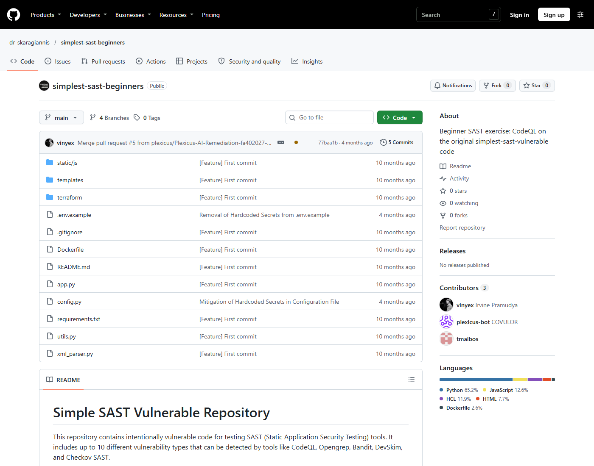
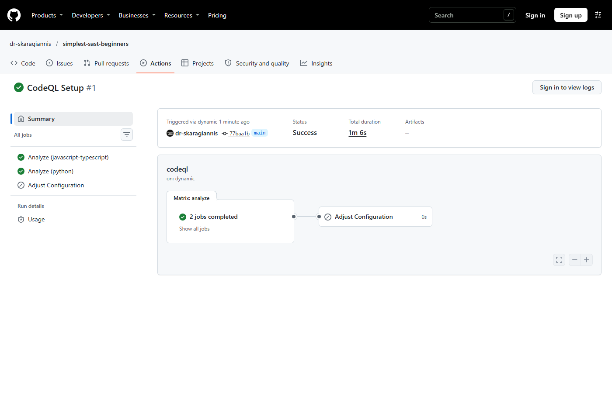
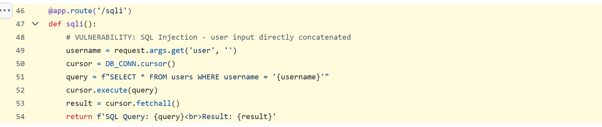
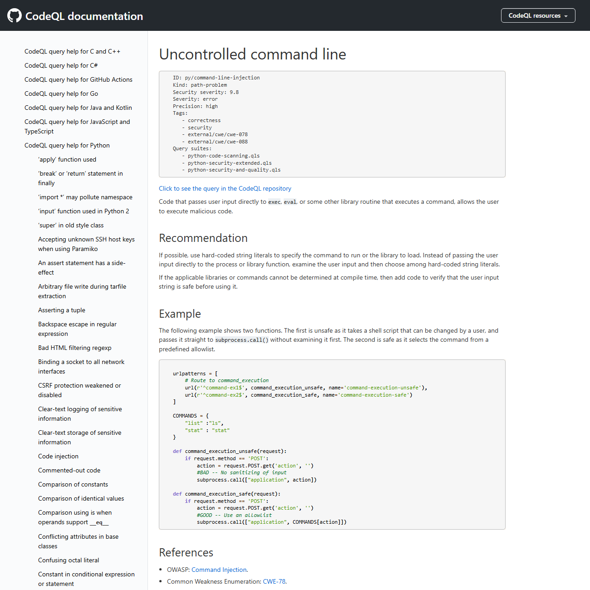
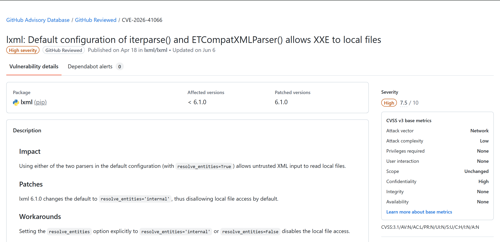
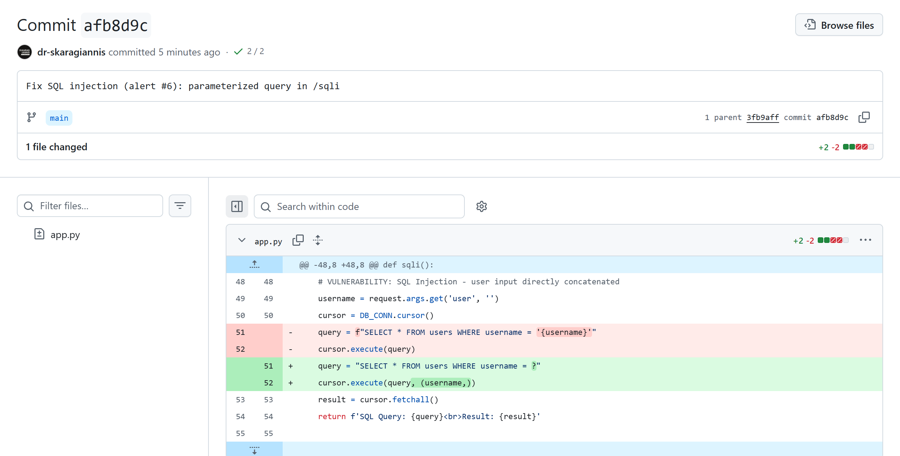
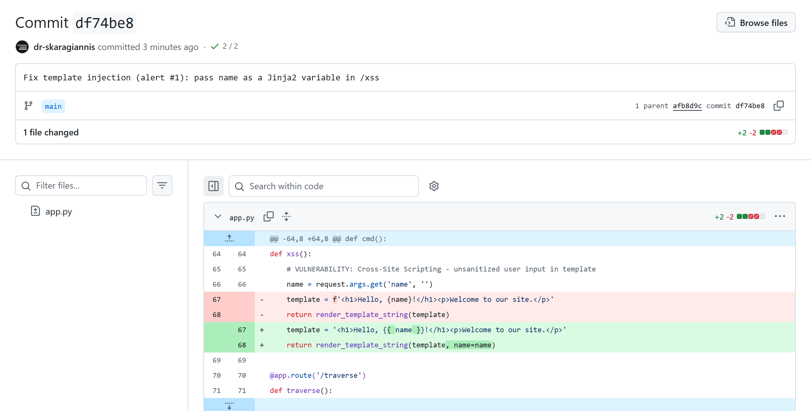
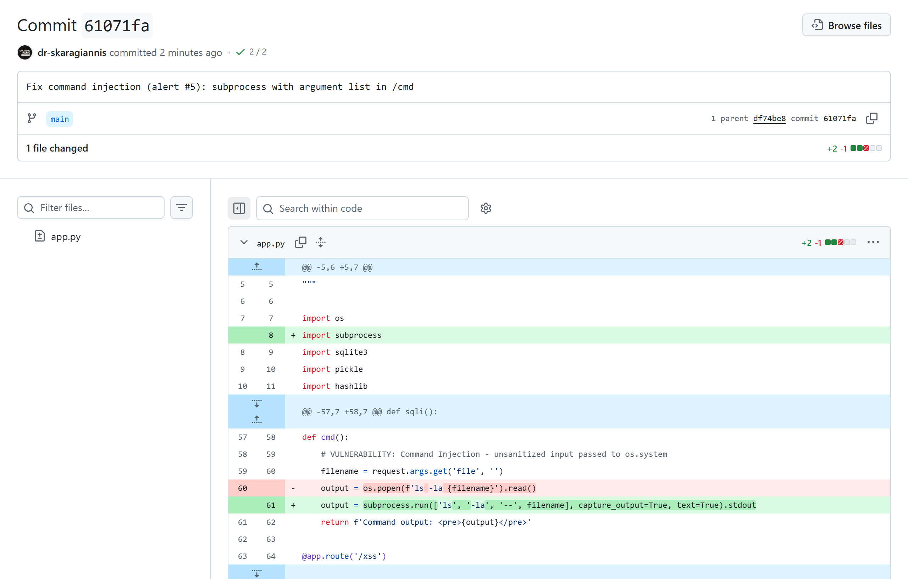

# 04. SAST με GitHub CodeQL

Εργαστήριο **στατικής ανάλυσης ασφάλειας κώδικα** (Static Application Security Testing, SAST). Ανεβάζετε σε δικό σας αποθετήριο στο GitHub μια μικρή εφαρμογή Flask που γράφτηκε σκόπιμα με ευπάθειες ([plexicus/simplest-sast-vulnerable](https://github.com/plexicus/simplest-sast-vulnerable)), ενεργοποιείτε το **CodeQL** και διαβάζετε τα ευρήματα όπως ένας μηχανικός ασφάλειας. Στη συνέχεια ελέγχετε τις βιβλιοθήκες για γνωστά **CVE** (SCA), διορθώνετε τον κώδικα και επαληθεύετε ότι τα alerts κλείνουν.

> 🇬🇧 **English version:** [en/04. SAST-CodeQL/README.md](../en/04.%20SAST-CodeQL/README.md)

Σε αντίθεση με τα εργαστήρια CTF, εδώ **δεν** επιτίθεστε σε μηχανή. Η ανάλυση διαβάζει μόνο τον πηγαίο κώδικα, χωρίς να τον εκτελεί.

---

## Υλικό

| Αρχείο | Περιεχόμενο |
| :--- | :--- |
| [Lab 04 - SAST-CodeQL.pdf](Lab%2004%20-%20SAST-CodeQL.pdf) | Η πλήρης άσκηση (51 σελ.): θεωρία (SAST, CWE, CVE, CVSS, GHSA, NVD), ενεργοποίηση CodeQL, ανάλυση alert, CVE στις εξαρτήσεις, ψευδώς αρνητικά, καταγραφή ευρήματος, οι 10 ευπάθειες του README, 7 πρακτικές ασκήσεις, διόρθωση και επανέλεγχος όλων των ευπαθειών (Δ0–Δ11), 10 διερευνητικές ερωτήσεις. |

**Αποθετήρια αναφοράς:**

- [dr-skaragiannis/simplest-sast-beginners](https://github.com/dr-skaragiannis/simplest-sast-beginners): ο αρχικός κώδικας (commit `77baa1b`) με τη σάρωση του οδηγού, τις διορθώσεις των CVE και τις 3 διορθώσεις κώδικα.
- [dr-skaragiannis/simplest-sast-vulnerable-lab](https://github.com/dr-skaragiannis/simplest-sast-vulnerable-lab): οι πρακτικές ασκήσεις και η διόρθωση όλων των ευπαθειών, ένα commit ανά διόρθωση.

**Απαιτήσεις:** λογαριασμός στο github.com (δωρεάν), `git`, browser. Η ανάλυση τρέχει στους servers του GitHub. Για το Bandit και το `pip-audit` χρειάζεται Python 3.

---

## Βασικές έννοιες

| Όρος | Σημασία |
| :--- | :--- |
| **SAST** | Ανάλυση του πηγαίου κώδικα χωρίς εκτέλεση. Το CodeQL μετατρέπει τον κώδικα σε βάση δεδομένων και τρέχει πάνω της ερωτήματα (queries), ένα ανά τύπο ευπάθειας. |
| **Alert / Rule** | Εύρημα σε συγκεκριμένο αρχείο και γραμμή / ο κανόνας που το παρήγαγε, π.χ. `py/sql-injection`. |
| **Πηγή / Καταβόθρα** | Το σημείο όπου μπαίνουν δεδομένα του χρήστη (`request.args.get`) / το επικίνδυνο σημείο όπου καταλήγουν (`cursor.execute`). |
| **CWE** | Ο κατάλογος της MITRE με τους **τύπους** αδυναμιών, π.χ. CWE-89 (SQL Injection). |
| **CVE / GHSA** | Αναγνωριστικό μιας **συγκεκριμένης** ευπάθειας σε συγκεκριμένο προϊόν / η καταχώρισή της στο GitHub Advisory Database. |
| **Security severity** | Βαθμός 0–10 κάθε κανόνα: Critical ≥ 9.0, High 7.0–8.9, Medium 4.0–6.9, Low < 4.0. |
| **SCA** | Έλεγχος των εξαρτήσεων (βιβλιοθηκών) για γνωστά CVE, π.χ. Dependabot, `pip-audit`. |

---

## Ροή εργαστηρίου

### 1. Δικό σας αποθετήριο

```bash
git clone https://github.com/plexicus/simplest-sast-vulnerable.git
cd simplest-sast-vulnerable
git remote set-url origin https://github.com/<username>/simplest-sast-beginners.git
git push -u origin main
```

Το νέο αποθετήριο πρέπει να είναι **Public** (εκεί το code scanning είναι δωρεάν) και **άδειο** (χωρίς README, .gitignore ή license).



### 2. Ενεργοποίηση του CodeQL

`Settings → Advanced Security → Code scanning → CodeQL analysis → Set up → Default`. Ελέγξτε ότι οι γλώσσες είναι **JavaScript/TypeScript** και **Python** και η σουίτα **Default**, και πατήστε **Enable CodeQL**.

### 3. Η εκτέλεση

Στην καρτέλα **Actions** εμφανίζεται το workflow **CodeQL Setup**, με ένα job ανάλυσης ανά γλώσσα. Στη δική μας σάρωση ολοκληρώθηκε σε **1m 6s** (CodeQL 2.27.6, 43 κανόνες Python, 87 JavaScript).



### 4. Τα alerts

`Security and quality → Code scanning`. Η σάρωση του αρχικού κώδικα βγάζει **13 alerts**: 11 Python, 2 JavaScript.

| # | Κανόνας | Θέση | Βαθμός | CWE |
| :--- | :--- | :--- | :--- | :--- |
| 5 | `py/command-line-injection` | `app.py:60` | Critical 9.8 | 78, 88 |
| 1 | `py/template-injection` | `app.py:68` | Critical 9.3 | 74 |
| 6 | `py/sql-injection` | `app.py:52` | High 8.8 | 89 |
| 7–10 | `py/reflective-xss` | `app.py:54, 68, 106, 129` | High 7.8 | 79, 116 |
| 12, 13 | `js/xss-through-dom` | `static/js/app.js:6, 13` | High 7.8 | 79, 116 |
| 11 | `py/path-injection` | `app.py:77` | High 7.5 | 22, 23, 36, 73, 99 |
| 4 | `py/flask-debug` | `app.py:133` | High 7.5 | 215, 489 |
| 2, 3 | `py/stack-trace-exposure` | `app.py:81, 92` | Medium 5.4 | 209, 497 |

**Φίλτρα αναζήτησης:** `is:open`, `severity:critical`, `rule:py/reflective-xss`, `language:python`, `tool:CodeQL`. Τα ίδια φίλτρα υπάρχουν στα μενού *Language*, *Tool*, *Rule* και *Severity*.

### 5. Ανάλυση ενός alert

Η σελίδα ενός alert δείχνει τον κανόνα, τη γραμμή της καταβόθρας και, με το **Show paths**, τη διαδρομή των δεδομένων. Για το SQL injection (#6):

`request.args.get('user', '')` (γρ. 49, **πηγή**) → `username` → `query` (γρ. 51, f-string) → `cursor.execute(query)` (γρ. 52, **καταβόθρα**)



Η τεκμηρίωση κάθε κανόνα (`codeql.github.com/codeql-query-help/<γλώσσα>/<rule-id>/`) δίνει το security severity, το precision, τα CWE και τις σουίτες. Το **Severity** (`error`/`warning`) είναι **άλλο** πεδίο από το security severity: το `js/xss-through-dom` είναι `warning` αλλά High 7.8.



### 6. Τι δεν βρήκε το CodeQL

Από τους 10 τύπους του README, η σουίτα Default **δεν** αναφέρει: insecure deserialization (η ροή χάνεται στο `bytes.fromhex`), hardcoded secrets (ο κανόνας έχει precision low), MD5 (δεν θεωρείται ευαίσθητο δεδομένο), XXE (η είσοδος έρχεται από `sys.argv`, όχι από HTTP) και insecure randomness. Μηδέν alerts **δεν** σημαίνει ασφαλής κώδικας. Γι' αυτό η άσκηση συγκρίνει με δεύτερο εργαλείο, το **Bandit** (24 ευρήματα: 4 High, 7 Medium, 13 Low).

---

## CVE στις εξαρτήσεις (SCA)

Το CodeQL εξετάζει τον δικό σας κώδικα. Για τις βιβλιοθήκες του `requirements.txt`:

```bash
pip install pip-audit
pip-audit -r requirements.txt
```

Βρίσκονται **2** πραγματικά CVE. Τα `pyyaml 6.0` και `psycopg2-binary 2.9.9` δεν έχουν κανένα advisory, και οι μεταβατικές εξαρτήσεις εγκαθίστανται στην τελευταία, καθαρή, έκδοση.

| CVE / GHSA | Πακέτο | Διόρθωση | Βαθμός | CWE | Commit |
| :--- | :--- | :--- | :--- | :--- | :--- |
| [CVE-2026-41066](https://github.com/advisories/GHSA-vfmq-68hx-4jfw) / GHSA-vfmq-68hx-4jfw | `lxml` | 4.9.3 → **6.1.0** | High 7.5 | 611 (XXE) | [`cd7037d`](https://github.com/dr-skaragiannis/simplest-sast-beginners/commit/cd7037d341f41b287648298a9b1ae5956bb0fa3d) |
| [CVE-2026-27205](https://github.com/advisories/GHSA-68rp-wp8r-4726) / GHSA-68rp-wp8r-4726 | `Flask` | 2.3.3 → **3.1.3** | Low 2.3 | 524 | [`3fb9aff`](https://github.com/dr-skaragiannis/simplest-sast-beginners/commit/3fb9aff70a21a80a7fa803138c84fd6960a2ab62) |



> ⚠️ **Η αναβάθμιση του lxml δεν αρκεί.** Η 6.1.0 αλλάζει μόνο την *προεπιλογή* σε `resolve_entities='internal'`. Το `xml_parser.py` ορίζει όμως **ρητά** `XMLParser(resolve_entities=True)`, οπότε το XXE παραμένει μέχρι να γίνει `resolve_entities=False`. Μετά από κάθε αναβάθμιση, διαβάστε την ενότητα *Patches* του advisory.

---

## Διόρθωση κώδικα: τα 3 σοβαρότερα alerts

Ένα commit ανά διόρθωση. Μετά από κάθε push περιμένετε τη νέα ανάλυση και ελέγχετε την καρτέλα **Closed**. Ανοιχτά alerts: **13 → 11 → 9 → 8**.

### Δ1. SQL Injection → παραμετροποιημένο ερώτημα (#6, High 8.8)

```diff
-    query = f"SELECT * FROM users WHERE username = '{username}'"
-    cursor.execute(query)
+    query = "SELECT * FROM users WHERE username = ?"
+    cursor.execute(query, (username,))
```

Η τιμή στέλνεται **ξεχωριστά** από το SQL και δεν αλλάζει ποτέ τη σύνταξή του. Δοκιμή `/sqli?user=' OR '1'='1`: πριν επέστρεφε τον `admin`, τώρα `[]`. Έκλεισαν τα **#6** και **#7** (το XSS της γρ. 54 περνούσε από την ίδια μεταβλητή `query`). Commit [`afb8d9c`](https://github.com/dr-skaragiannis/simplest-sast-beginners/commit/afb8d9c88b2114b41a4c2588517cc5101aa277c1).



### Δ2. Template Injection → η είσοδος ως μεταβλητή του προτύπου (#1, Critical 9.3)

```diff
-    template = f'<h1>Hello, {name}!</h1><p>Welcome to our site.</p>'
-    return render_template_string(template)
+    template = '<h1>Hello, {{ name }}!</h1><p>Welcome to our site.</p>'
+    return render_template_string(template, name=name)
```

Το πρότυπο είναι σταθερό και η είσοδος περνά ως **τιμή**, με αυτόματη κωδικοποίηση (autoescape). Το `{{7*7}}` εμφανίζεται ως κείμενο αντί για `49`, και το `<script>` γίνεται `&lt;script&gt;`. Έκλεισαν τα **#1** και **#8**. Commit [`df74be8`](https://github.com/dr-skaragiannis/simplest-sast-beginners/commit/df74be8b24f7d3d170a449c45ef6b02d503242f0).



### Δ3. Command Injection → subprocess με λίστα ορισμάτων (#5, Critical 9.8)

```diff
 import os
+import subprocess
 ...
-    output = os.popen(f'ls -la {filename}').read()
+    output = subprocess.run(['ls', '-la', '--', filename], capture_output=True, text=True).stdout
```

Χωρίς κέλυφος, το `filename` είναι **ένα** όρισμα και τα `;`, `&`, `|` δεν χωρίζουν εντολές. Το `--` εμποδίζει ένα όνομα που ξεκινά με `-` να γίνει επιλογή του `ls` (CWE-88). Δοκιμή `/cmd?file=nofile & echo INJECTED`: πριν τύπωνε `INJECTED`, τώρα τίποτα. Έκλεισε το **#5**. Commit [`61071fa`](https://github.com/dr-skaragiannis/simplest-sast-beginners/commit/61071fab956e16341bb2dcc31c855294eae8f3f2).



> 💡 Η διόρθωση με νέο `import` έγινε **τελευταία**, επειδή η νέα γραμμή μετακινεί όλο τον κώδικα από κάτω. Τα υπόλοιπα 8 alerts κράτησαν τον αριθμό τους και απλώς άλλαξαν γραμμή.

Η διόρθωση **όλων** των ευπαθειών (Δ0–Δ11, μαζί με όσες δεν εντόπισε το CodeQL) περιγράφεται στο PDF της άσκησης, με ένα commit ανά διόρθωση στο [simplest-sast-vulnerable-lab](https://github.com/dr-skaragiannis/simplest-sast-vulnerable-lab/commits/main).

---

## Ερωτήσεις αυτοελέγχου

1. Πόσα ανοιχτά alerts έβγαλε το CodeQL και πόσα ανά γλώσσα;
2. Ποια alerts είναι Critical; Αριθμός, κανόνας, θέση, security severity.
3. Ποιος κανόνας εμφανίζεται συχνότερα και σε ποιες γραμμές;
4. Ποια γραμμή του `app.py` έχει δύο διαφορετικά alerts;
5. Στο SQL injection: πού είναι η πηγή, από ποιες μεταβλητές περνά η τιμή, πού είναι η καταβόθρα;
6. Ποιο security severity, precision και CWE έχει ο `py/sql-injection`;
7. Στο path injection: ποια παράμετρος ελέγχει το αρχείο και πόσα CWE tags έχει ο κανόνας;
8. Ποιο alert δεν έχει *Show paths* και γιατί;
9. Ποια alerts είναι Medium και τι επιστρέφεται στον χρήστη;
10. Γιατί το `js/xss-through-dom` είναι `warning` αλλά εμφανίζεται ως High;

---

## Πηγές

- **Αποθετήριο-στόχος:** [plexicus/simplest-sast-vulnerable](https://github.com/plexicus/simplest-sast-vulnerable)
- **CodeQL:** [Code scanning με CodeQL](https://docs.github.com/en/code-security/code-scanning/introduction-to-code-scanning/about-code-scanning-with-codeql), [CodeQL query help](https://codeql.github.com/codeql-query-help/)
- **Κατάλογοι:** [CWE (MITRE)](https://cwe.mitre.org/), [GitHub Advisory Database](https://github.com/advisories), [NVD](https://nvd.nist.gov/), [FIRST CVSS 3.1 Calculator](https://www.first.org/cvss/calculator/3.1)
- **Εργαλεία:** [Bandit](https://bandit.readthedocs.io/), [pip-audit](https://github.com/pypa/pip-audit), [Dependabot](https://docs.github.com/en/code-security/dependabot)
- **OWASP:** [Top 10](https://owasp.org/Top10/), [SQL Injection Prevention Cheat Sheet](https://cheatsheetseries.owasp.org/cheatsheets/SQL_Injection_Prevention_Cheat_Sheet.html), [OS Command Injection Defense Cheat Sheet](https://cheatsheetseries.owasp.org/cheatsheets/OS_Command_Injection_Defense_Cheat_Sheet.html)
